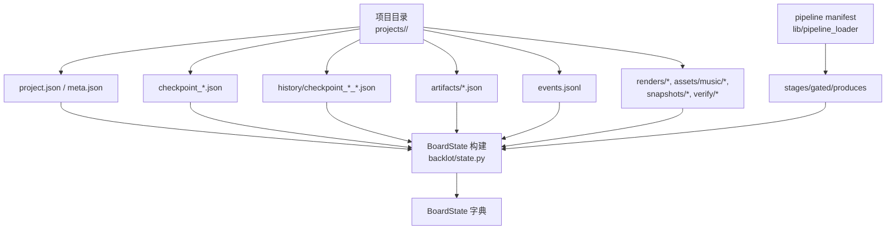
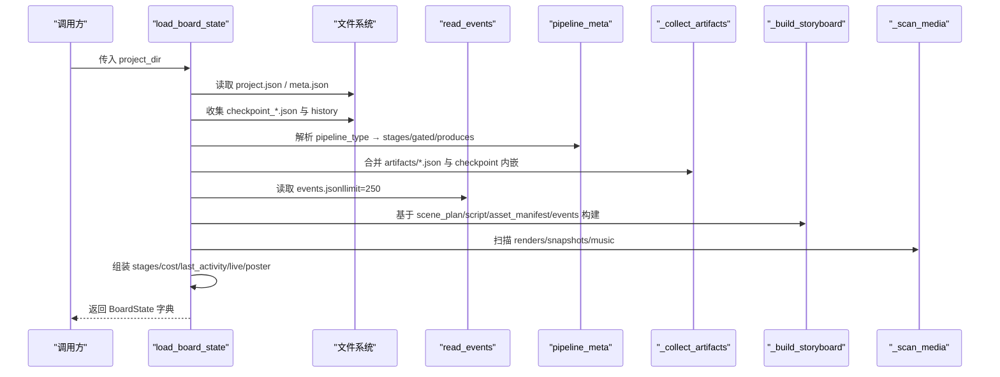
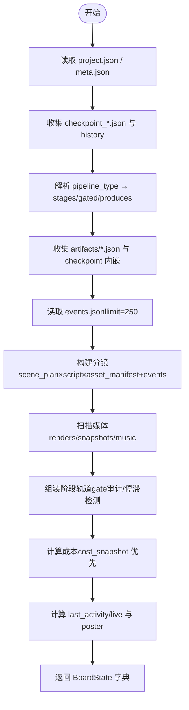
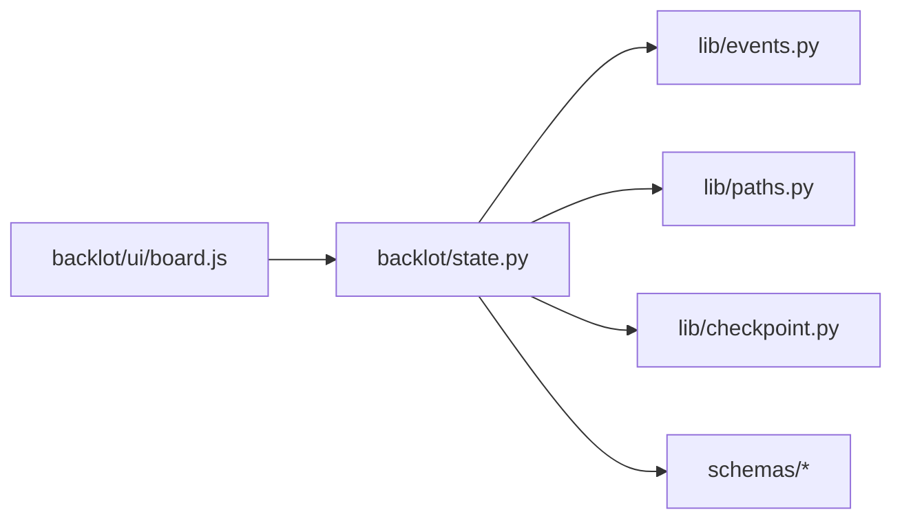

# BoardState数据结构

<cite>
**本文引用的文件**   
- [backlot/state.py](file://backlot/state.py)
- [lib/events.py](file://lib/events.py)
- [lib/paths.py](file://lib/paths.py)
- [lib/checkpoint.py](file://lib/checkpoint.py)
- [schemas/checkpoints/checkpoint.schema.json](file://schemas/checkpoints/checkpoint.schema.json)
- [schemas/artifacts/asset_manifest.schema.json](file://schemas/artifacts/asset_manifest.schema.json)
- [schemas/artifacts/storyboard.schema.json](file://schemas/artifacts/storyboard.schema.json)
- [backlot/ui/board.js](file://backlot/ui/board.js)
</cite>

## 目录
1. [简介](#简介)
2. [项目结构](#项目结构)
3. [核心组件](#核心组件)
4. [架构总览](#架构总览)
5. [详细组件分析](#详细组件分析)
6. [依赖关系分析](#依赖关系分析)
7. [性能与内存优化](#性能与内存优化)
8. [故障排查指南](#故障排查指南)
9. [结论](#结论)
10. [附录：序列化与反序列化示例](#附录序列化与反序列化示例)

## 简介
BoardState 是 Backlot 看板的核心状态对象，它将一个“项目目录”下的所有可观测数据（里程碑、制品、分镜、媒体、事件、成本等）聚合为一个只读、防御性的字典视图。其设计原则是“永不阻塞、永不崩溃”，即使遇到损坏的 JSON、缺失的制品或半写的检查点，也只会降级显示，不会导致系统崩溃。

## 项目结构
BoardState 的构建主要位于 backlot/state.py，它读取并组合以下来源：
- 项目标记与元信息：project.json、meta.json
- 阶段检查点与历史：checkpoint_*.json、history/checkpoint_*_*.json
- 制品：artifacts/*.json（以及根级 decision_log.json）
- 事件流：events.jsonl
- 媒体扫描：renders、assets/music、snapshots、verify 等目录
- 流水线元数据：通过 pipeline loader 加载 manifest，得到 stages/gated/produces

图表来源
- [backlot/state.py:586-656](file://backlot/state.py#L586-L656)
- [lib/events.py:98-118](file://lib/events.py#L98-L118)
- [lib/paths.py:1-18](file://lib/paths.py#L1-L18)

章节来源
- [backlot/state.py:1-120](file://backlot/state.py#L1-L120)
- [lib/events.py:1-119](file://lib/events.py#L1-L119)
- [lib/paths.py:1-18](file://lib/paths.py#L1-L18)

## 核心组件
BoardState 是一个字典，包含以下关键字段及含义：
- project_id：项目标识，来源于项目目录名。
- title：项目标题，优先来自 project.json.title，其次 meta.json.name，否则由 project_id 转换而来。
- pipeline：流水线元数据，包含 pipeline_type、stages（每个 stage 含 name/gated/produces）、known（是否已知）。
- style_playbook：风格策略引用（可选）。
- created_at：项目创建时间（ISO 字符串，可选）。
- has_marker：是否存在 project.json。
- has_pipeline_state：是否存在任何 checkpoint。
- stages：按流水线顺序排列的阶段轨道，每个阶段条目包含 name/gated/produces/status/timestamp/review/cost_snapshot/error/human_approved/partial_progress/versions/history_entries/gate_skipped/stalled/stalled_minutes 等。
- artifacts：制品字典，键为制品名（如 research_brief/brief/proposal_packet/script/scene_plan/asset_manifest/edit_decisions/render_report/final_review/publish_log/decision_log），值为对应 JSON 内容。
- storyboard：分镜脚本聚合结果，包含 scenes（卡片列表）、total_duration_seconds、style_playbook。
- media：媒体集合，包含 renders（渲染视频）、snapshots（截图）、music（音乐）。
- events：事件流（最近 N 条，默认限制 250 条），用于驱动“生成中”状态和活动时间线。
- cost：成本快照，优先取最新 checkpoint.cost_snapshot，否则回退到 asset_manifest.total_cost_usd。
- last_activity：最近一次活动的时间戳（epoch 秒）。
- live：是否处于活跃窗口（LIVE_WINDOW_SECONDS 内无活动则视为空闲）。
- poster：封面图路径，优先从分镜视觉/快照/常见图片目录/最新渲染帧推导。

章节来源
- [backlot/state.py:586-656](file://backlot/state.py#L586-L656)
- [backlot/state.py:143-222](file://backlot/state.py#L143-L222)
- [backlot/state.py:244-264](file://backlot/state.py#L244-L264)
- [backlot/state.py:401-493](file://backlot/state.py#L401-L493)
- [backlot/state.py:500-532](file://backlot/state.py#L500-L532)
- [backlot/state.py:535-560](file://backlot/state.py#L535-L560)
- [backlot/state.py:563-579](file://backlot/state.py#L563-L579)

## 架构总览
BoardState 的构建流程如下：
1. 读取项目标记与元信息（project.json、meta.json）。
2. 收集当前检查点与历史版本（checkpoint_*.json、history/）。
3. 解析流水线元数据（pipeline_type → manifest → stages/gated/produces）。
4. 收集制品（artifacts/*.json 与 checkpoint 内嵌 artifacts 回填）。
5. 读取事件流（events.jsonl，限制条数）。
6. 构建分镜（scene_plan × script × asset_manifest + 实时事件）。
7. 扫描媒体（renders/snapshots/music）。
8. 组装阶段轨道（stage rail），计算 gate 审计、停滞检测。
9. 计算成本（cost_snapshot 优先，否则 total_cost_usd）。
10. 计算 last_activity/live，选择 poster。
11. 返回完整 BoardState 字典。

图表来源
- [backlot/state.py:586-656](file://backlot/state.py#L586-L656)
- [lib/events.py:98-118](file://lib/events.py#L98-L118)
- [backlot/state.py:143-222](file://backlot/state.py#L143-L222)
- [backlot/state.py:244-264](file://backlot/state.py#L244-L264)
- [backlot/state.py:401-493](file://backlot/state.py#L401-L493)
- [backlot/state.py:500-532](file://backlot/state.py#L500-L532)

## 详细组件分析

### 字段定义与用途
- project_id：项目唯一标识，来源于目录名。
- title：展示标题，优先级 project.json.title > meta.json.name > project_id 转换。
- pipeline：流水线元数据，包含 pipeline_type、stages（name/gated/produces）、known。
- style_playbook：风格策略引用（可选）。
- created_at：项目创建时间（ISO 字符串，可选）。
- has_marker：是否存在 project.json。
- has_pipeline_state：是否存在任意 checkpoint。
- stages：阶段轨道，每个阶段条目包含：
  - name/gated/produces/status/timestamp/review/cost_snapshot/error/human_approved/partial_progress/versions/history_entries
  - gate_skipped：门控跳过审计（仅 gated 且 completed 时判定）
  - stalled/stalled_minutes：停滞检测（in_progress 且超过 STALL_WINDOW_SECONDS）
- artifacts：制品字典，键为制品名，值为 JSON 内容。
- storyboard：分镜脚本聚合：
  - scenes：卡片列表（id/type/description/time/hero_moment/shot_language/intent/framing/movement/narration/section_label/required_assets/visual/takes/audio/generating/generating_tool）
  - total_duration_seconds：总时长
  - style_playbook：风格策略引用
- media：媒体集合：
  - renders：渲染视频列表（path/size/mtime/at_root）
  - snapshots：截图列表（path）
  - music：音乐列表（path/at_root）
- events：事件流（ts/event/scene_id/tool/depth 等），用于驱动“生成中”状态。
- cost：成本快照（total_spent_usd/total_reserved_usd/budget_remaining_usd），优先 checkpoint.cost_snapshot，否则 asset_manifest.total_cost_usd。
- last_activity：最近活动 epoch 秒。
- live：是否在 LIVE_WINDOW_SECONDS 内活跃。
- poster：封面图路径（image/video 均可，服务端支持视频抽帧）。

章节来源
- [backlot/state.py:586-656](file://backlot/state.py#L586-L656)
- [backlot/state.py:143-222](file://backlot/state.py#L143-L222)
- [backlot/state.py:244-264](file://backlot/state.py#L244-L264)
- [backlot/state.py:401-493](file://backlot/state.py#L401-L493)
- [backlot/state.py:500-532](file://backlot/state.py#L500-L532)
- [backlot/state.py:535-560](file://backlot/state.py#L535-L560)
- [backlot/state.py:563-579](file://backlot/state.py#L563-L579)
- [schemas/checkpoints/checkpoint.schema.json:1-47](file://schemas/checkpoints/checkpoint.schema.json#L1-L47)
- [schemas/artifacts/asset_manifest.schema.json:1-63](file://schemas/artifacts/asset_manifest.schema.json#L1-L63)
- [schemas/artifacts/storyboard.schema.json:1-289](file://schemas/artifacts/storyboard.schema.json#L1-L289)

### 状态对象的构建过程
- 项目目录扫描：读取 project.json/meta.json，收集 checkpoint_*.json 与 history。
- 流水线元数据：根据 pipeline_type 加载 manifest，获取 stages/gated/produces；未知时回退到 FALLBACK_STAGES。
- 制品收集：artifacts/*.json 与 checkpoint 内嵌 artifacts（支持路径解析与项目内安全校验）。
- 事件读取：events.jsonl 最多读取 250 条，忽略损坏行。
- 分镜构建：scene_plan × script × asset_manifest，结合事件推断“生成中”状态，选择最佳可视（renderable 优先，缺失回退 snapshot）。
- 媒体扫描：renders（mp4/webm/mov）、根级 mp4/mp3、assets/music、snapshots/verify（png/jpg/jpeg/webp/gif/svg）。
- 阶段轨道：按 manifest 顺序填充，补充未声明 stage（canonical 位置插入），计算 gate 审计与停滞检测。
- 成本计算：优先 checkpoint.cost_snapshot，否则 asset_manifest.total_cost_usd。
- 活跃度与封面：last_activity 基于 checkpoint/events/artifacts mtime；poster 优先分镜视觉/快照/常见目录/最新渲染帧。

图表来源
- [backlot/state.py:586-656](file://backlot/state.py#L586-L656)
- [backlot/state.py:143-222](file://backlot/state.py#L143-L222)
- [backlot/state.py:244-264](file://backlot/state.py#L244-L264)
- [backlot/state.py:401-493](file://backlot/state.py#L401-L493)
- [backlot/state.py:500-532](file://backlot/state.py#L500-L532)
- [backlot/state.py:563-579](file://backlot/state.py#L563-L579)

章节来源
- [backlot/state.py:586-656](file://backlot/state.py#L586-L656)
- [backlot/state.py:143-222](file://backlot/state.py#L143-L222)
- [backlot/state.py:244-264](file://backlot/state.py#L244-L264)
- [backlot/state.py:401-493](file://backlot/state.py#L401-L493)
- [backlot/state.py:500-532](file://backlot/state.py#L500-L532)
- [backlot/state.py:563-579](file://backlot/state.py#L563-L579)

### 状态验证规则与错误处理机制
- JSON 读取：_read_json 对 OSError/JSONDecodeError/UnicodeError 一律返回 None，确保不崩溃。
- 事件读取：read_events 忽略损坏行，OSError 返回空列表。
- 制品路径解析：_resolve_artifact 仅允许项目内路径，越界返回 None。
- 资产路径解析：_resolve_asset_path 尝试多种相对/绝对路径，超出项目范围视为不可服务。
- 分镜可视性：仅 raster/image/video 可渲染；其他类型（如 .tsx 动画）不直接作为 takes，回退 snapshot。
- 阶段门控审计：gated 且 completed 但未经历 awaiting_human 或未 human_approved 则标记 gate_skipped。
- 停滞检测：in_progress 且 last_activity 超过 STALL_WINDOW_SECONDS 标记 stalled/stalled_minutes。
- 成本回退：若无 cost_snapshot，使用 asset_manifest.total_cost_usd。
- 封面选择：优先分镜视觉/快照/常见目录/最新渲染帧，失败返回 None。

章节来源
- [backlot/state.py:40-56](file://backlot/state.py#L40-L56)
- [backlot/state.py:95-114](file://backlot/state.py#L95-L114)
- [backlot/state.py:271-346](file://backlot/state.py#L271-L346)
- [backlot/state.py:143-222](file://backlot/state.py#L143-L222)
- [backlot/state.py:563-579](file://backlot/state.py#L563-L579)
- [lib/events.py:98-118](file://lib/events.py#L98-L118)

### 生命周期管理与内存优化策略
- 只读与防御性：BoardState 构建函数从不抛出异常，所有 I/O 错误均降级处理。
- 事件限制：read_events(limit=250) 控制事件数量，避免大文件解析。
- 媒体扫描边界：仅扫描特定目录与扩展名，排除 node_modules/.git/__pycache__/history/.cache 等噪声。
- 路径安全：制品与资产路径解析严格限定在项目范围内，防止越权访问。
- 缓存与惰性：pipeline manifest 加载在 _load_pipeline_meta 中按需进行；事件读取有线程锁但跨进程无同步，容忍部分丢失。
- UI 侧规范化：board.js normalize() 对缺失字段进行默认值填充，保证前端健壮性。

章节来源
- [backlot/state.py:18-37](file://backlot/state.py#L18-L37)
- [backlot/state.py:586-656](file://backlot/state.py#L586-L656)
- [lib/events.py:24-34](file://lib/events.py#L24-L34)
- [backlot/ui/board.js:1184-1208](file://backlot/ui/board.js#L1184-L1208)

## 依赖关系分析
BoardState 构建依赖的关键模块与职责：
- backlot/state.py：BoardState 构建主逻辑，负责读取、组合、推导。
- lib/events.py：事件流写入与读取，提供 live 状态与“生成中”推断。
- lib/paths.py：统一仓库根与项目根路径，确保一致性。
- lib/checkpoint.py：检查点读写与校验，提供 stage 顺序与 gate 策略。
- schemas/*：JSON Schema 约束，保障制品与检查点结构正确性。
- backlot/ui/board.js：前端规范化与渲染，保证 UI 健壮性。

图表来源
- [backlot/state.py:586-656](file://backlot/state.py#L586-L656)
- [lib/events.py:98-118](file://lib/events.py#L98-L118)
- [lib/paths.py:1-18](file://lib/paths.py#L1-L18)
- [lib/checkpoint.py:140-172](file://lib/checkpoint.py#L140-L172)
- [backlot/ui/board.js:1184-1208](file://backlot/ui/board.js#L1184-L1208)

章节来源
- [backlot/state.py:586-656](file://backlot/state.py#L586-L656)
- [lib/events.py:98-118](file://lib/events.py#L98-L118)
- [lib/paths.py:1-18](file://lib/paths.py#L1-L18)
- [lib/checkpoint.py:140-172](file://lib/checkpoint.py#L140-L172)
- [backlot/ui/board.js:1184-1208](file://backlot/ui/board.js#L1184-L1208)

## 性能与内存优化
- 事件限制：read_events 默认 limit=250，避免大文件解析。
- 媒体扫描边界：仅扫描必要目录与扩展名，排除构建噪声。
- 路径解析短路：_resolve_asset_path/_resolve_artifact 快速失败，减少无效 I/O。
- 管道元数据懒加载：_load_pipeline_meta 仅在需要时加载 manifest。
- UI 侧规范化：board.js normalize() 对缺失字段进行默认值填充，降低渲染失败概率。
- 服务器端摘要缓存：_summary_cache 缓存项目摘要，减少重复全量解析。

章节来源
- [backlot/state.py:586-656](file://backlot/state.py#L586-L656)
- [lib/events.py:98-118](file://lib/events.py#L98-L118)
- [backlot/ui/board.js:1184-1208](file://backlot/ui/board.js#L1184-L1208)

## 故障排查指南
- JSON 读取失败：_read_json 返回 None，检查文件编码与完整性。
- 事件读取为空：read_events 可能因文件不存在或损坏返回空列表，确认 events.jsonl 存在且格式正确。
- 制品路径越界：_resolve_artifact/_resolve_asset_path 拒绝项目外路径，检查路径是否为相对/绝对形式且位于项目内。
- 分镜可视性：非 image/video 的资产不作为 takes，检查 asset_manifest.type 与文件扩展名。
- 阶段门控审计：gated 且 completed 但未 awaiting_human 或 human_approved 将标记 gate_skipped，检查 checkpoint 的 human_approved 与历史。
- 停滞检测：in_progress 且 last_activity 超过 STALL_WINDOW_SECONDS 标记 stalled，检查心跳与工具事件是否持续写入。
- 成本回退：若无 cost_snapshot，使用 asset_manifest.total_cost_usd，检查制品是否包含 total_cost_usd。
- 封面选择失败：poster 可能为 None，检查分镜视觉/快照/常见目录/最新渲染帧是否存在。

章节来源
- [backlot/state.py:40-56](file://backlot/state.py#L40-L56)
- [backlot/state.py:95-114](file://backlot/state.py#L95-L114)
- [backlot/state.py:271-346](file://backlot/state.py#L271-L346)
- [backlot/state.py:143-222](file://backlot/state.py#L143-L222)
- [backlot/state.py:563-579](file://backlot/state.py#L563-L579)
- [lib/events.py:98-118](file://lib/events.py#L98-L118)

## 结论
BoardState 以只读、防御性的方式将项目目录中的多源数据整合为统一的看板状态，确保在数据不完整或损坏时仍能稳定展示。其构建流程清晰、依赖明确，并通过事件限制、路径安全、媒体边界与 UI 规范化等手段实现良好的性能与鲁棒性。对于使用者而言，理解各字段的含义与构建步骤有助于调试与优化项目工作流。

## 附录：序列化与反序列化示例
- 序列化（Python 字典 → JSON）：
  - 使用 json.dumps(BoardState, ensure_ascii=False, indent=2) 输出可读 JSON。
  - 注意：BoardState 本身为纯 Python 字典，可直接序列化。
- 反序列化（JSON → Python 字典）：
  - 使用 json.loads(json_str) 恢复为字典。
  - 前端 board.js 的 normalize() 会对缺失字段进行默认值填充，确保 UI 健壮性。
- 示例路径参考：
  - 后端序列化：[backlot/state.py:586-656](file://backlot/state.py#L586-L656)
  - 前端规范化：[backlot/ui/board.js:1184-1208](file://backlot/ui/board.js#L1184-L1208)

章节来源
- [backlot/state.py:586-656](file://backlot/state.py#L586-L656)
- [backlot/ui/board.js:1184-1208](file://backlot/ui/board.js#L1184-L1208)