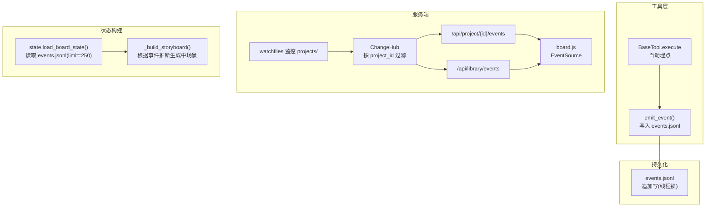
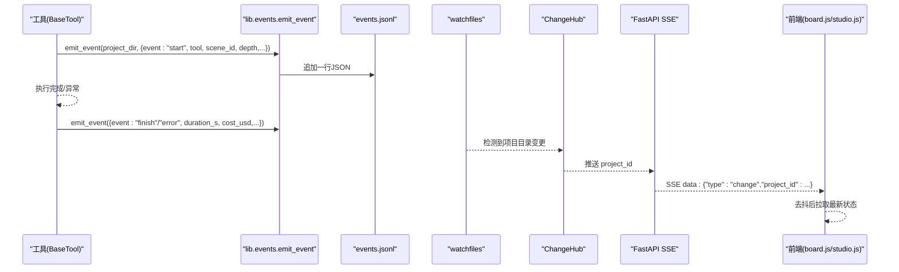
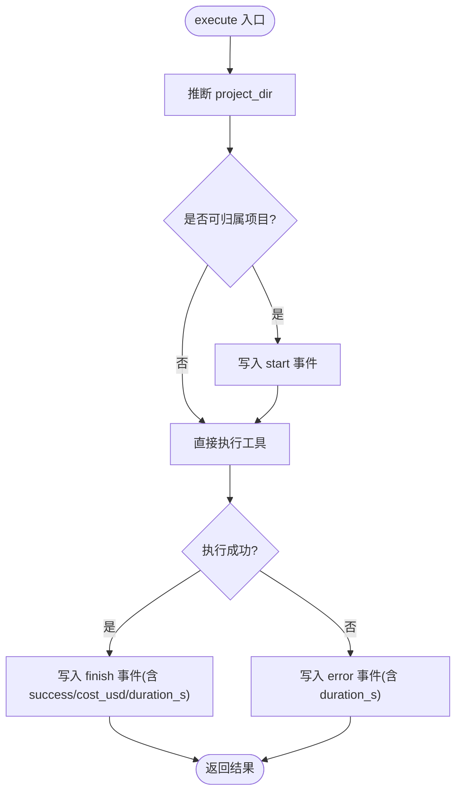
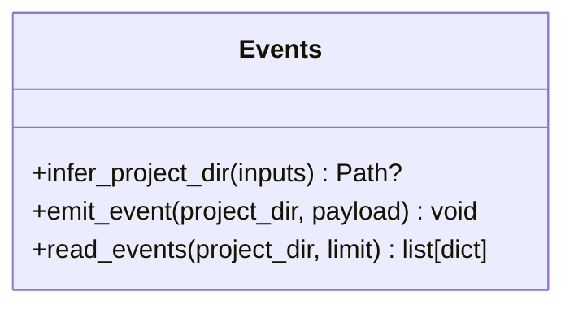
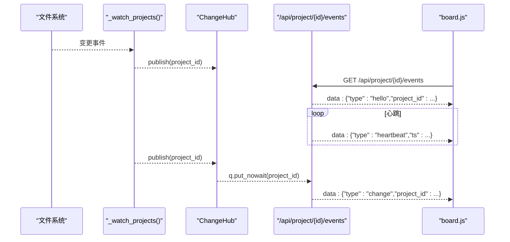
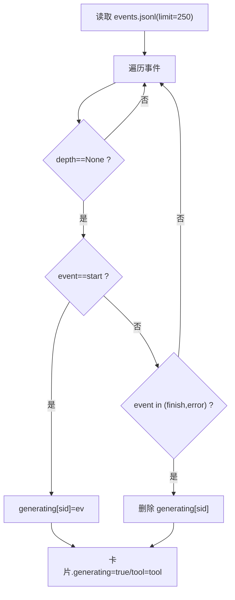
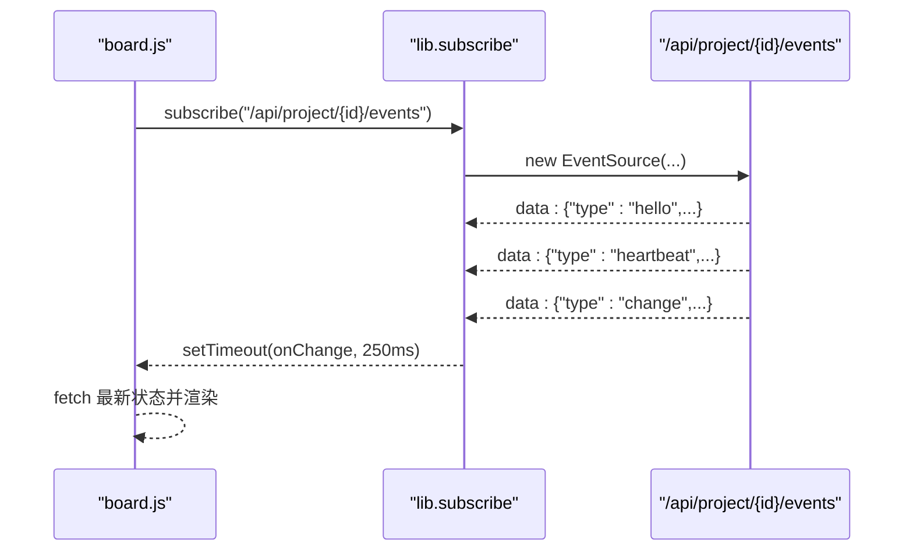
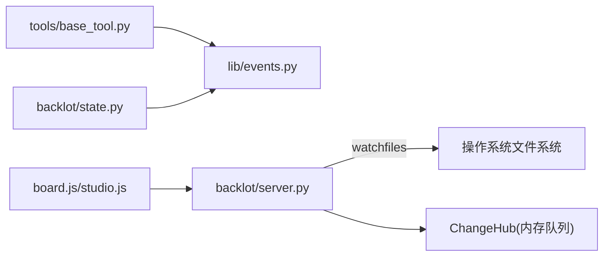

# 事件系统

<cite>
**本文引用的文件**   
- [lib/events.py](file://lib/events.py)
- [tools/base_tool.py](file://tools/base_tool.py)
- [backlot/server.py](file://backlot/server.py)
- [backlot/state.py](file://backlot/state.py)
- [backlot/ui/lib.js](file://backlot/ui/lib.js)
- [backlot/ui/board.js](file://backlot/ui/board.js)
- [backlot/ui/studio.js](file://backlot/ui/studio.js)
</cite>

## 目录
1. [简介](#简介)
2. [项目结构](#项目结构)
3. [核心组件](#核心组件)
4. [架构总览](#架构总览)
5. [详细组件分析](#详细组件分析)
6. [依赖关系分析](#依赖关系分析)
7. [性能与限流](#性能与限流)
8. [错误处理与容错](#错误处理与容错)
9. [事件数据模型与格式规范](#事件数据模型与格式规范)
10. [SSE 实时通信协议](#sse-实时通信协议)
11. [事件过滤与聚合策略](#事件过滤与聚合策略)
12. [事件驱动的编程模式与最佳实践](#事件驱动的编程模式与最佳实践)
13. [故障排查指南](#故障排查指南)
14. [结论](#结论)

## 简介
本文件系统化梳理 OpenMontage-MV 的事件系统，覆盖以下方面：
- 事件的发布、订阅与处理机制（工具执行埋点 → 持久化 → SSE 推送 → 前端消费）
- SSE（Server-Sent Events）实现原理与实时通信协议
- 事件的数据结构与字段规范（event、scene_id、tool、depth 等）
- 事件的持久化存储与读取（events.jsonl）
- 事件过滤、限流与错误处理策略
- 事件驱动的编程模式与最佳实践

## 项目结构
事件系统贯穿“工具层埋点 → 事件持久化 → 服务端监听与分发 → 前端 SSE 消费”的完整链路。关键位置如下：
- 工具执行埋点：BaseTool 自动包装 execute()，在调用前后写入 start/finish/error 事件
- 事件持久化：每个项目目录下的 events.jsonl 追加写
- 服务端监听与分发：watchfiles 监控项目目录变更，ChangeHub fan-out 到 SSE 订阅者
- 前端消费：board.js 通过 EventSource 订阅 /api/project/{id}/events 或 /api/library/events；studio.js 订阅会话事件流

**图表来源** 
- [tools/base_tool.py:148-224](file://tools/base_tool.py#L148-L224)
- [lib/events.py:77-96](file://lib/events.py#L77-L96)
- [backlot/server.py:132-149](file://backlot/server.py#L132-L149)
- [backlot/server.py:185-242](file://backlot/server.py#L185-L242)
- [backlot/state.py:586-656](file://backlot/state.py#L586-L656)

**章节来源**
- [tools/base_tool.py:148-224](file://tools/base_tool.py#L148-L224)
- [lib/events.py:77-96](file://lib/events.py#L77-L96)
- [backlot/server.py:132-149](file://backlot/server.py#L132-L149)
- [backlot/state.py:586-656](file://backlot/state.py#L586-L656)

## 核心组件
- BaseTool 执行埋点：自动注入 start/finish/error 事件，附带 tool、scene_id、depth、output_path、duration_s、cost_usd 等字段
- lib.events：事件写入与读取（append-only JSONL），项目归属推断，线程级写锁
- ChangeHub：内存队列 fan-out，支持按 project_id 过滤与批量合并
- SSE 接口：/api/project/{id}/events、/api/library/events、/api/chat/{session_id}/events
- 状态构建：load_board_state 读取 events.jsonl 并推导 per-scene 生成态

**章节来源**
- [tools/base_tool.py:148-224](file://tools/base_tool.py#L148-L224)
- [lib/events.py:46-96](file://lib/events.py#L46-L96)
- [backlot/server.py:43-74](file://backlot/server.py#L43-L74)
- [backlot/server.py:185-242](file://backlot/server.py#L185-L242)
- [backlot/state.py:586-656](file://backlot/state.py#L586-L656)

## 架构总览
事件从工具执行开始，经 JSONL 持久化，再由文件系统监听触发 SSE 推送，前端以 EventSource 消费。状态构建模块会读取最近事件用于 UI 展示（如“生成中”）。

**图表来源** 
- [tools/base_tool.py:148-224](file://tools/base_tool.py#L148-L224)
- [lib/events.py:77-96](file://lib/events.py#L77-L96)
- [backlot/server.py:132-149](file://backlot/server.py#L132-L149)
- [backlot/server.py:185-242](file://backlot/server.py#L185-L242)
- [backlot/ui/lib.js:66-81](file://backlot/ui/lib.js#L66-L81)

## 详细组件分析

### 工具执行埋点（BaseTool）
- 自动包装 execute()，捕获 start/finish/error 三类事件
- 深度 depth：selector→provider 嵌套调用时递增，便于消费者仅统计顶层成本
- 项目归属推断：优先显式 project_dir/project_path，其次从输出/输入路径推断
- 非致命性：事件层失败不影响工具执行

**图表来源** 
- [tools/base_tool.py:148-224](file://tools/base_tool.py#L148-L224)

**章节来源**
- [tools/base_tool.py:148-224](file://tools/base_tool.py#L148-L224)

### 事件持久化与读取（lib.events）
- append-only JSONL，单行一条事件，线程级写锁保证并发安全
- 跨进程写入不保证原子，但读端跳过畸形行，降级为丢失一条活动记录
- read_events 支持 limit 限制，默认读取最近 N 条

**图表来源** 
- [lib/events.py:46-119](file://lib/events.py#L46-L119)

**章节来源**
- [lib/events.py:46-119](file://lib/events.py#L46-L119)

### 变更监听与 SSE 分发（server.py）
- watchfiles 监控 projects/ 目录，过滤无关路径，汇总 touched 项目 id
- ChangeHub 维护多个异步队列，按订阅 project_id 过滤，满队丢弃（已足够唤醒）
- SSE 心跳：每 15 秒发送 heartbeat，避免连接超时
- 去抖合并：收到一个 change 后清空队列剩余项，减少重复刷新

**图表来源** 
- [backlot/server.py:132-149](file://backlot/server.py#L132-L149)
- [backlot/server.py:185-242](file://backlot/server.py#L185-L242)

**章节来源**
- [backlot/server.py:132-149](file://backlot/server.py#L132-L149)
- [backlot/server.py:185-242](file://backlot/server.py#L185-L242)

### 状态构建与事件消费（state.py）
- load_board_state 读取 events.jsonl（limit=250）
- _build_storyboard 基于事件推断 per-scene 生成态：
  - 仅考虑 top-level 事件（depth 为空）
  - start 标记生成中，finish/error 结束生成态
- 结合 artifacts、checkpoints、history 构建 BoardState

**图表来源** 
- [backlot/state.py:401-493](file://backlot/state.py#L401-L493)

**章节来源**
- [backlot/state.py:586-656](file://backlot/state.py#L586-L656)
- [backlot/state.py:401-493](file://backlot/state.py#L401-L493)

### 前端 SSE 消费（board.js / studio.js / lib.js）
- board.js：使用 subscribe(url, onChange) 订阅项目变更，250ms 去抖后拉取最新状态
- studio.js：订阅会话事件流，处理 user/assistant/tool_call/tool_result/todos/approval_request/project/state/turn_done/error 等类型
- lib.js：EventSource 封装，onmessage 解析 JSON，仅处理 type="change"

**图表来源** 
- [backlot/ui/lib.js:66-81](file://backlot/ui/lib.js#L66-L81)
- [backlot/server.py:185-242](file://backlot/server.py#L185-L242)

**章节来源**
- [backlot/ui/lib.js:66-81](file://backlot/ui/lib.js#L66-L81)
- [backlot/ui/board.js:1-200](file://backlot/ui/board.js#L1-L200)
- [backlot/ui/studio.js:1-200](file://backlot/ui/studio.js#L1-L200)

## 依赖关系分析
- tools/base_tool.py 依赖 lib.events.emit_event/infer_project_dir
- backlot/server.py 依赖 watchfiles（可选）、ChangeHub、_sse 格式化
- backlot/state.py 依赖 lib.events.read_events
- 前端依赖浏览器原生 EventSource

**图表来源** 
- [tools/base_tool.py:148-224](file://tools/base_tool.py#L148-L224)
- [lib/events.py:77-96](file://lib/events.py#L77-L96)
- [backlot/server.py:132-149](file://backlot/server.py#L132-L149)
- [backlot/state.py:586-656](file://backlot/state.py#L586-L656)

**章节来源**
- [tools/base_tool.py:148-224](file://tools/base_tool.py#L148-L224)
- [lib/events.py:77-96](file://lib/events.py#L77-L96)
- [backlot/server.py:132-149](file://backlot/server.py#L132-L149)
- [backlot/state.py:586-656](file://backlot/state.py#L586-L656)

## 性能与限流
- 事件写入：线程锁串行写，跨进程 O_APPEND 近似原子，读端跳过畸形行
- 变更监听：watchfiles 批处理变更，字符串比较过滤无关路径，避免频繁 I/O
- SSE 队列：maxsize=64，满队丢弃（已足够触发一次刷新）
- 心跳：15 秒间隔，防止代理/浏览器超时
- 前端去抖：250ms 合并多次 change，降低刷新频率

**章节来源**
- [lib/events.py:26-29](file://lib/events.py#L26-L29)
- [backlot/server.py:54-74](file://backlot/server.py#L54-L74)
- [backlot/server.py:30](file://backlot/server.py#L30)
- [backlot/ui/lib.js:66-81](file://backlot/ui/lib.js#L66-L81)

## 错误处理与容错
- 事件写入：所有异常被吞掉，确保工具执行不受影响
- 事件读取：OSError/JSONDecodeError 均被捕获，返回空列表或忽略坏行
- SSE：连接断开自动重连（EventSource），服务端检测 is_disconnected 退出
- 状态构建：任何 JSON 解析/IO 异常都降级，不崩溃

**章节来源**
- [lib/events.py:94-96](file://lib/events.py#L94-L96)
- [lib/events.py:104-118](file://lib/events.py#L104-L118)
- [backlot/server.py:194-214](file://backlot/server.py#L194-L214)
- [backlot/state.py:40-48](file://backlot/state.py#L40-L48)

## 事件数据模型与格式规范
- 存储格式：每行一个 JSON 对象，包含 ts（UTC ISO 时间戳）及业务字段
- 必填/常用字段：
  - event: "start" | "finish" | "error"
  - tool: 工具名（类名或 name 属性）
  - scene_id: 场景标识（来自 inputs.scene_id）
  - depth: 调用深度（顶层为 None/0，嵌套递增）
  - output_path: 输出路径（可选）
  - success: 是否成功（finish 事件）
  - cost_usd: 费用（finish 事件，数值或 None）
  - duration_s: 耗时（error/finish 事件）
  - error: 错误信息（error 事件）
- 其他元数据：ts（写入时由 emit_event 添加）

注意：
- depth 用于区分 selector 与 provider 调用，消费端可按 depth 做聚合（如只统计顶层 cost_usd）
- scene_id 用于将事件归因到具体场景，驱动 per-scene 生成态

**章节来源**
- [tools/base_tool.py:182-221](file://tools/base_tool.py#L182-L221)
- [lib/events.py:87-93](file://lib/events.py#L87-L93)
- [backlot/state.py:428-436](file://backlot/state.py#L428-L436)

## SSE 实时通信协议
- 媒体类型：text/event-stream
- 消息格式：data: {JSON}\n\n
- 事件类型：
  - hello：握手，携带 session_id 或 project_id
  - heartbeat：心跳，包含 ts
  - change：项目变更通知，包含 project_id
  - event：会话事件（studio），包含 event 对象（seq、ts、type、data）
- 客户端行为：
  - board.js：仅处理 type="change"，250ms 去抖后拉取状态
  - studio.js：按 type 路由到对应处理器

**章节来源**
- [backlot/server.py:456-458](file://backlot/server.py#L456-L458)
- [backlot/server.py:185-242](file://backlot/server.py#L185-L242)
- [backlot/server.py:302-325](file://backlot/server.py#L302-L325)
- [backlot/ui/lib.js:66-81](file://backlot/ui/lib.js#L66-L81)
- [backlot/ui/studio.js:189-200](file://backlot/ui/studio.js#L189-L200)

## 事件过滤与聚合策略
- 项目归属过滤：ChangeHub 按 project_id 订阅，仅推送相关变更
- 变更去抖：服务端合并 burst，前端 250ms 合并
- 事件消费过滤：_build_storyboard 仅处理 depth 为空的事件，避免嵌套干扰
- 历史回放：studio SSE 支持 after 游标，按 seq 增量回放

**章节来源**
- [backlot/server.py:54-74](file://backlot/server.py#L54-L74)
- [backlot/server.py:201-207](file://backlot/server.py#L201-L207)
- [backlot/state.py:428-436](file://backlot/state.py#L428-L436)
- [backlot/server.py:302-325](file://backlot/server.py#L302-L325)

## 事件驱动的编程模式与最佳实践
- 工具开发：
  - 保持 inputs 中包含 scene_id、output_path 等关键字段，便于事件归因
  - 遵循 BaseTool 契约，无需手动埋点（自动包装）
- 事件消费：
  - 仅关注顶层事件（depth 为空），避免重复统计
  - 使用 scene_id 进行 per-scene 状态管理
- 性能优化：
  - 合理设置 limit（默认 250），避免过大事件集
  - 前端去抖与后端队列容量配合，避免风暴
- 可靠性：
  - 接受事件丢失（畸形行跳过），UI 降级而非崩溃
  - SSE 断线重连，服务端心跳保活

**章节来源**
- [tools/base_tool.py:148-224](file://tools/base_tool.py#L148-L224)
- [backlot/state.py:428-436](file://backlot/state.py#L428-L436)
- [lib/events.py:104-118](file://lib/events.py#L104-L118)
- [backlot/server.py:194-214](file://backlot/server.py#L194-L214)

## 故障排查指南
- 无事件写入：
  - 检查 infer_project_dir 是否能推断出项目目录（inputs 是否包含 project_dir 或有效路径）
  - 确认项目目录存在且可写
- 前端无更新：
  - 检查 SSE 连接是否建立（hello/heartbeat）
  - 查看浏览器控制台是否有 EventSource 错误
- 状态不正确：
  - 检查 events.jsonl 是否包含正确的 start/finish/error
  - 确认 _build_storyboard 逻辑是否正确识别 depth 和 event 类型
- 性能问题：
  - 调整 SSE_HEARTBEAT_SECONDS 与前端去抖时间
  - 检查 watchfiles 是否产生大量无关变更

**章节来源**
- [lib/events.py:46-74](file://lib/events.py#L46-L74)
- [backlot/server.py:185-242](file://backlot/server.py#L185-L242)
- [backlot/state.py:428-436](file://backlot/state.py#L428-L436)

## 结论
OpenMontage-MV 的事件系统以“工具埋点 → JSONL 持久化 → 文件监听 → SSE 推送 → 前端消费”为核心链路，具备高内聚、低耦合、强容错的特点。通过严格的字段规范与过滤策略，实现了可靠的实时状态同步与 per-scene 生成态追踪。建议在实际使用中遵循最佳实践，确保事件质量与系统稳定性。