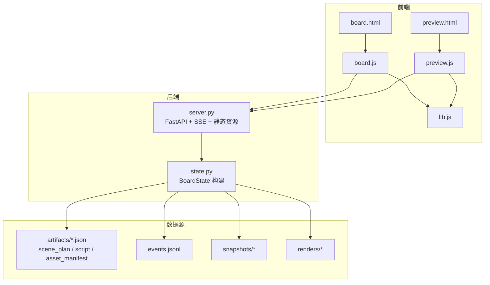
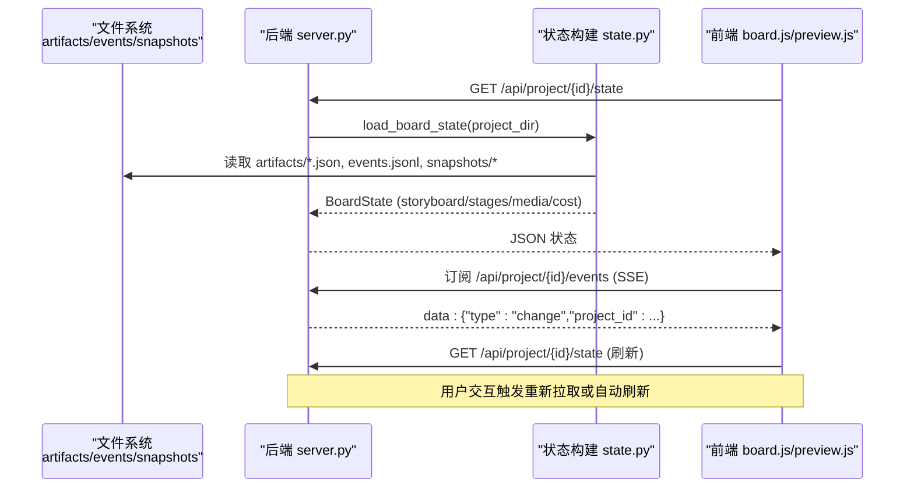
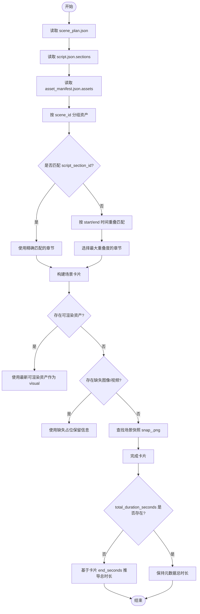
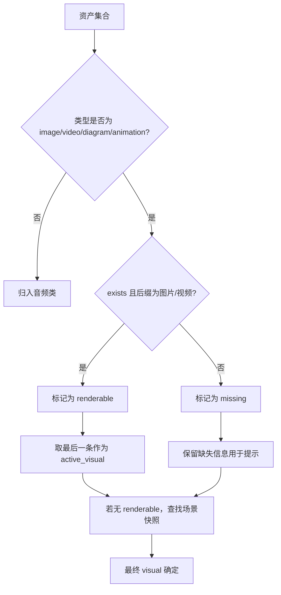
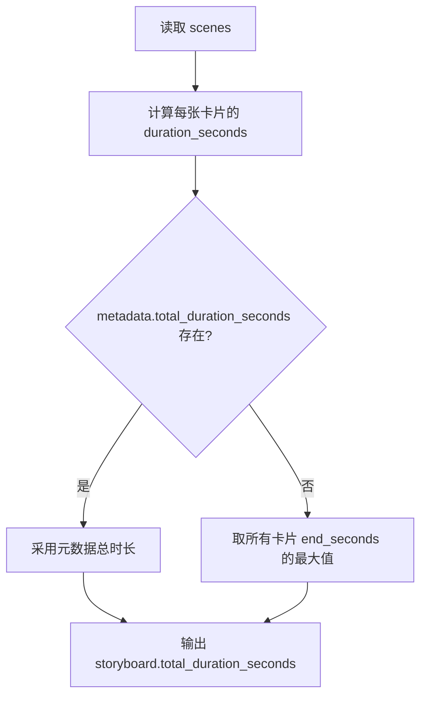
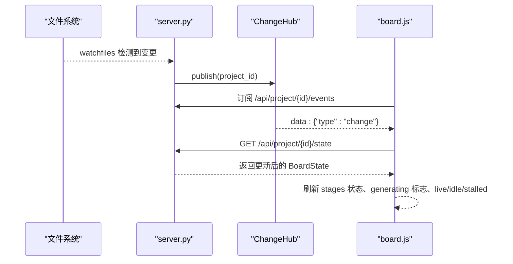
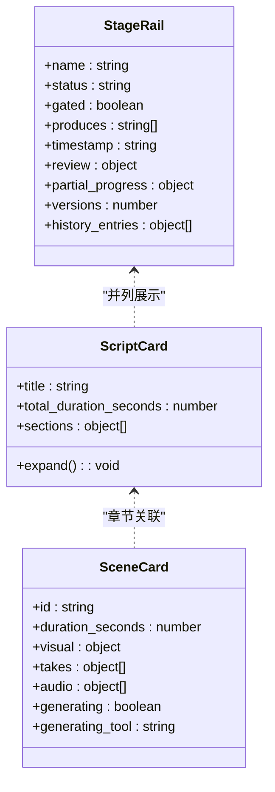
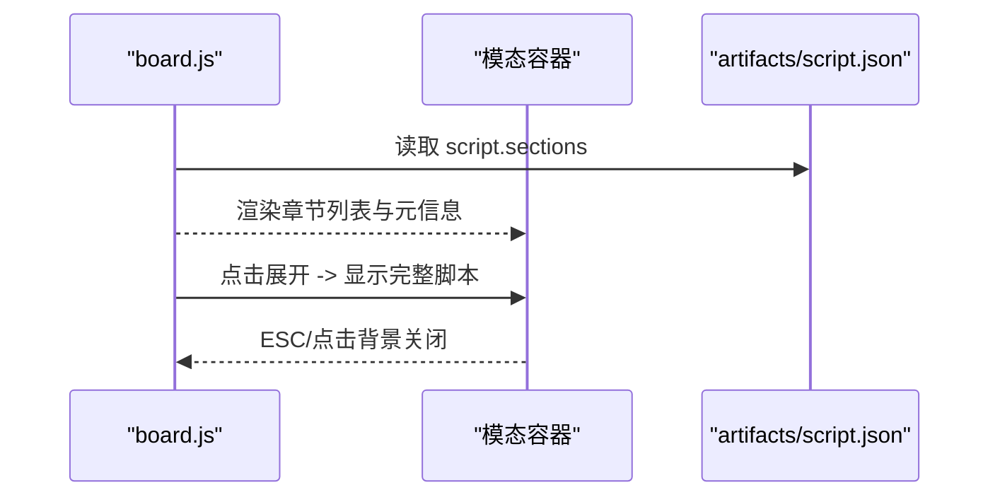
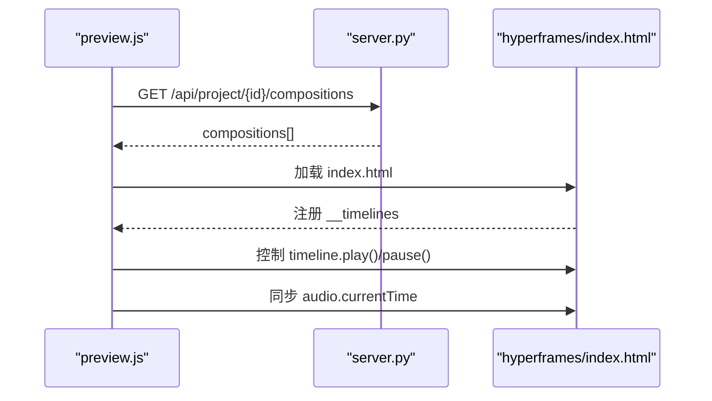
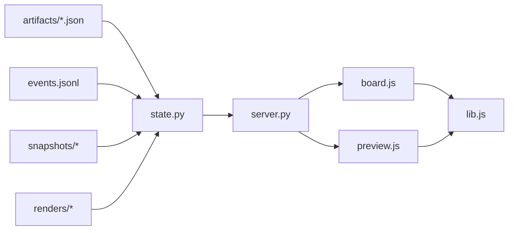

# 分镜组装与渲染

<cite>
**本文引用的文件**   
- [backlot/server.py](file://backlot/server.py)
- [backlot/state.py](file://backlot/state.py)
- [backlot/ui/board.html](file://backlot/ui/board.html)
- [backlot/ui/board.js](file://backlot/ui/board.js)
- [backlot/ui/preview.html](file://backlot/ui/preview.html)
- [backlot/ui/preview.js](file://backlot/ui/preview.js)
- [backlot/ui/lib.js](file://backlot/ui/lib.js)
- [schemas/artifacts/storyboard.schema.json](file://schemas/artifacts/storyboard.schema.json)
- [schemas/artifacts/asset_manifest.schema.json](file://schemas/artifacts/asset_manifest.schema.json)
- [skills/pipelines/music-video/storyboard-director.md](file://skills/pipelines/music-video/storyboard-director.md)
</cite>

## 目录
1. [简介](#简介)
2. [项目结构](#项目结构)
3. [核心组件](#核心组件)
4. [架构总览](#架构总览)
5. [详细组件分析](#详细组件分析)
6. [依赖关系分析](#依赖关系分析)
7. [性能考量](#性能考量)
8. [故障排查指南](#故障排查指南)
9. [结论](#结论)
10. [附录](#附录)

## 简介
本文件聚焦“分镜组装与渲染”的完整流程，覆盖以下关键目标：
- 场景卡片的数据构建过程：scene_plan、script、asset_manifest 的关联与合并策略。
- 视觉资产的优先级选择与回退机制（可渲染资产 → 缺失资产占位 → 场景快照）。
- 分镜时间轴计算与时长统计（单镜时长、总时长推导）。
- 生成状态的实时监控与进度显示（SSE 事件驱动、活跃窗口、停滞检测）。
- 分镜可视化渲染与交互（胶片条、缩略图、播放、模态预览）。
- 分镜脚本编辑与预览（脚本卡片展开、章节展示、时长统计）。

## 项目结构
Backlot 提供 Web 端看板与预览能力，后端通过 FastAPI 暴露 API、SSE 事件流与媒体服务；状态解析由 state.py 完成，前端 board.js/preview.js 负责渲染与交互。

**图表来源** 
- [backlot/server.py:151-406](file://backlot/server.py#L151-L406)
- [backlot/state.py:586-656](file://backlot/state.py#L586-L656)
- [backlot/ui/board.html:1-16](file://backlot/ui/board.html#L1-L16)
- [backlot/ui/board.js:1-80](file://backlot/ui/board.js#L1-L80)
- [backlot/ui/preview.html:1-76](file://backlot/ui/preview.html#L1-L76)
- [backlot/ui/preview.js:1-60](file://backlot/ui/preview.js#L1-L60)
- [backlot/ui/lib.js:1-104](file://backlot/ui/lib.js#L1-L104)

**章节来源**
- [backlot/server.py:151-406](file://backlot/server.py#L151-L406)
- [backlot/state.py:586-656](file://backlot/state.py#L586-L656)
- [backlot/ui/board.html:1-16](file://backlot/ui/board.html#L1-L16)
- [backlot/ui/board.js:1-80](file://backlot/ui/board.js#L1-L80)
- [backlot/ui/preview.html:1-76](file://backlot/ui/preview.html#L1-L76)
- [backlot/ui/preview.js:1-60](file://backlot/ui/preview.js#L1-L60)
- [backlot/ui/lib.js:1-104](file://backlot/ui/lib.js#L1-L104)

## 核心组件
- 状态构建器（state.py）：从 artifacts、events、snapshots、renders 等构建 BoardState，包含 storyboard（场景卡片）、stages（阶段轨道）、media（媒体索引）、cost（成本快照）等。
- 服务端（server.py）：提供项目状态 API、SSE 变更推送、媒体与缩略图服务、预览页面路由。
- 看板前端（board.js）：渲染阶段轨道、脚本卡片、分镜胶片条、审批审查区、活动日志，并通过 SSE 实时更新。
- 预览前端（preview.js）：加载 HyperFrames 组成并控制播放、时间线同步、音频对齐。

**章节来源**
- [backlot/state.py:229-264](file://backlot/state.py#L229-L264)
- [backlot/state.py:401-493](file://backlot/state.py#L401-L493)
- [backlot/server.py:174-242](file://backlot/server.py#L174-L242)
- [backlot/ui/board.js:248-296](file://backlot/ui/board.js#L248-L296)
- [backlot/ui/preview.js:188-219](file://backlot/ui/preview.js#L188-L219)

## 架构总览
下图展示了从文件系统到 UI 的端到端数据流，以及实时更新的通道。

**图表来源** 
- [backlot/server.py:174-242](file://backlot/server.py#L174-L242)
- [backlot/state.py:586-656](file://backlot/state.py#L586-L656)

## 详细组件分析

### 分镜数据组装（scene_plan × script × asset_manifest）
- 输入来源：
  - scene_plan.json：scenes 数组，含 start_seconds/end_seconds、id、description、framing/movement/narration 等。
  - script.json：sections 数组，含 id/start_seconds/end_seconds/text/label 等。
  - asset_manifest.json：assets 数组，含 type/path/scene_id/source_tool/cost_usd/duration_seconds/resolution 等。
- 关联规则：
  - 场景与脚本段落通过 script_section_id 精确匹配，否则按时间重叠度回退匹配。
  - 资产按 scene_id 分组，区分视觉类（image/video/diagram/animation）与音频类（audio/narration/music/sfx）。
- 输出：
  - storyboard.scenes 为场景卡片列表，包含 duration_seconds、visual/takes/audio/generating 等字段。
  - total_duration_seconds 优先取自 metadata.total_duration_seconds，否则基于卡片 end_seconds 推导。

**图表来源** 
- [backlot/state.py:379-493](file://backlot/state.py#L379-L493)

**章节来源**
- [backlot/state.py:379-493](file://backlot/state.py#L379-L493)
- [schemas/artifacts/storyboard.schema.json:171-286](file://schemas/artifacts/storyboard.schema.json#L171-L286)
- [schemas/artifacts/asset_manifest.schema.json:1-63](file://schemas/artifacts/asset_manifest.schema.json#L1-L63)

### 视觉资产优先级与回退机制
- 优先级顺序：
  1) 可渲染资产（image/video/diagram），取最后一个 renderable 条目作为 active_visual。
  2) 缺失资产（exists=false 且类型为 image/video/diagram），用于提示“文件缺失”。
  3) 场景快照（snapshots/<scene_id>.png），当无可用资产时回退至快照。
- 渲染性判断：
  - 仅 raster/image 与 video 被视为 renderable；bespoke/atelier 动画（如 .tsx）不可直接缩略，走快照路径。
- 前端处理：
  - 图片失败时回退到 shot spec 占位（描述+景别/运镜摘要）。
  - 视频支持内联播放与暂停。

**图表来源** 
- [backlot/state.py:299-347](file://backlot/state.py#L299-L347)
- [backlot/state.py:349-377](file://backlot/state.py#L349-L377)
- [backlot/ui/board.js:749-800](file://backlot/ui/board.js#L749-L800)

**章节来源**
- [backlot/state.py:299-347](file://backlot/state.py#L299-L347)
- [backlot/state.py:349-377](file://backlot/state.py#L349-L377)
- [backlot/ui/board.js:749-800](file://backlot/ui/board.js#L749-L800)

### 时间轴计算与时长统计
- 单镜时长：duration_seconds = max(0, end_seconds - start_seconds)，若任一为空则为 None。
- 总时长：优先使用 scene_plan.metadata.total_duration_seconds；否则取所有卡片的 end_seconds 最大值。
- 脚本章节时长：sections 中的 start_seconds/end_seconds 用于与场景匹配和展示。

**图表来源** 
- [backlot/state.py:459-493](file://backlot/state.py#L459-L493)

**章节来源**
- [backlot/state.py:459-493](file://backlot/state.py#L459-L493)

### 生成状态实时监控与进度显示
- 事件驱动：events.jsonl 中 start/finish/error 事件决定场景是否处于 generating 状态。
- 活跃窗口：last_activity 基于 checkpoint_*.json、events.jsonl、artifacts/*.json 的最新 mtime；在 LIVE_WINDOW_SECONDS 内视为 live。
- 停滞检测：in_progress 阶段超过 STALL_WINDOW_SECONDS 无活动则标记 stalled，并在 UI 中提示。
- SSE 推送：server.py 监听文件系统变化，向订阅者发送 change 事件，前端按需刷新状态。

**图表来源** 
- [backlot/server.py:132-242](file://backlot/server.py#L132-L242)
- [backlot/state.py:563-656](file://backlot/state.py#L563-L656)
- [backlot/ui/board.js:1-80](file://backlot/ui/board.js#L1-L80)

**章节来源**
- [backlot/server.py:132-242](file://backlot/server.py#L132-L242)
- [backlot/state.py:563-656](file://backlot/state.py#L563-L656)
- [backlot/ui/board.js:1-80](file://backlot/ui/board.js#L1-L80)

### 分镜可视化渲染与交互
- 阶段轨道（rail）：根据 pipeline manifest 或 fallback 阶段定义，显示名称、状态、子文本（部分进度、错误、时间戳）。
- 脚本卡片：展示标题、总时长、章节数量与片段内容，支持点击展开全屏预览。
- 胶片条（filmstrip）：每个场景一张卡片，宽度随 duration 动态调整；hover/点击可切换 take、播放视频、查看快照。
- 审批审查区：对 awaiting_human 的阶段，汇总 artifact 摘要与决策事实，引导人工审批。
- 活动日志：聚合 tool 级别的 start/finish/error，去重后展示最近 10 条。

**图表来源** 
- [backlot/state.py:143-223](file://backlot/state.py#L143-L223)
- [backlot/ui/board.js:129-153](file://backlot/ui/board.js#L129-L153)
- [backlot/ui/board.js:274-296](file://backlot/ui/board.js#L274-L296)
- [backlot/ui/board.js:733-800](file://backlot/ui/board.js#L733-L800)

**章节来源**
- [backlot/state.py:143-223](file://backlot/state.py#L143-L223)
- [backlot/ui/board.js:129-153](file://backlot/ui/board.js#L129-L153)
- [backlot/ui/board.js:274-296](file://backlot/ui/board.js#L274-L296)
- [backlot/ui/board.js:733-800](file://backlot/ui/board.js#L733-L800)

### 分镜脚本编辑与预览
- 脚本预览：board.js 渲染 sections 的前 N 条，支持点击打开模态框展示完整脚本。
- 章节信息：每节显示 slug、start/end 时长、action 文本、speaker_directions、enhancement_cues。
- 审批反馈：对 script 阶段的 review 摘要显示 critical/suggestions/nitpicks 计数与决策说明。

**图表来源** 
- [backlot/ui/board.js:252-296](file://backlot/ui/board.js#L252-L296)
- [backlot/ui/board.js:530-566](file://backlot/ui/board.js#L530-L566)

**章节来源**
- [backlot/ui/board.js:252-296](file://backlot/ui/board.js#L252-L296)
- [backlot/ui/board.js:530-566](file://backlot/ui/board.js#L530-L566)

### 预览与播放（HyperFrames 组成）
- 组成发现：server.py 扫描 projects/<id>/**/hyperframes.json，提取 name/duration/fps/resolution/audio 等元数据。
- 播放器：preview.js 加载 index.html，尝试获取 window.__timelines 控制 GSAP timeline，并与 narration 音频对齐。
- 交互：Play/Pause、拖拽进度条、键盘空格控制、嵌入模式 ESC 关闭。

**图表来源** 
- [backlot/server.py:420-453](file://backlot/server.py#L420-L453)
- [backlot/ui/preview.js:188-219](file://backlot/ui/preview.js#L188-L219)

**章节来源**
- [backlot/server.py:420-453](file://backlot/server.py#L420-L453)
- [backlot/ui/preview.js:188-219](file://backlot/ui/preview.js#L188-L219)

## 依赖关系分析
- 状态构建依赖：
  - artifacts/*.json（scene_plan、script、asset_manifest 等）
  - events.jsonl（工具级事件）
  - snapshots/*（场景快照）
  - renders/*（成品视频）
- 前端依赖：
  - lib.js（通用工具：getJSON、el、fmtDuration、thumbURL、subscribe 等）
  - board.js（看板渲染与交互）
  - preview.js（组成预览播放器）
- 后端依赖：
  - server.py（FastAPI、SSE、静态资源、缩略图缓存）
  - state.py（BoardState 构建逻辑）

**图表来源** 
- [backlot/state.py:586-656](file://backlot/state.py#L586-L656)
- [backlot/server.py:174-242](file://backlot/server.py#L174-L242)
- [backlot/ui/lib.js:1-104](file://backlot/ui/lib.js#L1-L104)

**章节来源**
- [backlot/state.py:586-656](file://backlot/state.py#L586-L656)
- [backlot/server.py:174-242](file://backlot/server.py#L174-L242)
- [backlot/ui/lib.js:1-104](file://backlot/ui/lib.js#L1-L104)

## 性能考量
- 缩略图缓存：server.py 将图片缩放与视频首帧抽取结果缓存至 .backlot/thumbs，避免重复计算。
- 事件限流：SSE 心跳间隔 15 秒，批量变更合并，减少前端刷新频率。
- 状态构建优化：load_board_state 只读取必要文件，限制 events 读取上限（limit=250），避免大文件阻塞。
- 媒体扫描排除：SCAN_EXCLUDE 忽略 node_modules/.git/__pycache__ 等噪声目录。

[本节为通用指导，不直接分析具体文件]

## 故障排查指南
- 资产不可见：
  - 检查 asset_manifest.json 中 path 是否正确解析（项目相对/仓库相对/绝对路径）。
  - 确认 exists/renderable 字段；若为 .tsx 动画，需依赖场景快照。
- 时间轴异常：
  - 校验 scene_plan.scenes 的 start_seconds/end_seconds 是否连续无重叠。
  - 若 total_duration_seconds 缺失，确认卡片 end_seconds 是否有有效值。
- 生成状态不更新：
  - 检查 events.jsonl 是否有对应 scene_id 的 start/finish/error 事件。
  - 确认 last_activity 是否在 LIVE_WINDOW_SECONDS 内；若停滞，检查 STALL_WINDOW_SECONDS 阈值。
- 预览无法播放：
  - 确认 hyperframes.json 存在且 index.html 可访问。
  - 检查 window.__timelines 是否成功抓取；必要时回退自由运行模式。

**章节来源**
- [backlot/state.py:299-347](file://backlot/state.py#L299-L347)
- [backlot/state.py:459-493](file://backlot/state.py#L459-L493)
- [backlot/server.py:460-500](file://backlot/server.py#L460-L500)
- [backlot/ui/preview.js:120-184](file://backlot/ui/preview.js#L120-L184)

## 结论
本系统通过 state.py 将 scene_plan、script、asset_manifest 等多源数据统一组装为 BoardState，并以 board.js/preview.js 实现高交互性的分镜可视化与预览。SSE 事件驱动确保生成状态实时可见，结合停滞检测与活跃窗口提升用户体验。资产优先级与回退机制保证在不同生成状态下均能稳定呈现。整体架构清晰、扩展性强，适合音乐视频流水线中的分镜编排与审阅。

[本节为总结，不直接分析具体文件]

## 附录
- 分镜脚本规范参考：
  - storyboard.schema.json 定义了 shots 的强约束（≤23、整数时长 4-15 秒、时间线连续）。
  - storyboard-director.md 描述了分镜导演的工作流程与输出格式。

**章节来源**
- [schemas/artifacts/storyboard.schema.json:171-286](file://schemas/artifacts/storyboard.schema.json#L171-L286)
- [skills/pipelines/music-video/storyboard-director.md:1-93](file://skills/pipelines/music-video/storyboard-director.md#L1-L93)