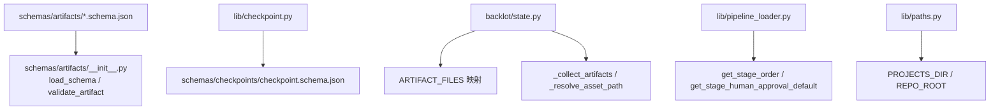
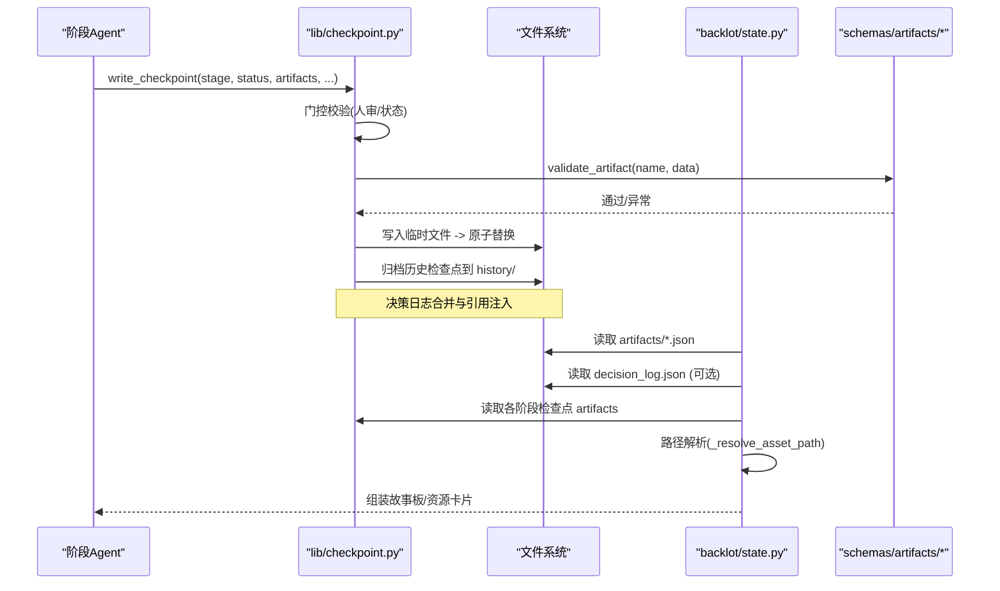
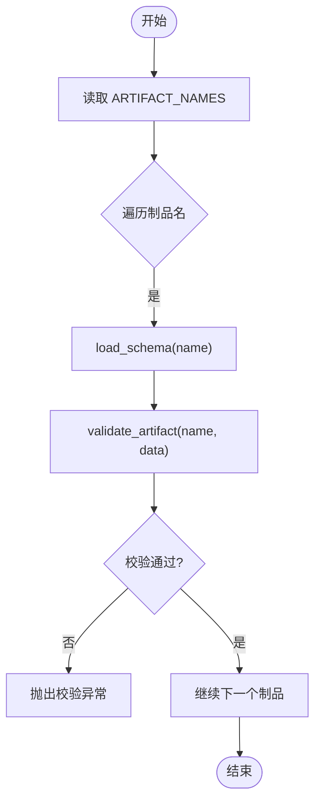
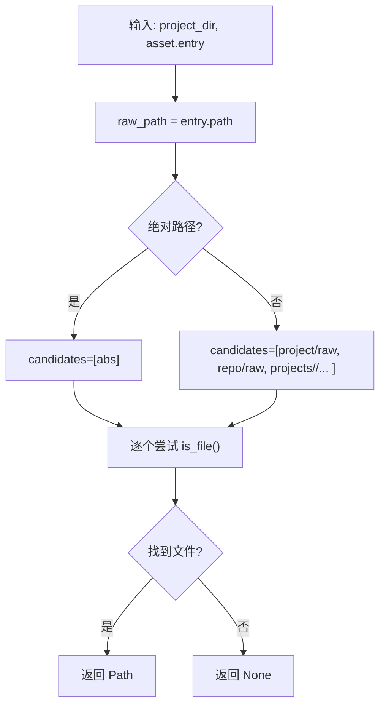
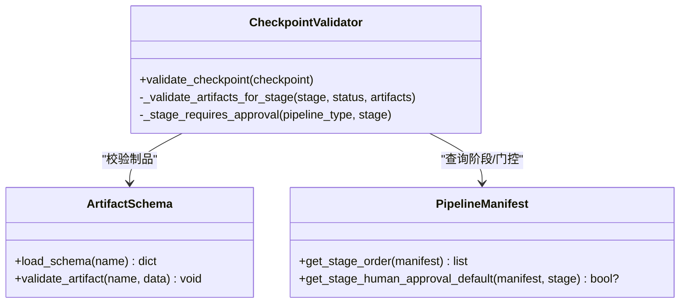
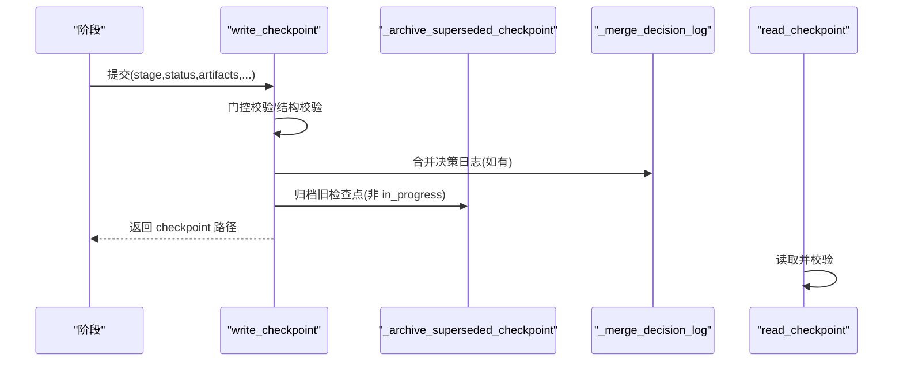
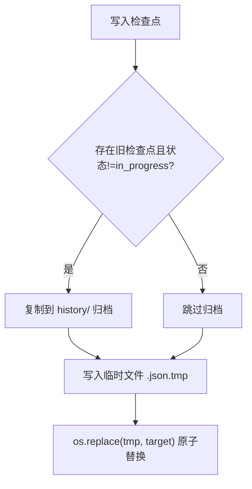
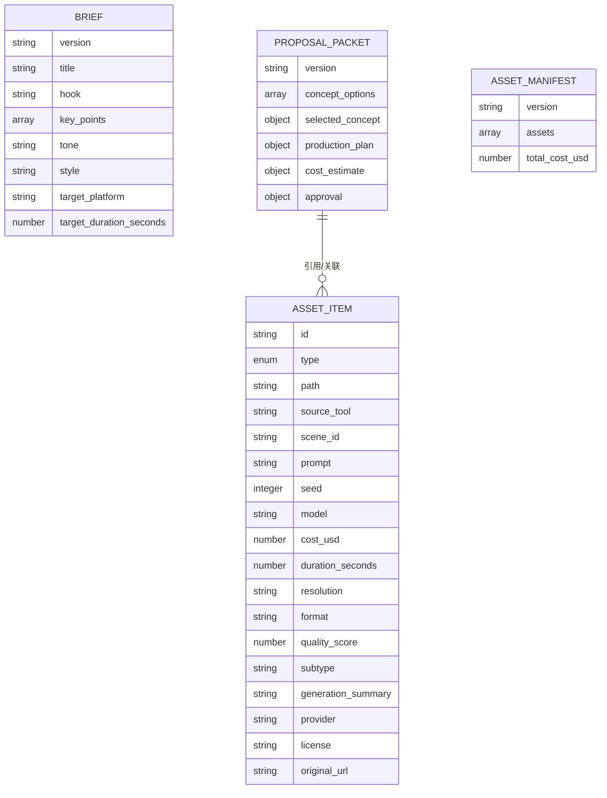
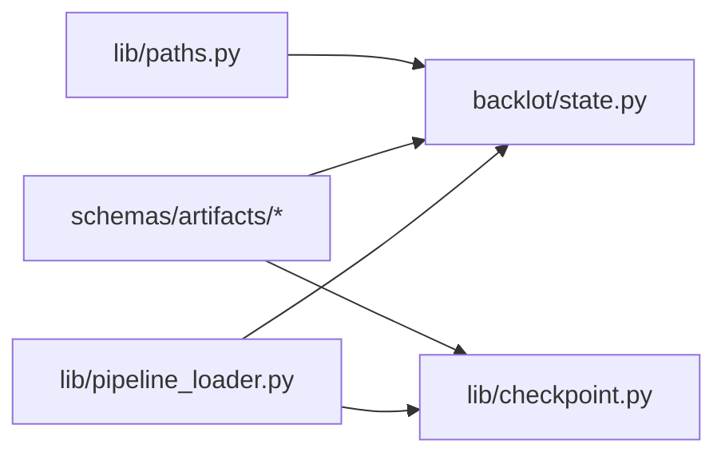

# 制品收集与解析

<cite>
**本文引用的文件**   
- [lib/checkpoint.py](file://lib/checkpoint.py)
- [lib/paths.py](file://lib/paths.py)
- [schemas/artifacts/__init__.py](file://schemas/artifacts/__init__.py)
- [schemas/artifacts/brief.schema.json](file://schemas/artifacts/brief.schema.json)
- [schemas/artifacts/proposal_packet.schema.json](file://schemas/artifacts/proposal_packet.schema.json)
- [schemas/artifacts/asset_manifest.schema.json](file://schemas/artifacts/asset_manifest.schema.json)
- [schemas/checkpoints/checkpoint.schema.json](file://schemas/checkpoints/checkpoint.schema.json)
- [backlot/state.py](file://backlot/state.py)
- [lib/pipeline_loader.py](file://lib/pipeline_loader.py)
</cite>

## 目录
1. [简介](#简介)
2. [项目结构](#项目结构)
3. [核心组件](#核心组件)
4. [架构总览](#架构总览)
5. [详细组件分析](#详细组件分析)
6. [依赖关系分析](#依赖关系分析)
7. [性能考虑](#性能考虑)
8. [故障排查指南](#故障排查指南)
9. [结论](#结论)
10. [附录：扩展开发指南](#附录扩展开发指南)

## 简介
本文件系统化阐述制品（Artifacts）的收集、识别、加载、验证与解析机制，覆盖 research_brief、brief、proposal_packet、script、scene_plan、asset_manifest 等关键类型。文档同时说明制品文件的查找策略与路径解析逻辑、校验规则与兼容性处理、制品与检查点（Checkpoint）的关联与同步机制、增量更新与缓存策略，并提供制品格式的扩展开发指南。

## 项目结构
- 制品定义与校验：位于 schemas/artifacts/*.schema.json，配合 schemas/artifacts/__init__.py 提供统一加载与校验接口。
- 检查点与阶段映射：lib/checkpoint.py 维护阶段到制品的映射、检查点读写、归档与决策日志合并。
- 路径与根目录：lib/paths.py 提供仓库根与项目根的统一入口。
- 制品收集与展示：backlot/state.py 负责从 artifacts/*.json 与检查点中聚合制品，并实现资产路径解析与故事板拼装。
- 流水线清单：lib/pipeline_loader.py 负责加载与缓存 pipeline manifest，决定阶段顺序与人审门控。

**图表来源** 
- [schemas/artifacts/__init__.py:1-45](file://schemas/artifacts/__init__.py#L1-L45)
- [lib/checkpoint.py:140-172](file://lib/checkpoint.py#L140-L172)
- [backlot/state.py:229-264](file://backlot/state.py#L229-L264)
- [lib/pipeline_loader.py:125-182](file://lib/pipeline_loader.py#L125-L182)
- [lib/paths.py:13-18](file://lib/paths.py#L13-L18)

**章节来源**
- [lib/checkpoint.py:1-537](file://lib/checkpoint.py#L1-L537)
- [lib/paths.py:1-18](file://lib/paths.py#L1-L18)
- [schemas/artifacts/__init__.py:1-45](file://schemas/artifacts/__init__.py#L1-L45)
- [backlot/state.py:225-424](file://backlot/state.py#L225-L424)
- [lib/pipeline_loader.py:1-241](file://lib/pipeline_loader.py#L1-L241)

## 核心组件
- 制品名称与Schema注册：通过 ARTIFACT_NAMES 声明受支持的制品名，并由 load_schema/validate_artifact 动态加载对应 JSON Schema 进行校验。
- 阶段-制品映射：CANONICAL_STAGE_ARTIFACTS 将 stage 与“标准制品”绑定，如 research→research_brief、idea→brief、proposal→proposal_packet、script→script、scene_plan→scene_plan、assets→asset_manifest。
- 检查点写入与校验：write_checkpoint 在写入前执行门控（人审）、合并决策日志、序列化到临时文件后原子替换，并归档旧版本；validate_checkpoint 对 stage/status/artifacts 做结构与内容校验。
- 制品收集与回退：_collect_artifacts 优先读取 artifacts/*.json，其次回退到 decision_log.json（项目根），最后从各检查点的 artifacts 字段回填。
- 资产路径解析：_resolve_asset_path 支持绝对路径、项目相对路径、仓库相对路径以及重复 projects/<id>/ 前缀的多形态兼容。

**章节来源**
- [schemas/artifacts/__init__.py:13-44](file://schemas/artifacts/__init__.py#L13-L44)
- [lib/checkpoint.py:30-48](file://lib/checkpoint.py#L30-L48)
- [lib/checkpoint.py:336-467](file://lib/checkpoint.py#L336-L467)
- [backlot/state.py:244-264](file://backlot/state.py#L244-L264)
- [backlot/state.py:271-296](file://backlot/state.py#L271-L296)

## 架构总览
制品系统围绕“检查点 + 制品文件 + Schema 校验 + 流水线清单”的四元结构运行：
- 流水线清单（pipeline manifest）决定阶段顺序与人审门控。
- 每个阶段完成后写入检查点，包含 artifacts 键值（内联或路径）。
- 制品文件集中存放于 artifacts/*.json，供 UI 与下游工具消费。
- 所有制品数据均按 JSON Schema 校验，确保一致性。

**图表来源** 
- [lib/checkpoint.py:336-467](file://lib/checkpoint.py#L336-L467)
- [schemas/artifacts/__init__.py:27-39](file://schemas/artifacts/__init__.py#L27-L39)
- [backlot/state.py:244-264](file://backlot/state.py#L244-L264)
- [backlot/state.py:271-296](file://backlot/state.py#L271-L296)

## 详细组件分析

### 制品类型识别与加载机制
- 名称注册：ARTIFACT_NAMES 列出受支持的制品名，包括 brief、proposal_packet、asset_manifest、review、decision_log、final_review 等。
- 加载与校验：load_schema 根据 name 定位 {name}.schema.json，validate_artifact 使用 jsonschema 校验实例。
- 阶段-制品绑定：CANONICAL_STAGE_ARTIFACTS 将 stage 与“标准制品”一一对应，用于强制要求与校验。

**图表来源** 
- [schemas/artifacts/__init__.py:13-44](file://schemas/artifacts/__init__.py#L13-L44)
- [schemas/artifacts/__init__.py:27-39](file://schemas/artifacts/__init__.py#L27-L39)

**章节来源**
- [schemas/artifacts/__init__.py:1-45](file://schemas/artifacts/__init__.py#L1-L45)
- [lib/checkpoint.py:30-48](file://lib/checkpoint.py#L30-L48)

### 制品文件查找策略与路径解析
- 优先级：artifacts/*.json > project_root/decision_log.json > 检查点 artifacts 回填。
- 路径兼容：支持绝对路径、项目相对路径、仓库相对路径、重复 projects/<id>/ 前缀。
- 资产条目规范化：_asset_entry 推断媒体类型、判断是否存在与是否可渲染（图片/视频），并生成 board 可用的结构化信息。

**图表来源** 
- [backlot/state.py:271-296](file://backlot/state.py#L271-L296)

**章节来源**
- [backlot/state.py:244-264](file://backlot/state.py#L244-L264)
- [backlot/state.py:271-296](file://backlot/state.py#L271-L296)
- [backlot/state.py:299-346](file://backlot/state.py#L299-L346)

### 制品数据的验证规则与兼容性处理
- 检查点级校验：validate_checkpoint 校验 stage/status/artifacts 结构，并调用 _validate_artifacts_for_stage 确保“完成态”包含必需的标准制品。
- 制品级校验：对已知制品名走 JSON Schema 校验，未知制品名直接跳过（兼容扩展）。
- 门控与审批：若阶段需要人审（manifest 或调用方标记），则 completed 必须附带 human_approved=True，否则抛错。
- 决策日志合并：当 artifacts 中包含 decision_log，会合并到项目级 decision_log.json，并在 proposal_packet/render_report 中注入 decision_log_ref 引用。

**图表来源** 
- [lib/checkpoint.py:140-172](file://lib/checkpoint.py#L140-L172)
- [lib/checkpoint.py:230-261](file://lib/checkpoint.py#L230-L261)
- [schemas/artifacts/__init__.py:27-39](file://schemas/artifacts/__init__.py#L27-L39)
- [lib/pipeline_loader.py:173-182](file://lib/pipeline_loader.py#L173-L182)

**章节来源**
- [lib/checkpoint.py:140-172](file://lib/checkpoint.py#L140-L172)
- [lib/checkpoint.py:336-467](file://lib/checkpoint.py#L336-L467)
- [schemas/checkpoints/checkpoint.schema.json:1-47](file://schemas/checkpoints/checkpoint.schema.json#L1-L47)

### 制品与检查点的关联关系与数据同步
- 阶段-制品映射：CANONICAL_STAGE_ARTIFACTS 明确每个阶段的“标准制品”，用于强制校验。
- 写入流程：write_checkpoint 先校验，再写临时文件，随后归档旧检查点并原子替换，保证幂等与可恢复。
- 读取流程：read_checkpoint/get_latest_checkpoint 读取并校验；get_completed_stages/get_next_stage 基于已完成检查点推进流水线。
- 决策日志同步：写入时合并 decision_log，并在相关制品中注入引用，便于跨制品追溯。

**图表来源** 
- [lib/checkpoint.py:336-467](file://lib/checkpoint.py#L336-L467)
- [lib/checkpoint.py:263-300](file://lib/checkpoint.py#L263-L300)
- [lib/checkpoint.py:306-334](file://lib/checkpoint.py#L306-L334)
- [lib/checkpoint.py:470-502](file://lib/checkpoint.py#L470-L502)

**章节来源**
- [lib/checkpoint.py:30-48](file://lib/checkpoint.py#L30-L48)
- [lib/checkpoint.py:336-467](file://lib/checkpoint.py#L336-L467)
- [lib/checkpoint.py:470-502](file://lib/checkpoint.py#L470-L502)

### 增量更新与缓存策略
- 检查点增量：仅当现有检查点状态非 in_progress 时才归档，避免心跳式刷新产生冗余历史。
- 原子写入：先写 .tmp 再 os.replace，防止部分写入导致损坏。
- 清单缓存：pipeline_loader 使用 lru_cache 缓存 manifest 加载结果，减少 YAML 解析与 schema 校验开销。
- 项目根路径：PROJECTS_DIR 作为唯一真实来源，所有检查点、事件、UI 监听均遵循该根。

**图表来源** 
- [lib/checkpoint.py:263-300](file://lib/checkpoint.py#L263-L300)
- [lib/checkpoint.py:452-467](file://lib/checkpoint.py#L452-L467)
- [lib/pipeline_loader.py:27-46](file://lib/pipeline_loader.py#L27-L46)
- [lib/paths.py:13-18](file://lib/paths.py#L13-L18)

**章节来源**
- [lib/checkpoint.py:263-300](file://lib/checkpoint.py#L263-L300)
- [lib/pipeline_loader.py:27-46](file://lib/pipeline_loader.py#L27-L46)
- [lib/paths.py:13-18](file://lib/paths.py#L13-L18)

### 关键制品格式概览
- brief.schema.json：创意简报，包含标题、钩子、关键点、风格、目标平台与时长等必填字段。
- proposal_packet.schema.json：提案包，包含概念选项、生产计划、成本估算、审批状态等复杂结构。
- asset_manifest.schema.json：资产清单，记录生成/获取的资产项及其元数据（类型、路径、模型、成本、分辨率等）。

**图表来源** 
- [schemas/artifacts/brief.schema.json:1-49](file://schemas/artifacts/brief.schema.json#L1-L49)
- [schemas/artifacts/proposal_packet.schema.json:1-379](file://schemas/artifacts/proposal_packet.schema.json#L1-L379)
- [schemas/artifacts/asset_manifest.schema.json:1-63](file://schemas/artifacts/asset_manifest.schema.json#L1-L63)

**章节来源**
- [schemas/artifacts/brief.schema.json:1-49](file://schemas/artifacts/brief.schema.json#L1-L49)
- [schemas/artifacts/proposal_packet.schema.json:1-379](file://schemas/artifacts/proposal_packet.schema.json#L1-L379)
- [schemas/artifacts/asset_manifest.schema.json:1-63](file://schemas/artifacts/asset_manifest.schema.json#L1-L63)

## 依赖关系分析
- backlot/state.py 依赖 lib/paths.py 提供的 REPO_ROOT 与 PROJECTS_DIR 以正确解析路径。
- lib/checkpoint.py 依赖 schemas/artifacts 与 schemas/checkpoints 的 Schema 进行强校验。
- lib/pipeline_loader.py 为 checkpoint 与 state 提供阶段顺序与人审门控信息。

**图表来源** 
- [lib/paths.py:13-18](file://lib/paths.py#L13-L18)
- [schemas/artifacts/__init__.py:1-45](file://schemas/artifacts/__init__.py#L1-L45)
- [lib/checkpoint.py:140-172](file://lib/checkpoint.py#L140-L172)
- [lib/pipeline_loader.py:125-182](file://lib/pipeline_loader.py#L125-L182)

**章节来源**
- [backlot/state.py:225-424](file://backlot/state.py#L225-L424)
- [lib/checkpoint.py:140-172](file://lib/checkpoint.py#L140-L172)
- [lib/pipeline_loader.py:125-182](file://lib/pipeline_loader.py#L125-L182)

## 性能考虑
- 清单缓存：使用 lru_cache 缓存 manifest 加载，避免重复解析与校验。
- 原子写入：临时文件+替换降低并发写入风险，提升可靠性。
- 最小化I/O：仅在必要时归档历史检查点，避免频繁复制。
- 路径解析优化：候选路径集合有限，失败快速回退，减少无效IO。

[本节为通用指导，不直接分析具体文件]

## 故障排查指南
- 校验失败：若制品不符合 Schema，validate_artifact 会抛出异常；检查制品字段是否符合 required/enum/类型约束。
- 门控违规：completed 未携带 human_approved=True 且阶段需人审，将触发门控错误；请按协议先写 awaiting_human，待用户批准后再写 completed。
- 路径不可达：_resolve_asset_path 无法解析路径时，exists=False；确认路径是否为绝对/项目相对/仓库相对形式，并确保文件存在于项目目录内。
- 历史归档失败：归档过程吞掉异常以避免阻塞写入；检查磁盘权限与占用情况（Windows 下文件被占用可能导致复制失败）。

**章节来源**
- [lib/checkpoint.py:140-172](file://lib/checkpoint.py#L140-L172)
- [lib/checkpoint.py:230-261](file://lib/checkpoint.py#L230-L261)
- [backlot/state.py:271-296](file://backlot/state.py#L271-L296)
- [lib/checkpoint.py:263-300](file://lib/checkpoint.py#L263-L300)

## 结论
制品系统通过“清单驱动的阶段顺序 + 严格 Schema 校验 + 原子写入与归档 + 多形态路径解析”的组合，实现了稳定、可审计、可扩展的制品生命周期管理。结合检查点与决策日志，既能保障流水线推进的正确性，也为回溯与治理提供了坚实基础。

[本节为总结，不直接分析具体文件]

## 附录：扩展开发指南
- 新增制品类型
  - 在 schemas/artifacts/ 下新增 {name}.schema.json，并在 schemas/artifacts/__init__.py 的 ARTIFACT_NAMES 中注册。
  - 如需与阶段绑定，更新 CANONICAL_STAGE_ARTIFACTS（lib/checkpoint.py）以强制要求。
- 新增阶段
  - 在 pipeline manifest 中声明新阶段，必要时设置 human_approval_default。
  - 如需与标准制品绑定，更新 CANONICAL_STAGE_ARTIFACTS。
- 路径解析扩展
  - 若制品路径出现新的表示形式，可在 backlot/state.py 的 _resolve_asset_path 中添加候选路径策略。
- 门控与审批
  - 通过 manifest 的 human_approval_default 控制阶段门控；调用 write_checkpoint 时需遵守协议（awaiting_human → completed + human_approved）。
- 决策日志
  - 在 artifacts 中提供 decision_log，系统将自动合并并注入引用；确保 decision_id 唯一以避免重复。

**章节来源**
- [schemas/artifacts/__init__.py:13-44](file://schemas/artifacts/__init__.py#L13-L44)
- [lib/checkpoint.py:30-48](file://lib/checkpoint.py#L30-L48)
- [lib/pipeline_loader.py:173-182](file://lib/pipeline_loader.py#L173-L182)
- [backlot/state.py:271-296](file://backlot/state.py#L271-L296)
- [lib/checkpoint.py:306-334](file://lib/checkpoint.py#L306-L334)