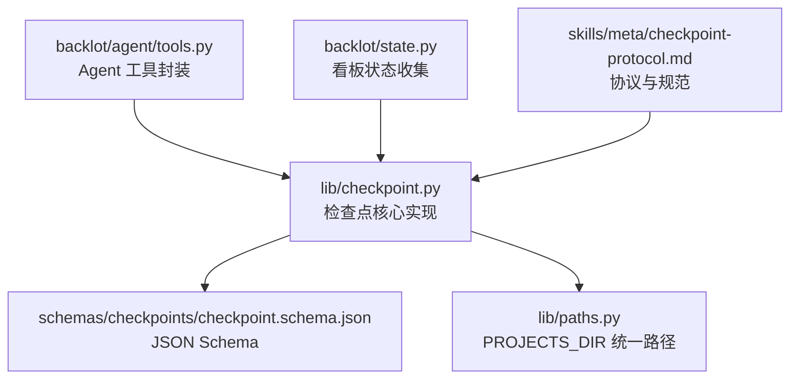
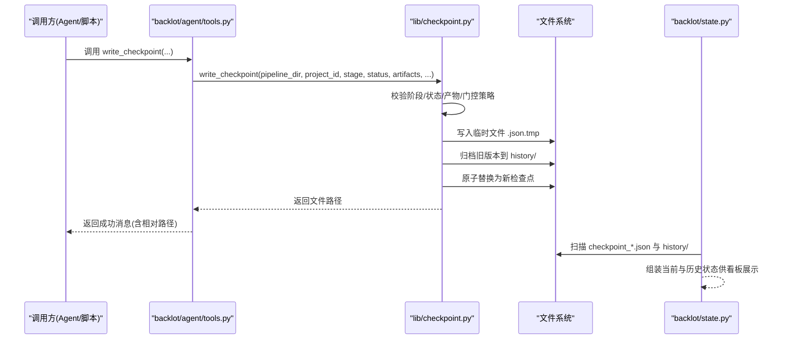
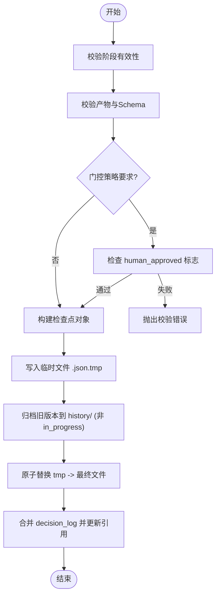
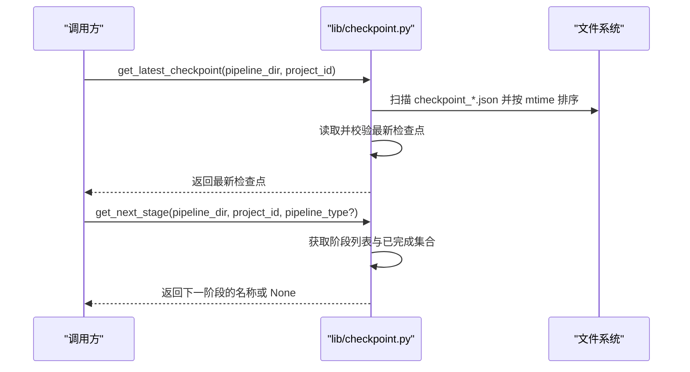
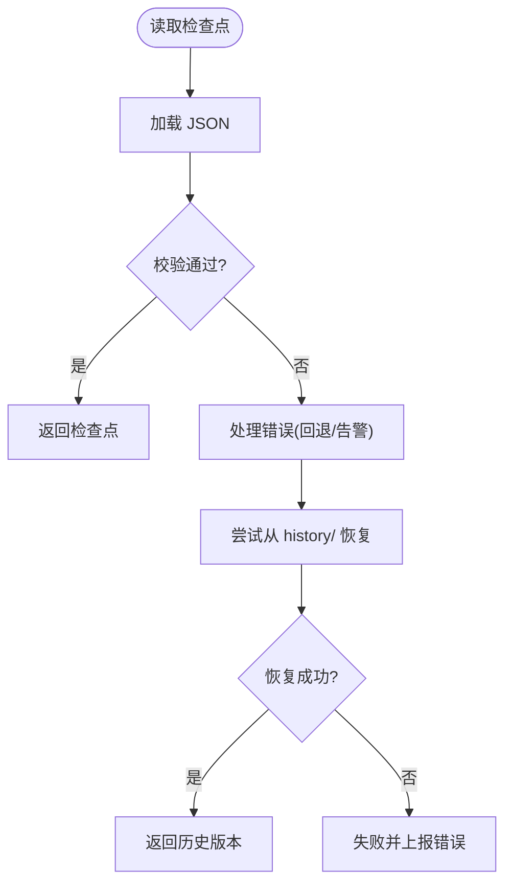
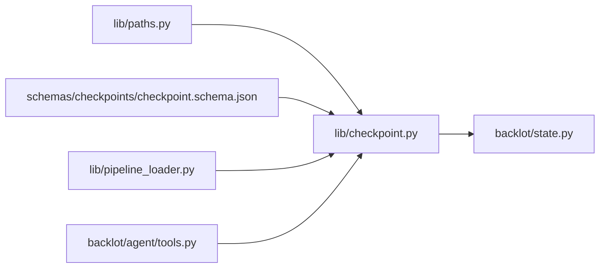

# 检查点系统

<cite>
**本文引用的文件**   
- [lib/checkpoint.py](file://lib/checkpoint.py)
- [schemas/checkpoints/checkpoint.schema.json](file://schemas/checkpoints/checkpoint.schema.json)
- [skills/meta/checkpoint-protocol.md](file://skills/meta/checkpoint-protocol.md)
- [backlot/agent/tools.py](file://backlot/agent/tools.py)
- [backlot/state.py](file://backlot/state.py)
- [lib/paths.py](file://lib/paths.py)
</cite>

## 目录
1. [简介](#简介)
2. [项目结构](#项目结构)
3. [核心组件](#核心组件)
4. [架构总览](#架构总览)
5. [详细组件分析](#详细组件分析)
6. [依赖关系分析](#依赖关系分析)
7. [性能考量](#性能考量)
8. [故障排查指南](#故障排查指南)
9. [结论](#结论)
10. [附录](#附录)

## 简介
本文件系统化阐述 OpenMontage-MV 的检查点（Checkpoint）机制，覆盖以下主题：
- 检查点的创建、保存、恢复与版本控制
- checkpoint_*.json 的命名约定与存储结构
- 检查点元数据字段说明（status、timestamp、review、cost_snapshot、error 等）
- 历史版本的归档策略与清理机制
- 完整性校验与损坏恢复流程
- 面向使用者的 API 接口与使用示例

该机制为流水线各阶段提供可恢复的状态快照，支持人类审批门控、审计追踪与回滚，同时通过 Backlot 看板实时呈现进度。

## 项目结构
检查点相关代码主要分布在以下位置：
- lib/checkpoint.py：检查点读写、验证、归档与项目初始化等核心逻辑
- schemas/checkpoints/checkpoint.schema.json：检查点 JSON Schema 定义
- skills/meta/checkpoint-protocol.md：检查点协议与最佳实践
- backlot/agent/tools.py：面向 Agent 的工具封装（如 write_checkpoint）
- backlot/state.py：Backlot 看板对检查点与历史文件的收集与展示
- lib/paths.py：仓库根与 projects 根路径的统一来源

图表来源
- [lib/checkpoint.py:1-120](file://lib/checkpoint.py#L1-L120)
- [schemas/checkpoints/checkpoint.schema.json:1-47](file://schemas/checkpoints/checkpoint.schema.json#L1-L47)
- [lib/paths.py:1-18](file://lib/paths.py#L1-L18)
- [backlot/agent/tools.py:219-251](file://backlot/agent/tools.py#L219-L251)
- [backlot/state.py:116-140](file://backlot/state.py#L116-L140)
- [skills/meta/checkpoint-protocol.md:1-70](file://skills/meta/checkpoint-protocol.md#L1-L70)

章节来源
- [lib/checkpoint.py:1-120](file://lib/checkpoint.py#L1-L120)
- [lib/paths.py:1-18](file://lib/paths.py#L1-L18)

## 核心组件
- 项目初始化与布局
  - init_project：创建 projects/<project_id>/ 标准目录结构与 project.json 标记文件，供 Backlot 看板识别项目。
- 检查点写入与读取
  - write_checkpoint：构建并校验检查点，执行门控策略，归档旧版本，原子替换当前文件。
  - read_checkpoint：读取指定阶段的检查点并进行校验。
  - get_latest_checkpoint：按文件修改时间获取最新检查点。
- 阶段推进与恢复
  - get_completed_stages：返回已完成阶段的列表。
  - get_next_stage：根据已完成阶段计算下一个待运行阶段。
- 历史归档
  - _archive_superseded_checkpoint：将非 in_progress 的旧检查点复制到 history/ 子目录，保留版本轨迹。
- 决策日志合并
  - _merge_decision_log：合并 decision_log 到项目级 decision_log.json，并在相关产物中写入引用。

章节来源
- [lib/checkpoint.py:178-227](file://lib/checkpoint.py#L178-L227)
- [lib/checkpoint.py:336-467](file://lib/checkpoint.py#L336-L467)
- [lib/checkpoint.py:470-503](file://lib/checkpoint.py#L470-L503)
- [lib/checkpoint.py:505-537](file://lib/checkpoint.py#L505-L537)
- [lib/checkpoint.py:263-301](file://lib/checkpoint.py#L263-L301)
- [lib/checkpoint.py:302-334](file://lib/checkpoint.py#L302-L334)

## 架构总览
检查点系统的整体交互如下：
- 调用方（Agent/脚本）通过工具或库函数调用 write_checkpoint/read_checkpoint 等接口。
- 写入时进行严格的 schema 与业务规则校验（包括阶段有效性、必需产物、门控策略）。
- 写入成功后，旧版本（非 in_progress）被归档至 history/，新文件以临时文件+原子替换方式落盘。
- Backlot 看板周期性扫描 checkpoint_*.json 与 history/ 下的归档，渲染项目状态与历史轨迹。

图表来源
- [backlot/agent/tools.py:219-251](file://backlot/agent/tools.py#L219-L251)
- [lib/checkpoint.py:336-467](file://lib/checkpoint.py#L336-L467)
- [backlot/state.py:116-140](file://backlot/state.py#L116-L140)

## 详细组件分析

### 检查点文件命名与存储结构
- 命名约定
  - 当前检查点：projects/<project_id>/checkpoint_<stage>.json
  - 历史归档：projects/<project_id>/history/checkpoint_<stage>_<safe_timestamp>.json（若冲突追加 st_mtime_ns）
- 存储结构
  - 每个项目目录包含 artifacts、assets/images、assets/video、assets/audio、assets/music、renders 等子目录
  - project.json 作为项目标记文件，记录 project_id、title、pipeline_type、created_at、version 等
- 文件访问安全
  - Backlot 在解析字符串路径时仅允许指向项目目录内的 JSON，防止越权读取

章节来源
- [lib/checkpoint.py:174-176](file://lib/checkpoint.py#L174-L176)
- [lib/checkpoint.py:178-227](file://lib/checkpoint.py#L178-L227)
- [backlot/state.py:98-113](file://backlot/state.py#L98-L113)

### 检查点元数据字段说明
依据 JSON Schema 与写入逻辑，关键字段如下：
- version：固定为 "1.0"
- project_id：项目标识
- pipeline_type：流水线类型（用于阶段白名单与门控策略）
- stage：阶段名（需属于当前 pipeline 的阶段列表）
- status：枚举值 ["completed", "failed", "awaiting_human", "in_progress"]
- timestamp：ISO 8601 UTC 时间戳
- style_playbook：可选样式策略
- checkpoint_policy：策略枚举 ["guided", "manual_all", "auto_noncreative"]
- human_approval_required：是否需要人工审批
- human_approved：是否已获批准
- artifacts：产物映射（键为产物名，值为对象或文件路径；受 Schema 约束）
- review：评审输出（可选）
- cost_snapshot：成本快照（total_spent_usd、total_reserved_usd、budget_remaining_usd）
- error：错误信息（可选）
- metadata：扩展元数据（可选）

章节来源
- [schemas/checkpoints/checkpoint.schema.json:1-47](file://schemas/checkpoints/checkpoint.schema.json#L1-L47)
- [lib/checkpoint.py:407-429](file://lib/checkpoint.py#L407-L429)

### 检查点创建与保存流程
- 入口
  - write_checkpoint：接收 pipeline_dir、project_id、stage、status、artifacts 及可选参数
- 前置校验
  - 阶段有效性校验（基于 pipeline_type 或回退到已知阶段集合）
  - 产物校验（必需产物存在性、Schema 校验）
  - 门控策略校验（human_approval_default 与 human_approved 一致性）
- 写入策略
  - 先写入 .json.tmp 临时文件，避免部分写入导致损坏
  - 归档旧版本（非 in_progress）到 history/
  - 原子替换 tmp -> 最终文件
- 决策日志合并
  - 若 artifacts 中包含 decision_log，则合并到项目级 decision_log.json，并在 proposal_packet/render_report 中写入引用

图表来源
- [lib/checkpoint.py:336-467](file://lib/checkpoint.py#L336-L467)
- [lib/checkpoint.py:302-334](file://lib/checkpoint.py#L302-L334)

章节来源
- [lib/checkpoint.py:336-467](file://lib/checkpoint.py#L336-L467)

### 检查点恢复与版本控制
- 读取单个检查点
  - read_checkpoint：读取指定阶段的 checkpoint_<stage>.json 并校验
- 获取最新检查点
  - get_latest_checkpoint：按文件 mtime 排序取最新，并校验
- 阶段推进
  - get_completed_stages：遍历阶段，返回 status="completed" 的列表
  - get_next_stage：按流水线阶段顺序返回首个未完成阶段
- 历史归档
  - _archive_superseded_checkpoint：复制旧版本到 history/，文件名包含阶段名与安全时间戳，确保不覆盖已有文件

图表来源
- [lib/checkpoint.py:483-503](file://lib/checkpoint.py#L483-L503)
- [lib/checkpoint.py:505-537](file://lib/checkpoint.py#L505-L537)

章节来源
- [lib/checkpoint.py:470-503](file://lib/checkpoint.py#L470-L503)
- [lib/checkpoint.py:505-537](file://lib/checkpoint.py#L505-L537)
- [lib/checkpoint.py:263-301](file://lib/checkpoint.py#L263-L301)

### 历史版本归档策略与清理机制
- 归档策略
  - 仅在覆盖非 in_progress 的检查点时归档（避免心跳式刷新产生大量历史）
  - 归档文件名：checkpoint_<stage>_<safe_timestamp>.json，冲突时追加 st_mtime_ns
  - 归档过程为 best-effort，I/O 异常不会中断写入
- 清理机制
  - 当前实现未内置自动清理策略；如需清理，应基于 history/ 下文件的时间戳或数量进行外部维护（例如定期删除早于某时间的归档）

章节来源
- [lib/checkpoint.py:263-301](file://lib/checkpoint.py#L263-L301)

### 完整性验证与损坏恢复流程
- 完整性验证
  - 读取与写入均调用 validate_checkpoint，结合 JSON Schema 与阶段/产物规则进行强校验
  - 产物校验会检查必需产物是否存在且符合对应 Schema
- 损坏恢复
  - 写入采用临时文件 + 原子替换，避免部分写入导致的损坏
  - 读取失败时（如 JSON 解码错误），上层可回退到历史归档或提示用户修复
  - Backlot 看板在解析字符串路径时限制在项目目录内，防止越权读取

图表来源
- [lib/checkpoint.py:470-481](file://lib/checkpoint.py#L470-L481)
- [lib/checkpoint.py:140-172](file://lib/checkpoint.py#L140-L172)
- [backlot/state.py:98-113](file://backlot/state.py#L98-L113)

章节来源
- [lib/checkpoint.py:140-172](file://lib/checkpoint.py#L140-L172)
- [lib/checkpoint.py:470-481](file://lib/checkpoint.py#L470-L481)

### 检查点操作的 API 接口与使用示例
- Python 库接口
  - init_project(project_id, title, pipeline_type, pipeline_dir?, style_playbook?)
  - write_checkpoint(pipeline_dir, project_id, stage, status, artifacts, pipeline_type?, style_playbook?, checkpoint_policy?, human_approval_required?, human_approved?, review?, cost_snapshot?, error?, metadata?)
  - read_checkpoint(pipeline_dir, project_id, stage)
  - get_latest_checkpoint(pipeline_dir, project_id)
  - get_completed_stages(pipeline_dir, project_id, pipeline_type?)
  - get_next_stage(pipeline_dir, project_id, pipeline_type?)
- Agent 工具封装
  - run_write_checkpoint：接受 JSON 字符串形式的 artifacts/metadata，调用 write_checkpoint 并返回相对路径
- 使用示例（描述性）
  - 初始化项目：调用 init_project 创建项目目录与 project.json
  - 写入检查点：在阶段完成后调用 write_checkpoint，传入 stage、status、artifacts 与必要元数据
  - 恢复进度：启动时调用 get_next_stage 判断是否继续，必要时读取当前阶段检查点以恢复上下文

章节来源
- [lib/checkpoint.py:178-227](file://lib/checkpoint.py#L178-L227)
- [lib/checkpoint.py:336-467](file://lib/checkpoint.py#L336-L467)
- [lib/checkpoint.py:470-503](file://lib/checkpoint.py#L470-L503)
- [backlot/agent/tools.py:219-251](file://backlot/agent/tools.py#L219-L251)

## 依赖关系分析
- 内部依赖
  - lib/checkpoint.py 依赖 lib/paths.py 获取 PROJECTS_DIR
  - 校验依赖 schemas/checkpoints/checkpoint.schema.json
  - 阶段列表与门控策略依赖 lib/pipeline_loader（当提供 pipeline_type 时）
- 外部集成
  - backlot/state.py 负责收集 checkpoint_*.json 与 history/ 归档，供看板展示
  - backlot/agent/tools.py 暴露 write_checkpoint 给 Agent 使用

图表来源
- [lib/paths.py:1-18](file://lib/paths.py#L1-L18)
- [lib/checkpoint.py:1-120](file://lib/checkpoint.py#L1-L120)
- [backlot/state.py:116-140](file://backlot/state.py#L116-L140)
- [backlot/agent/tools.py:219-251](file://backlot/agent/tools.py#L219-L251)

章节来源
- [lib/checkpoint.py:1-120](file://lib/checkpoint.py#L1-L120)
- [lib/paths.py:1-18](file://lib/paths.py#L1-L18)

## 性能考量
- 写入优化
  - 临时文件 + 原子替换减少损坏风险
  - 归档为 best-effort，I/O 异常不影响主流程
- 读取优化
  - 最新检查点按文件 mtime 排序，避免全量解析
- 缓存策略
  - Schema 加载使用 lru_cache，减少重复 I/O
- 建议
  - 对于长耗时阶段，频繁写入 in_progress 心跳以提升看板响应性
  - 合理控制 artifacts 大小，避免过大 JSON 影响读写性能

[本节为通用指导，不直接分析具体文件]

## 故障排查指南
- 常见错误
  - 阶段无效：stage 不在当前 pipeline 的阶段列表中
  - 产物缺失：完成态或等待审批态缺少必需产物
  - 门控违规：需要人工审批的阶段在未设置 human_approved=True 的情况下写入 completed
  - Schema 校验失败：产物或检查点不符合 JSON Schema
- 定位方法
  - 查看 write_checkpoint 抛出的 CheckpointValidationError 消息
  - 检查 project.json 与 checkpoint_<stage>.json 的内容
  - 确认 history/ 下是否有归档版本可用于恢复
- 恢复步骤
  - 若当前检查点损坏，尝试从 history/ 恢复
  - 修正 artifacts 或元数据后重新写入
  - 使用 get_next_stage 确认下一步阶段

章节来源
- [lib/checkpoint.py:94-172](file://lib/checkpoint.py#L94-L172)
- [lib/checkpoint.py:336-467](file://lib/checkpoint.py#L336-L467)
- [backlot/state.py:116-140](file://backlot/state.py#L116-L140)

## 结论
OpenMontage-MV 的检查点系统提供了健壮的状态持久化、版本管理与人类审批门控能力。通过严格的校验、原子写入与历史归档，确保了流水线的高可用性与可追溯性。配合 Backlot 看板，用户可直观掌握项目进度与历史轨迹。建议在开发过程中遵循 checkpoint-protocol 的最佳实践，充分利用 in_progress 心跳与决策日志，提升协作效率与容错能力。

[本节为总结性内容，不直接分析具体文件]

## 附录
- 协议参考
  - 检查点协议文档描述了何时以及如何使用检查点，包括人审门控、进度心跳与恢复流程
- 路径配置
  - PROJECTS_DIR 可通过环境变量 OPENMONTAGE_PROJECTS_DIR 覆盖，便于测试与多环境部署

章节来源
- [skills/meta/checkpoint-protocol.md:1-70](file://skills/meta/checkpoint-protocol.md#L1-L70)
- [lib/paths.py:1-18](file://lib/paths.py#L1-L18)