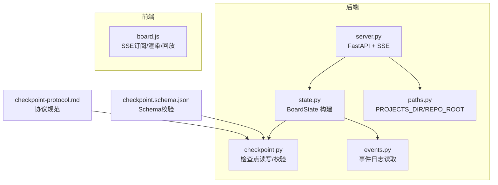
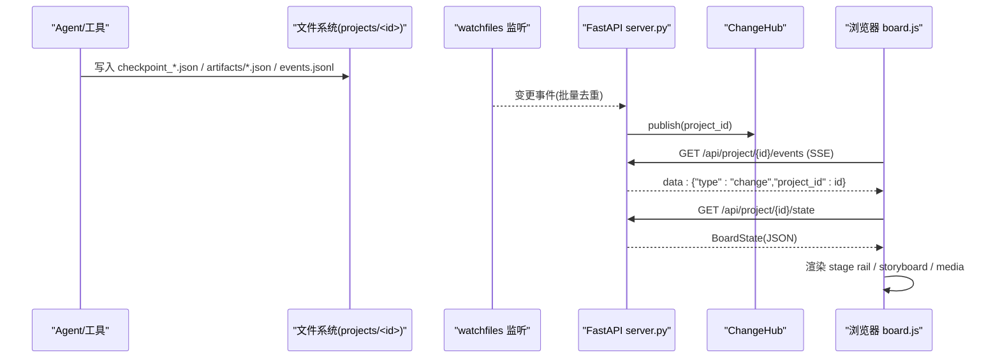
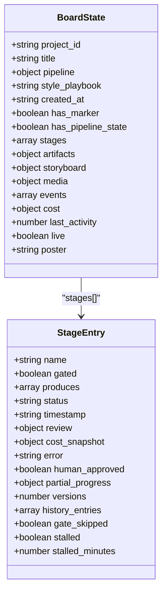
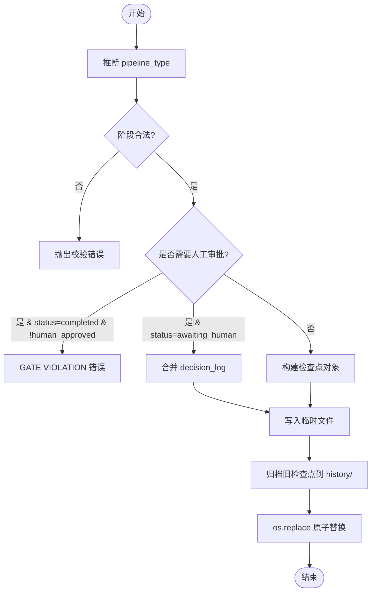
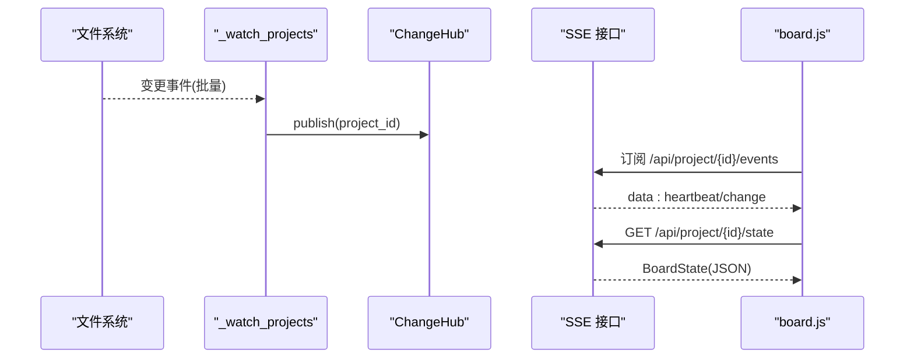
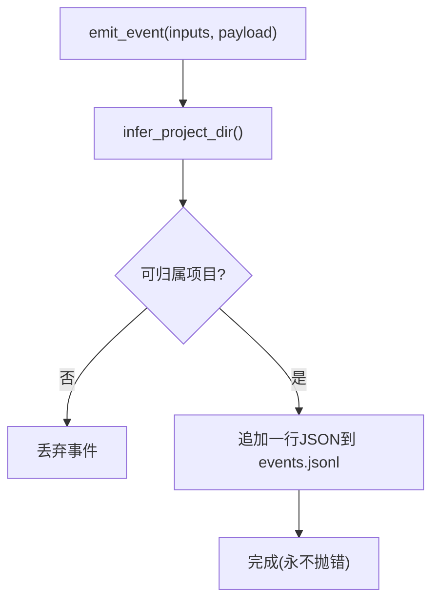
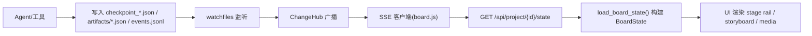
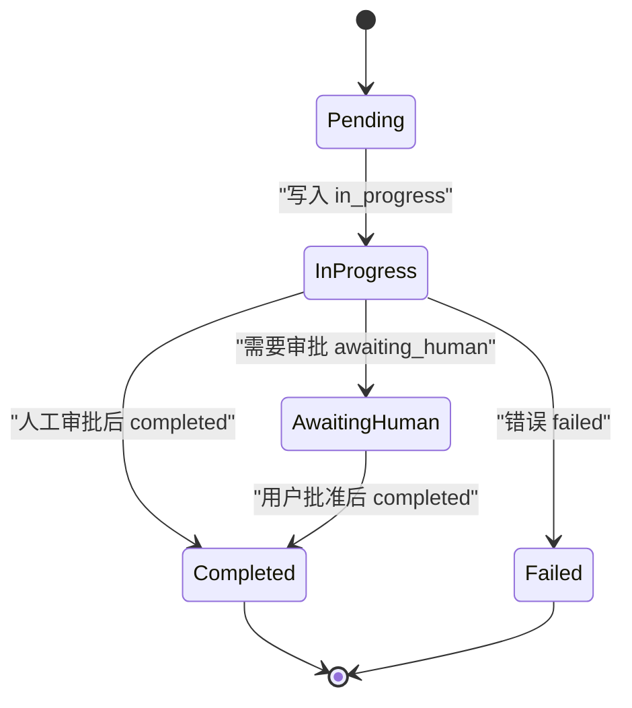
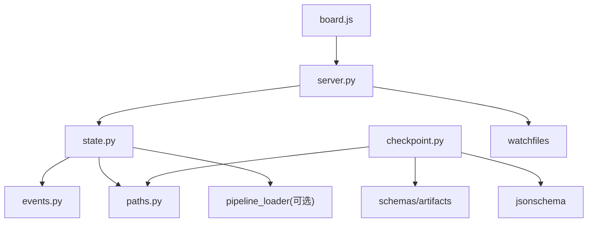

# 状态管理系统

<cite>
**本文引用的文件**   
- [backlot/state.py](file://backlot/state.py)
- [lib/checkpoint.py](file://lib/checkpoint.py)
- [lib/events.py](file://lib/events.py)
- [backlot/server.py](file://backlot/server.py)
- [schemas/checkpoints/checkpoint.schema.json](file://schemas/checkpoints/checkpoint.schema.json)
- [skills/meta/checkpoint-protocol.md](file://skills/meta/checkpoint-protocol.md)
- [lib/paths.py](file://lib/paths.py)
- [backlot/ui/board.js](file://backlot/ui/board.js)
</cite>

## 目录
1. [简介](#简介)
2. [项目结构](#项目结构)
3. [核心组件](#核心组件)
4. [架构总览](#架构总览)
5. [详细组件分析](#详细组件分析)
6. [依赖关系分析](#依赖关系分析)
7. [性能考量](#性能考量)
8. [故障排查指南](#故障排查指南)
9. [结论](#结论)
10. [附录](#附录)

## 简介
本文件系统化阐述 OpenMontage-MV 的状态管理机制，围绕以下目标展开：
- BoardState 数据结构的设计理念与字段定义
- 检查点机制的实现（创建、保存、恢复、版本控制）
- 项目状态的持久化策略与实时同步机制
- 事件系统的工作原理（发布、订阅、处理）
- 状态变更的数据流图与状态转换图
- 最佳实践与性能优化建议

该状态管理以“只读观察”为核心原则：后端服务不写入项目目录，仅通过文件系统监听变化并推送通知；前端通过 SSE 拉取增量更新，保持界面与磁盘状态一致。

## 项目结构
状态管理相关代码主要分布在以下模块：
- backlot/state.py：BoardState 的构建与聚合（只读）
- lib/checkpoint.py：检查点的读写、校验、归档与版本控制
- lib/events.py：工具调用事件的追加式日志与读取
- backlot/server.py：FastAPI 服务、SSE 变更广播、媒体与缩略图
- schemas/checkpoints/checkpoint.schema.json：检查点 JSON Schema
- skills/meta/checkpoint-protocol.md：检查点协议规范（人类审批、部分进度等）
- lib/paths.py：仓库根与 projects 根的统一入口
- backlot/ui/board.js：前端渲染与回放、SSE 订阅

图表来源
- [backlot/server.py:151-215](file://backlot/server.py#L151-L215)
- [backlot/state.py:586-656](file://backlot/state.py#L586-L656)
- [lib/checkpoint.py:336-467](file://lib/checkpoint.py#L336-L467)
- [lib/events.py:77-119](file://lib/events.py#L77-L119)
- [schemas/checkpoints/checkpoint.schema.json:1-47](file://schemas/checkpoints/checkpoint.schema.json#L1-L47)
- [skills/meta/checkpoint-protocol.md:1-201](file://skills/meta/checkpoint-protocol.md#L1-L201)
- [lib/paths.py:1-18](file://lib/paths.py#L1-L18)
- [backlot/ui/board.js:1-200](file://backlot/ui/board.js#L1-L200)

章节来源
- [backlot/server.py:151-215](file://backlot/server.py#L151-L215)
- [backlot/state.py:586-656](file://backlot/state.py#L586-L656)
- [lib/checkpoint.py:336-467](file://lib/checkpoint.py#L336-L467)
- [lib/events.py:77-119](file://lib/events.py#L77-L119)
- [schemas/checkpoints/checkpoint.schema.json:1-47](file://schemas/checkpoints/checkpoint.schema.json#L1-L47)
- [skills/meta/checkpoint-protocol.md:1-201](file://skills/meta/checkpoint-protocol.md#L1-L201)
- [lib/paths.py:1-18](file://lib/paths.py#L1-L18)
- [backlot/ui/board.js:1-200](file://backlot/ui/board.js#L1-L200)

## 核心组件
- BoardState 构建器（只读）：从项目目录扫描 checkpoint_*.json、artifacts/*.json、events.jsonl 等，组装为统一的 BoardState 视图，包含 stages、artifacts、storyboard、media、events、cost、live 等字段。
- 检查点子系统：负责写校验、归档历史、门控审批、决策日志合并、阶段顺序与产物映射。
- 事件子系统：append-only 的事件日志，线程安全写入，容错读取，用于实时活动与场景生成态。
- 实时同步：watchfiles 监听 projects 目录变化，ChangeHub 广播至 SSE 客户端，服务端缓存摘要并在变更时失效。
- 前端渲染：board.js 订阅 SSE，渲染 stage rail、故事板、成本条、播放与回放。

章节来源
- [backlot/state.py:586-656](file://backlot/state.py#L586-L656)
- [lib/checkpoint.py:336-467](file://lib/checkpoint.py#L336-L467)
- [lib/events.py:77-119](file://lib/events.py#L77-L119)
- [backlot/server.py:132-149](file://backlot/server.py#L132-L149)
- [backlot/ui/board.js:129-200](file://backlot/ui/board.js#L129-L200)

## 架构总览

图表来源
- [backlot/server.py:132-149](file://backlot/server.py#L132-L149)
- [backlot/server.py:185-215](file://backlot/server.py#L185-L215)
- [backlot/state.py:586-656](file://backlot/state.py#L586-L656)
- [lib/events.py:77-119](file://lib/events.py#L77-L119)
- [lib/checkpoint.py:336-467](file://lib/checkpoint.py#L336-L467)

## 详细组件分析

### BoardState 数据结构与设计理念
设计理念
- 只读与防御性：任何损坏的 JSON、缺失文件或半写检查点都不会导致崩溃，而是降级显示。
- 单一事实来源：所有路径来自 lib/paths.py 的 PROJECTS_DIR/REPO_ROOT，避免多源不一致。
- 可回放与审计：保留 history_entries 时间线，支持按时间点回放。
- 资源可见性：artifacts、media、storyboard 三维度呈现，便于 UI 展示。

关键字段与含义
- project_id/title/pipeline/style_playbook/created_at：项目元信息
- has_marker/has_pipeline_state：是否存在 marker 与 pipeline 状态
- stages：阶段轨道，含 name/gated/produces/status/timestamp/review/cost_snapshot/error/human_approved/partial_progress/versions/history_entries/gate_skipped/stalled/stalled_minutes
- artifacts：各阶段产物集合（从 artifacts/*.json 与 checkpoint.artifacts 回填）
- storyboard：场景卡片集合（scene_plan × script × asset_manifest + 实时事件）
- media：renders/snapshots/music 扫描结果
- events：最近事件（limit=250）
- cost：最新 cost_snapshot 或 manifest 汇总
- last_activity/live：最近活动时间与是否处于活跃窗口
- poster：封面图选择策略（优先图像，其次快照，最后视频帧）

章节来源
- [backlot/state.py:586-656](file://backlot/state.py#L586-L656)
- [backlot/state.py:143-222](file://backlot/state.py#L143-L222)
- [backlot/state.py:244-264](file://backlot/state.py#L244-L264)
- [backlot/state.py:401-493](file://backlot/state.py#L401-L493)
- [backlot/state.py:500-560](file://backlot/state.py#L500-L560)

#### BoardState 类图（概念映射）

图表来源
- [backlot/state.py:586-656](file://backlot/state.py#L586-L656)
- [backlot/state.py:143-222](file://backlot/state.py#L143-L222)

### 检查点机制（创建、保存、恢复、版本控制）
- 创建与校验
  - write_checkpoint 会先推断 pipeline_type（若未显式传入），再根据 manifest 确定阶段合法性与门控要求。
  - 对 artifacts 进行 schema 校验，必要时强制包含阶段必需产物。
  - 写入前使用临时文件 + os.replace 保证原子性。
- 归档与版本控制
  - 被覆盖的非 in_progress 检查点会被复制到 history/ 目录，文件名带时间戳，确保版本可追溯。
  - decision_log 合并到项目级 decision_log.json，并在相关 artifact 引用中写入 log_ref。
- 恢复与下一步
  - read_checkpoint/get_latest_checkpoint 提供读取能力。
  - get_completed_stages/get_next_stage 基于已完成检查点决定下一步。
- 门控审批
  - 若阶段需要人工审批，直接写 completed 且 human_approved=False 将抛出校验错误；必须写 awaiting_human 等待用户批准后再写 completed。

图表来源
- [lib/checkpoint.py:336-467](file://lib/checkpoint.py#L336-L467)
- [lib/checkpoint.py:263-300](file://lib/checkpoint.py#L263-L300)
- [lib/checkpoint.py:306-334](file://lib/checkpoint.py#L306-L334)
- [lib/checkpoint.py:505-537](file://lib/checkpoint.py#L505-L537)

章节来源
- [lib/checkpoint.py:336-467](file://lib/checkpoint.py#L336-L467)
- [lib/checkpoint.py:263-300](file://lib/checkpoint.py#L263-L300)
- [lib/checkpoint.py:306-334](file://lib/checkpoint.py#L306-L334)
- [lib/checkpoint.py:505-537](file://lib/checkpoint.py#L505-L537)
- [schemas/checkpoints/checkpoint.schema.json:1-47](file://schemas/checkpoints/checkpoint.schema.json#L1-L47)
- [skills/meta/checkpoint-protocol.md:1-201](file://skills/meta/checkpoint-protocol.md#L1-L201)

### 项目状态持久化策略
- 存储位置
  - 项目根：projects/<project_id>/
  - 关键文件：project.json（marker）、checkpoint_*.json（阶段快照）、history/（历史版本）、artifacts/*.json（产物）、events.jsonl（事件日志）、renders/snapshots/assets 等媒体。
- 一致性保障
  - 检查点写入采用临时文件 + 原子替换，避免半写破坏。
  - 事件写入使用线程锁保护单进程并发，跨进程无锁但容忍损坏行。
- 只读观察
  - Backlot 服务器不写入项目目录，仅通过 watchfiles 监听变化并广播。

章节来源
- [lib/paths.py:1-18](file://lib/paths.py#L1-L18)
- [lib/checkpoint.py:336-467](file://lib/checkpoint.py#L336-L467)
- [lib/events.py:77-119](file://lib/events.py#L77-L119)
- [backlot/server.py:132-149](file://backlot/server.py#L132-L149)

### 实时状态同步机制
- 文件监听
  - _watch_projects 使用 awatch 递归监听 projects 目录，过滤无关路径与噪声目录，批量收集变更并去重。
- 变更广播
  - ChangeHub 维护每个订阅者的队列，按 project_id 过滤推送，避免无关项目风暴。
- SSE 接口
  - /api/project/{id}/events 与 /api/library/events 提供心跳与 change 事件，客户端据此触发重新获取 state。
- 缓存与失效
  - 库列表摘要缓存 per project，变更时失效，减少全量解析开销。

图表来源
- [backlot/server.py:132-149](file://backlot/server.py#L132-L149)
- [backlot/server.py:185-215](file://backlot/server.py#L185-L215)
- [backlot/server.py:85-108](file://backlot/server.py#L85-L108)

章节来源
- [backlot/server.py:132-149](file://backlot/server.py#L132-L149)
- [backlot/server.py:185-215](file://backlot/server.py#L185-L215)
- [backlot/server.py:85-108](file://backlot/server.py#L85-L108)

### 事件系统（发布、订阅、处理）
- 发布
  - emit_event 向 events.jsonl 追加一行 JSON，自动注入 ts 时间戳，忽略无法归因的项目路径。
- 订阅
  - read_events 读取并跳过损坏行，支持 limit 限制返回数量。
- 用途
  - 驱动 storyboards 的“正在生成”状态（start/finish/error），以及 UI 的活动指示。

图表来源
- [lib/events.py:46-75](file://lib/events.py#L46-L75)
- [lib/events.py:77-96](file://lib/events.py#L77-L96)
- [lib/events.py:98-119](file://lib/events.py#L98-L119)

章节来源
- [lib/events.py:46-75](file://lib/events.py#L46-L75)
- [lib/events.py:77-96](file://lib/events.py#L77-L96)
- [lib/events.py:98-119](file://lib/events.py#L98-L119)

### 状态变更数据流图

图表来源
- [backlot/server.py:132-149](file://backlot/server.py#L132-L149)
- [backlot/server.py:185-215](file://backlot/server.py#L185-L215)
- [backlot/state.py:586-656](file://backlot/state.py#L586-L656)

### 状态转换图（阶段状态）

图表来源
- [schemas/checkpoints/checkpoint.schema.json:15-18](file://schemas/checkpoints/checkpoint.schema.json#L15-L18)
- [lib/checkpoint.py:336-467](file://lib/checkpoint.py#L336-L467)

## 依赖关系分析
- backlot/state.py 依赖 lib/events.py 读取事件，依赖 lib/paths.py 获取根路径，依赖 lib.pipeline_loader（可选）加载流水线清单。
- lib/checkpoint.py 依赖 schemas/artifacts 校验产物，依赖 jsonschema 校验检查点结构，依赖 lib.paths 获取 PROJECTS_DIR。
- backlot/server.py 依赖 backlot.state 提供 BoardState，依赖 watchfiles 监听，依赖 FastAPI 路由与 SSE。
- 前端 board.js 依赖 SSE 订阅与 REST 接口，渲染 BoardState。

图表来源
- [backlot/state.py:586-656](file://backlot/state.py#L586-L656)
- [lib/checkpoint.py:336-467](file://lib/checkpoint.py#L336-L467)
- [backlot/server.py:132-149](file://backlot/server.py#L132-L149)

章节来源
- [backlot/state.py:586-656](file://backlot/state.py#L586-L656)
- [lib/checkpoint.py:336-467](file://lib/checkpoint.py#L336-L467)
- [backlot/server.py:132-149](file://backlot/server.py#L132-L149)

## 性能考量
- 只读聚合与缓存
  - summarize_project 与 list_projects 使用内存缓存 per project，变更时失效，避免重复解析大文件。
- 事件限流
  - read_events 支持 limit，默认 250，降低传输与渲染压力。
- 文件监听批处理
  - awatch 批量收集变更，按项目去重，避免频繁广播。
- 缩略图缓存
  - 缩略图按内容哈希缓存，避免重复转码/缩放。
- 活跃窗口判定
  - LIVE_WINDOW_SECONDS 与 STALL_WINDOW_SECONDS 控制 live/stalled 状态，减少不必要的刷新。

章节来源
- [backlot/server.py:85-108](file://backlot/server.py#L85-L108)
- [backlot/state.py:607-656](file://backlot/state.py#L607-L656)
- [backlot/server.py:460-501](file://backlot/server.py#L460-L501)

## 故障排查指南
- 检查点校验失败
  - 现象：write_checkpoint 抛出 CheckpointValidationError
  - 排查：确认 stage 是否在有效阶段列表；status 是否符合枚举；artifacts 是否满足 schema；如需审批，确保 human_approved=True 才允许 completed。
- 门控违规
  - 现象：GATE VIOLATION 错误
  - 排查：manifest 中 human_approval_default=true 的阶段不能直接写 completed；需先写 awaiting_human，用户批准后再写 completed。
- 事件丢失或乱序
  - 现象：UI 未反映最新活动
  - 排查：确认 events.jsonl 存在且可读取；read_events 会跳过损坏行；检查 SSE 连接是否断开；确认 ChangeHub 队列是否满（丢弃非关键通知）。
- 卡顿检测
  - 现象：stage 标记为 stalled
  - 排查：检查 last_activity 与 STALL_WINDOW_SECONDS；确认 agent 是否持续写入 in_progress 检查点或事件。
- 媒体不可见
  - 现象：缩略图或媒体 404
  - 排查：确认文件在项目目录下且后缀在允许集合；/thumb 接口对视频需提取海报帧；确保路径未逃逸项目根。

章节来源
- [lib/checkpoint.py:336-467](file://lib/checkpoint.py#L336-L467)
- [lib/events.py:98-119](file://lib/events.py#L98-L119)
- [backlot/server.py:329-361](file://backlot/server.py#L329-L361)
- [backlot/state.py:628-636](file://backlot/state.py#L628-L636)

## 结论
OpenMontage-MV 的状态管理系统以“只读观察 + 文件系统作为唯一事实来源”为核心，结合检查点与事件日志实现强一致性与可回放性。通过严格的 schema 校验与门控协议，确保生产环境的安全与可控；借助 watchfiles 与 SSE 实现低延迟的实时同步。整体设计兼顾了可靠性、可观测性与用户体验，适合复杂管线与多人协作场景。

## 附录
- 最佳实践
  - 在每个阶段开始时写入 in_progress 检查点，长任务定期更新 metadata.partial_progress。
  - 严格遵循 checkpoint-protocol.md 的人类审批流程，不得绕过 gate。
  - 合理拆分 artifacts，避免单个文件过大影响读取与渲染。
  - 使用 limit 参数控制事件读取规模，避免前端过载。
- 性能优化建议
  - 启用 watchfiles 并合理设置 step，减少高频事件抖动。
  - 对大体积媒体使用缩略图与范围请求，减少带宽占用。
  - 利用 summary 缓存与按需刷新，避免全量解析。
- 扩展方向
  - 增加更细粒度的变更类型（如仅 artifacts 变更 vs 仅事件变更），以便前端差异化渲染。
  - 引入增量同步（如基于 mtime/ETag）以减少全量 state 拉取。