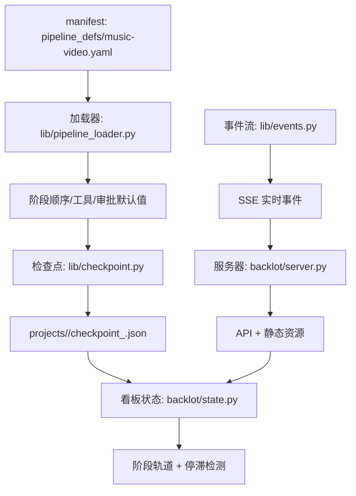
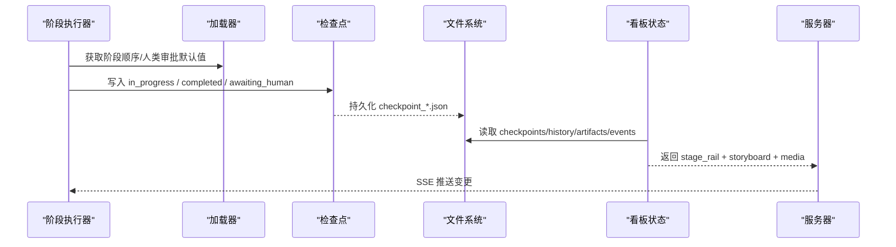
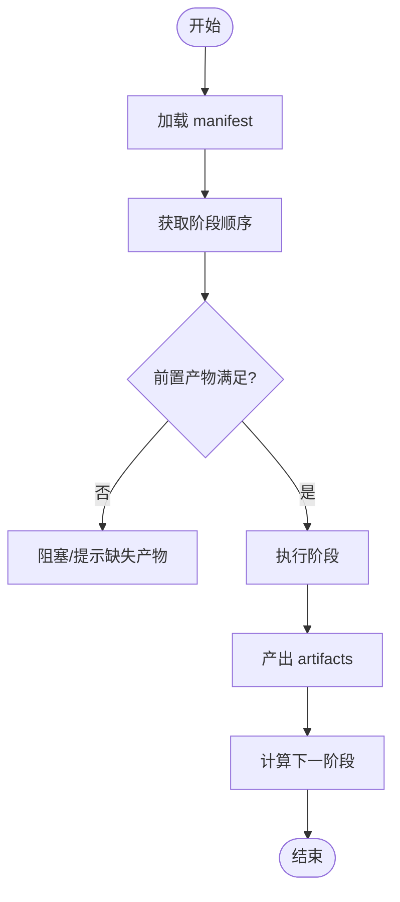
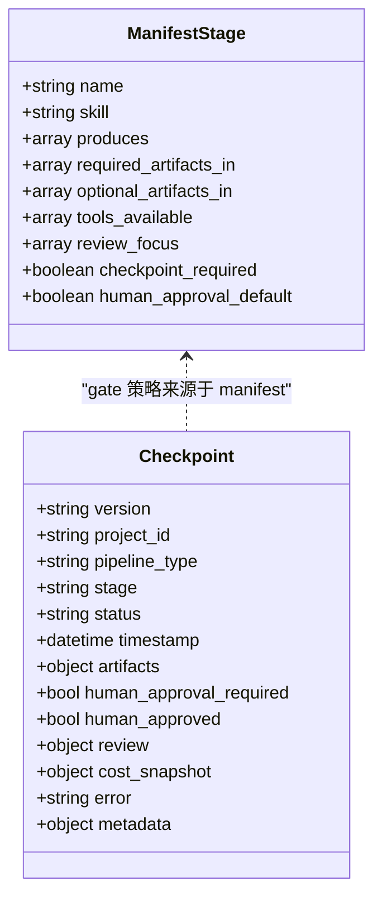
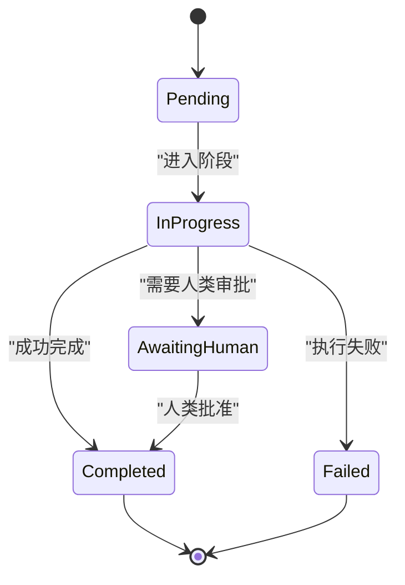
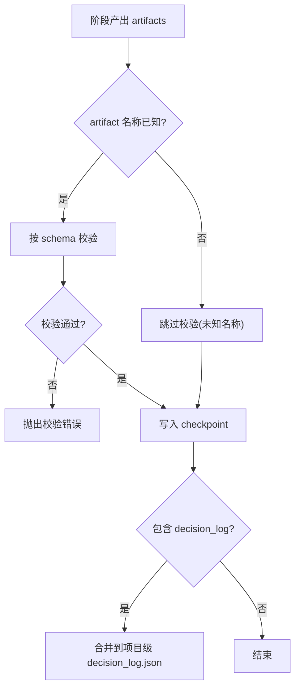
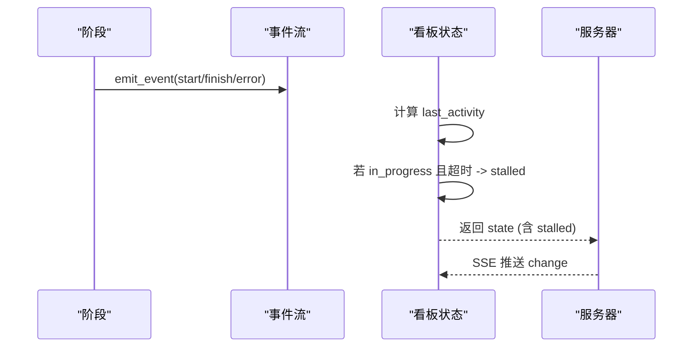
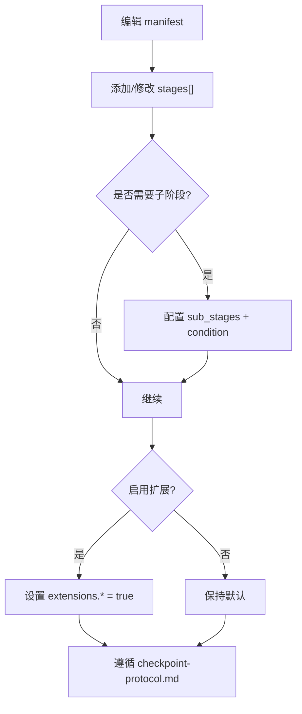
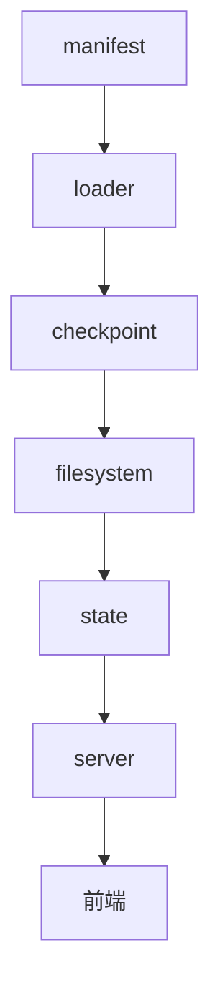

# 阶段轨道管理

<cite>
**本文引用的文件**   
- [music-video.yaml](file://pipeline_defs/music-video.yaml)
- [pipeline_manifest.schema.json](file://schemas/pipelines/pipeline_manifest.schema.json)
- [checkpoint.schema.json](file://schemas/checkpoints/checkpoint.schema.json)
- [pipeline_loader.py](file://lib/pipeline_loader.py)
- [checkpoint.py](file://lib/checkpoint.py)
- [state.py](file://backlot/state.py)
- [events.py](file://lib/events.py)
- [server.py](file://backlot/server.py)
- [checkpoint-protocol.md](file://skills/meta/checkpoint-protocol.md)
</cite>

## 目录
1. [引言](#引言)
2. [项目结构](#项目结构)
3. [核心组件](#核心组件)
4. [架构总览](#架构总览)
5. [详细组件分析](#详细组件分析)
6. [依赖关系分析](#依赖关系分析)
7. [性能考虑](#性能考虑)
8. [故障排查指南](#故障排查指南)
9. [结论](#结论)
10. [附录](#附录)

## 引言
本文件面向“阶段轨道管理”的完整说明，覆盖流水线阶段的定义、排序与依赖、gated 阶段的审批流程与 human_approved 机制、阶段状态转换规则（pending、in_progress、completed、awaiting_human）、阶段产物的声明与验证、执行进度监控与停滞检测，以及阶段自定义与扩展的开发指南。文档以 music-video 流水线为实例，结合 schema、加载器、检查点与看板状态推导等实现进行系统化阐述。

## 项目结构
- 流水线定义：pipeline_defs/music-video.yaml 描述阶段顺序、产物、工具、审查要点与人类审批默认策略。
- 规范约束：schemas/pipelines/pipeline_manifest.schema.json 约束 manifest 的结构；schemas/checkpoints/checkpoint.schema.json 约束 checkpoint 的状态与字段。
- 加载与查询：lib/pipeline_loader.py 负责读取、校验、缓存 manifest，并提供阶段顺序、工具集合、人类审批默认值等查询能力。
- 检查点与编排：lib/checkpoint.py 提供写入/读取检查点、归档历史、门控校验、决策日志合并、下一阶段计算等。
- 看板状态与监控：backlot/state.py 从文件系统推导 BoardState，构建阶段轨道、故事板、媒体扫描、停滞检测等；lib/events.py 提供事件流；backlot/server.py 暴露 API 与 SSE 推送。

**图表来源** 
- [music-video.yaml:36-187](file://pipeline_defs/music-video.yaml#L36-L187)
- [pipeline_loader.py:125-182](file://lib/pipeline_loader.py#L125-L182)
- [checkpoint.py:336-467](file://lib/checkpoint.py#L336-L467)
- [state.py:586-656](file://backlot/state.py#L586-L656)
- [events.py:77-118](file://lib/events.py#L77-L118)
- [server.py:151-242](file://backlot/server.py#L151-L242)

**章节来源**
- [music-video.yaml:36-187](file://pipeline_defs/music-video.yaml#L36-L187)
- [pipeline_manifest.schema.json:41-118](file://schemas/pipelines/pipeline_manifest.schema.json#L41-L118)
- [checkpoint.schema.json:1-47](file://schemas/checkpoints/checkpoint.schema.json#L1-L47)

## 核心组件
- 流水线清单（Manifest）：声明阶段名、skill、产物、工具、审查焦点、人类审批默认策略、子阶段等。
- 检查点（Checkpoint）：每个阶段完成后持久化的可恢复快照，包含状态、时间戳、产物、成本快照、错误、元数据等。
- 加载器（Loader）：读取并校验 manifest，提供阶段顺序、工具集、人类审批默认值、扩展权限等查询。
- 看板状态（BoardState）：基于文件系统（checkpoints、history、artifacts、events）推导 UI 所需的全量状态，含阶段轨道、故事板、媒体、停滞标记等。
- 事件流（Events）：追加式事件日志，驱动看板实时性与场景级生成状态。
- 服务器（Server）：FastAPI 应用，提供项目列表、状态、事件流、媒体与缩略图等服务。

**章节来源**
- [pipeline_loader.py:39-76](file://lib/pipeline_loader.py#L39-L76)
- [checkpoint.py:336-467](file://lib/checkpoint.py#L336-L467)
- [state.py:586-656](file://backlot/state.py#L586-L656)
- [events.py:77-118](file://lib/events.py#L77-L118)
- [server.py:151-242](file://backlot/server.py#L151-L242)

## 架构总览
阶段轨道管理的整体流程如下：
- Manifest 定义阶段顺序与 gate 策略。
- 运行期通过 loader 获取阶段顺序与 gate 默认值。
- 各阶段执行时按协议写入检查点，必要时进入 awaiting_human 等待人类审批。
- Backlot 看板持续读取文件系统，推导阶段轨道、故事板、媒体与停滞检测。
- Server 通过 SSE 将变更推送到前端，实现实时刷新。

**图表来源**
- [pipeline_loader.py:125-182](file://lib/pipeline_loader.py#L125-L182)
- [checkpoint.py:336-467](file://lib/checkpoint.py#L336-L467)
- [state.py:586-656](file://backlot/state.py#L586-L656)
- [server.py:185-242](file://backlot/server.py#L185-L242)

## 详细组件分析

### 阶段定义、排序与依赖
- 阶段定义：在 manifest 中通过 stages[] 声明 name、skill、produces、required_artifacts_in、optional_artifacts_in、tools_available、review_focus、success_criteria、human_approval_default、sub_stages 等。
- 阶段排序：loader.get_stage_order(manifest, include_sub_stages=False) 返回主阶段顺序；include_sub_stages=True 时展开子阶段为 stage.sub_stage。
- 依赖关系：required_artifacts_in 表示前置产物必须存在；optional_artifacts_in 可选；produces 声明该阶段产出；get_required_tools 汇总可用工具。

**图表来源**
- [music-video.yaml:36-187](file://pipeline_defs/music-video.yaml#L36-L187)
- [pipeline_loader.py:125-162](file://lib/pipeline_loader.py#L125-L162)

**章节来源**
- [pipeline_manifest.schema.json:41-118](file://schemas/pipelines/pipeline_manifest.schema.json#L41-L118)
- [pipeline_loader.py:125-162](file://lib/pipeline_loader.py#L125-L162)

### gated 阶段与 human_approved 机制
- Gate 来源：manifest 中 human_approval_default 决定某阶段是否 gate；checkpoint 写入时若 gated，则禁止直接写 completed，必须写 awaiting_human 并在用户批准后重写 completed 且 human_approved=True。
- 门控校验：write_checkpoint 内部 _stage_requires_approval 读取 manifest 或回退到调用方标志；违规会抛出明确的门控错误。
- 看板审计：board 状态推导中对 gated 且 completed 的阶段，若历史未出现 awaiting_human 且 human_approved 为假，则标记 gate_skipped。

**图表来源**
- [checkpoint.schema.json:1-47](file://schemas/checkpoints/checkpoint.schema.json#L1-L47)
- [pipeline_manifest.schema.json:41-118](file://schemas/pipelines/pipeline_manifest.schema.json#L41-L118)
- [checkpoint.py:378-405](file://lib/checkpoint.py#L378-L405)
- [state.py:174-184](file://backlot/state.py#L174-L184)

**章节来源**
- [checkpoint.py:378-405](file://lib/checkpoint.py#L378-L405)
- [state.py:174-184](file://backlot/state.py#L174-L184)
- [checkpoint-protocol.md:102-155](file://skills/meta/checkpoint-protocol.md#L102-L155)

### 阶段状态转换规则
- 允许状态：completed、failed、awaiting_human、in_progress。
- 典型转换：
  - pending → in_progress：进入阶段立即写入 in_progress 作为心跳与可见性。
  - in_progress → completed：阶段完成，写入最终产物并通过 schema 校验。
  - in_progress → awaiting_human：当 human_approval_default=true 时，先写 awaiting_human 等待人类批准。
  - awaiting_human → completed：人类批准后重写 completed 且 human_approved=True。
  - in_progress → failed：失败时记录错误信息。
- 看板推导：_build_stage_rail 根据最新 checkpoint 与 history_entries 确定当前状态，并对 gated 阶段做 gate_skipped 审计。

**图表来源**
- [checkpoint.schema.json:15-18](file://schemas/checkpoints/checkpoint.schema.json#L15-L18)
- [state.py:143-184](file://backlot/state.py#L143-L184)
- [checkpoint-protocol.md:74-100](file://skills/meta/checkpoint-protocol.md#L74-L100)

**章节来源**
- [checkpoint.schema.json:15-18](file://schemas/checkpoints/checkpoint.schema.json#L15-L18)
- [state.py:143-184](file://backlot/state.py#L143-L184)
- [checkpoint-protocol.md:74-100](file://skills/meta/checkpoint-protocol.md#L74-L100)

### 阶段产物声明与验证
- 产物声明：manifest 中 produces 列出该阶段产出的 artifact 名称；canonical 产物映射由 CANONICAL_STAGE_ARTIFACTS 维护。
- 产物验证：write_checkpoint 对已知 artifact 名称进行 schema 校验；in_progress 时可将部分数据放入 metadata.partial_progress 而非 artifacts。
- 决策日志合并：若 artifacts 中包含 decision_log，将被合并到项目级 decision_log.json，并在 proposal_packet/render_report 中写入引用。

**图表来源**
- [checkpoint.py:104-137](file://lib/checkpoint.py#L104-L137)
- [checkpoint.py:430-449](file://lib/checkpoint.py#L430-L449)

**章节来源**
- [checkpoint.py:104-137](file://lib/checkpoint.py#L104-L137)
- [checkpoint.py:430-449](file://lib/checkpoint.py#L430-L449)

### 执行进度监控与停滞检测
- 心跳与活动：进入阶段写 in_progress；长耗时阶段每完成一个子任务刷新 metadata.partial_progress。
- 事件流：BaseTool 层写入 events.jsonl，Backlot 读取用于场景级生成状态与实时性。
- 停滞检测：load_board_state 计算 last_activity，若某阶段处于 in_progress 且超过 STALL_WINDOW_SECONDS 无活动，则标记 stalled 与 stalled_minutes。

**图表来源**
- [events.py:77-118](file://lib/events.py#L77-L118)
- [state.py:624-636](file://backlot/state.py#L624-L636)
- [server.py:185-242](file://backlot/server.py#L185-L242)

**章节来源**
- [events.py:77-118](file://lib/events.py#L77-L118)
- [state.py:624-636](file://backlot/state.py#L624-L636)
- [checkpoint-protocol.md:74-100](file://skills/meta/checkpoint-protocol.md#L74-L100)

### 阶段自定义与扩展开发指南
- 新增阶段：在 manifest 的 stages[] 中添加 name、skill、produces、required_artifacts_in、tools_available、review_focus、success_criteria、human_approval_default 等。
- 子阶段：使用 sub_stages 声明条件触发的子步骤，loader.get_stage_sub_stages 支持按 context 过滤激活状态。
- 工具扩展：manifest.extensions 控制 custom_scripts/custom_playbooks/custom_skills/custom_tools 的启用；loader.check_extension_permitted 强制权限。
- 审查与协议：遵循 skills/meta/checkpoint-protocol.md 的检查点协议与 reviewer 流程。

**图表来源**
- [pipeline_manifest.schema.json:99-118](file://schemas/pipelines/pipeline_manifest.schema.json#L99-L118)
- [pipeline_loader.py:201-241](file://lib/pipeline_loader.py#L201-L241)
- [checkpoint-protocol.md:1-201](file://skills/meta/checkpoint-protocol.md#L1-L201)

**章节来源**
- [pipeline_manifest.schema.json:99-118](file://schemas/pipelines/pipeline_manifest.schema.json#L99-L118)
- [pipeline_loader.py:201-241](file://lib/pipeline_loader.py#L201-L241)
- [checkpoint-protocol.md:1-201](file://skills/meta/checkpoint-protocol.md#L1-L201)

## 依赖关系分析
- 阶段顺序与 gate 策略来源于 manifest，由 loader 提供；checkpoint 写入时依据 manifest 或调用方标志进行门控校验。
- 看板状态依赖文件系统（checkpoints、history、artifacts、events），不直接依赖运行时对象。
- 服务器通过 watchfiles 监听 projects/ 变更，触发 SSE 推送，前端按需拉取状态。

**图表来源**
- [pipeline_loader.py:125-182](file://lib/pipeline_loader.py#L125-L182)
- [checkpoint.py:336-467](file://lib/checkpoint.py#L336-L467)
- [state.py:586-656](file://backlot/state.py#L586-L656)
- [server.py:132-149](file://backlot/server.py#L132-L149)

**章节来源**
- [pipeline_loader.py:125-182](file://lib/pipeline_loader.py#L125-L182)
- [checkpoint.py:336-467](file://lib/checkpoint.py#L336-L467)
- [state.py:586-656](file://backlot/state.py#L586-L656)
- [server.py:132-149](file://backlot/server.py#L132-L149)

## 性能考虑
- Manifest 加载缓存：load_pipeline_readonly 使用 lru_cache，避免重复解析与校验。
- 看板状态推导：只读且防御性处理异常，确保 UI 不崩溃；summary 接口缓存并按变更失效。
- 事件写入：线程锁保证单进程并发安全；跨进程写入采用 O_APPEND，容忍损坏行。
- 停滞检测：基于最后活动时间窗口，避免频繁 IO。

[本节为通用指导，无需具体文件分析]

## 故障排查指南
- 门控违规：write_checkpoint 抛出门控错误，需确认 human_approval_default 与 human_approved 的使用是否符合协议。
- 产物校验失败：检查 artifacts 是否符合对应 schema；in_progress 时使用 metadata.partial_progress。
- 停滞检测：确认阶段是否持续写入 in_progress 与 partial_progress；检查 events.jsonl 是否存在。
- 看板不可用：检查 project.json、checkpoint_*.json、artifacts/*.json 是否存在且可读。

**章节来源**
- [checkpoint.py:378-405](file://lib/checkpoint.py#L378-L405)
- [checkpoint.py:104-137](file://lib/checkpoint.py#L104-L137)
- [events.py:77-118](file://lib/events.py#L77-L118)
- [state.py:586-656](file://backlot/state.py#L586-L656)

## 结论
阶段轨道管理以 manifest 为中心，结合检查点协议与看板状态推导，实现了可恢复、可审计、可扩展的流水线编排。Gate 机制确保关键节点的人类审批；事件与停滞检测提升可观测性与可靠性；扩展能力通过 manifest.extensions 与 sub_stages 灵活定制。遵循本文档的实践，可在 OpenMontage-MV 中高效构建与维护复杂的生产流水线。

## 附录
- 参考协议：skills/meta/checkpoint-protocol.md 提供了完整的检查点与人类审批协议。
- 示例流水线：pipeline_defs/music-video.yaml 展示了多阶段、产物、工具与审查焦点的配置方式。

[本节为补充说明，无需具体文件分析]