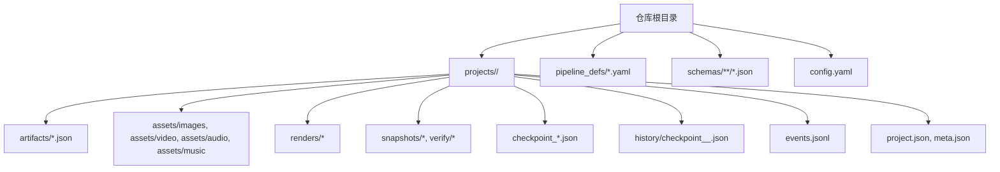
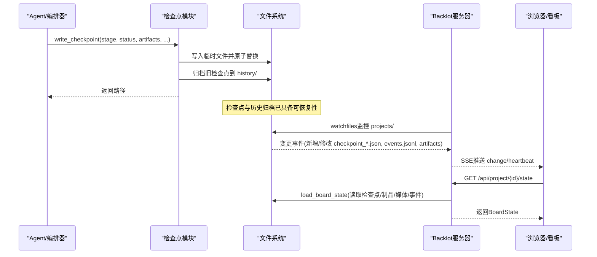
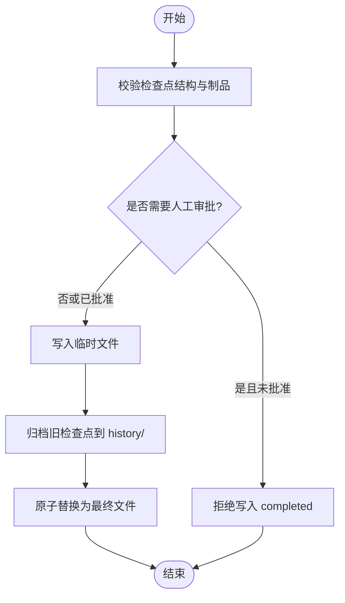
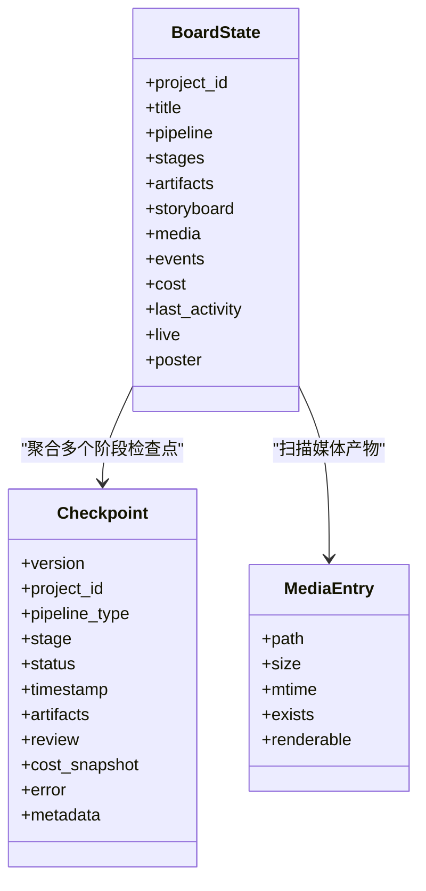
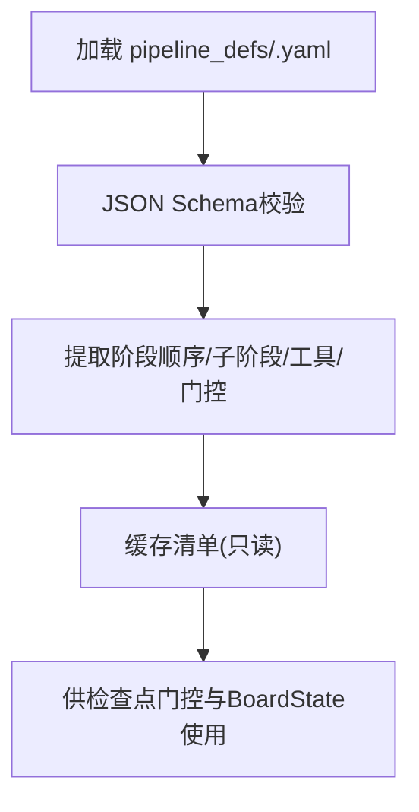
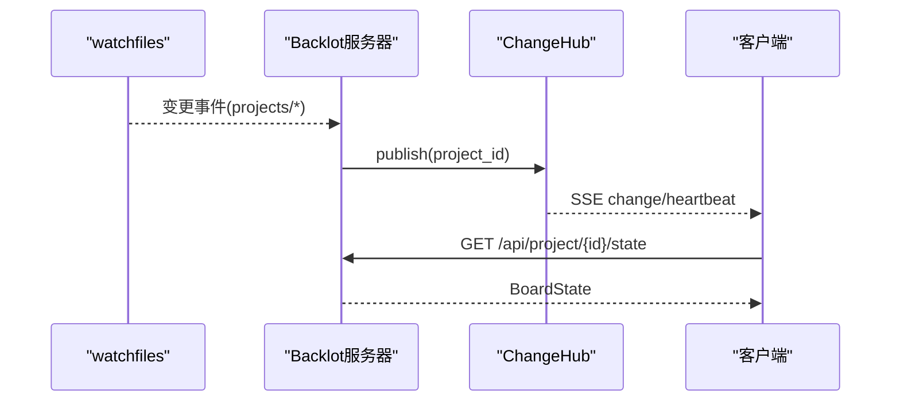
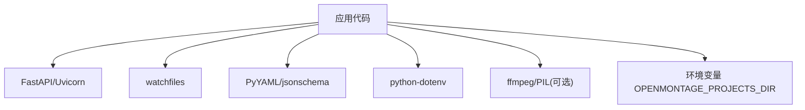

# 备份与恢复

<cite>
**本文引用的文件**   
- [backlot/state.py](file://backlot/state.py)
- [lib/checkpoint.py](file://lib/checkpoint.py)
- [schemas/checkpoints/checkpoint.schema.json](file://schemas/checkpoints/checkpoint.schema.json)
- [lib/pipeline_loader.py](file://lib/pipeline_loader.py)
- [pipeline_defs/music-video.yaml](file://pipeline_defs/music-video.yaml)
- [config.yaml](file://config.yaml)
- [lib/paths.py](file://lib/paths.py)
- [backlot/server.py](file://backlot/server.py)
- [requirements.txt](file://requirements.txt)
</cite>

## 目录
1. [简介](#简介)
2. [项目结构](#项目结构)
3. [核心组件](#核心组件)
4. [架构总览](#架构总览)
5. [详细组件分析](#详细组件分析)
6. [依赖关系分析](#依赖关系分析)
7. [性能考虑](#性能考虑)
8. [故障排查指南](#故障排查指南)
9. [结论](#结论)
10. [附录](#附录)

## 简介
本文件面向OpenMontage-MV项目的数据备份与恢复策略，覆盖以下关键主题：
- 项目状态数据的备份方案：BoardState持久化、检查点（checkpoint）与历史归档。
- 媒体文件与资产库的备份策略：渲染产物、素材、音乐、快照等。
- 流水线定义与配置文件的版本管理：YAML清单与Schema校验。
- 数据恢复流程与灾难恢复计划：从检查点恢复、回滚到历史版本、跨环境迁移。
- 增量备份与全量备份策略：基于文件系统变更与时间戳的差异化策略。
- 自动化备份脚本与定时任务：结合watchfiles与系统调度器实现。
- 数据迁移与版本升级：项目标记与Schema演进兼容。
- 存储优化与归档策略：缩略图缓存、历史归档、冷热分层。

## 项目结构
本项目将“项目工作区”集中存放在单一根目录下，所有检查点、制品、事件与媒体均位于该根目录内，便于统一备份与恢复。核心路径由环境变量或默认值决定，确保在测试、预发与生产环境中一致。

图表来源
- [lib/paths.py:1-18](file://lib/paths.py#L1-L18)
- [lib/checkpoint.py:178-227](file://lib/checkpoint.py#L178-L227)
- [backlot/state.py:244-264](file://backlot/state.py#L244-L264)
- [backlot/state.py:500-532](file://backlot/state.py#L500-L532)
- [config.yaml:1-20](file://config.yaml#L1-L20)

章节来源
- [lib/paths.py:1-18](file://lib/paths.py#L1-L18)
- [config.yaml:1-20](file://config.yaml#L1-L20)

## 核心组件
- 检查点写入与验证：每个阶段完成后生成检查点，包含状态、时间戳、制品引用与可选成本快照；写入前进行Schema与制品校验，并自动归档旧版本。
- BoardState聚合：读取检查点、制品、事件与媒体，构建可展示的项目状态，用于看板与UI。
- 流水线清单加载：解析YAML清单，提供阶段顺序、人工审批门控、工具能力等元信息。
- 服务器与实时观察：监听项目目录变更，通过SSE推送变化，避免重复计算。

章节来源
- [lib/checkpoint.py:336-467](file://lib/checkpoint.py#L336-L467)
- [backlot/state.py:586-656](file://backlot/state.py#L586-L656)
- [lib/pipeline_loader.py:49-70](file://lib/pipeline_loader.py#L49-L70)
- [backlot/server.py:132-149](file://backlot/server.py#L132-L149)

## 架构总览
下图展示了备份与恢复相关的关键交互：写入检查点时自动归档历史；BoardState聚合多源数据；服务器监听变更并通知前端；清单与Schema保障一致性。

图表来源
- [lib/checkpoint.py:336-467](file://lib/checkpoint.py#L336-L467)
- [backlot/server.py:132-149](file://backlot/server.py#L132-L149)
- [backlot/state.py:586-656](file://backlot/state.py#L586-L656)

## 详细组件分析

### 检查点与历史归档（Checkpoint & History）
- 写入流程：先写临时文件，再原子替换，保证中断不产生残缺检查点。
- 历史归档：当现有检查点非“进行中”状态时，复制到 history/ 并按时间戳命名，保留完整审计轨迹。
- 校验机制：按Schema校验检查点结构，并对制品名称与内容进行约束；对需要人工审批的阶段强制门控。
- 恢复能力：任一阶段的最新检查点可用于恢复；历史归档支持回滚到任意版本。

图表来源
- [lib/checkpoint.py:140-172](file://lib/checkpoint.py#L140-L172)
- [lib/checkpoint.py:263-301](file://lib/checkpoint.py#L263-L301)
- [lib/checkpoint.py:336-467](file://lib/checkpoint.py#L336-L467)
- [schemas/checkpoints/checkpoint.schema.json:1-47](file://schemas/checkpoints/checkpoint.schema.json#L1-L47)

章节来源
- [lib/checkpoint.py:336-467](file://lib/checkpoint.py#L336-L467)
- [schemas/checkpoints/checkpoint.schema.json:1-47](file://schemas/checkpoints/checkpoint.schema.json#L1-L47)

### BoardState聚合与媒体发现
- 聚合内容：项目标记、管线元信息、各阶段检查点与历史、制品、事件流、媒体扫描结果、成本快照、最后活动时间与“是否活跃”。
- 媒体扫描：扫描 renders、snapshots、verify、assets/music 等目录，识别图像/视频/音频类型，并生成相对路径供服务端安全访问。
- 海报选择：优先使用可渲染图像，其次快照，最后取最新渲染帧作为封面。

图表来源
- [backlot/state.py:586-656](file://backlot/state.py#L586-L656)
- [backlot/state.py:500-532](file://backlot/state.py#L500-L532)
- [backlot/state.py:535-560](file://backlot/state.py#L535-L560)

章节来源
- [backlot/state.py:586-656](file://backlot/state.py#L586-L656)
- [backlot/state.py:500-532](file://backlot/state.py#L500-L532)

### 流水线清单与配置版本管理
- 清单加载：从 pipeline_defs/*.yaml 加载并校验Schema，提供阶段顺序、子阶段、工具能力、人工审批默认策略等。
- 配置项：config.yaml 定义输出格式、编码、分辨率、FPS、CRF以及路径（pipeline_dir、library_dir、styles_dir、skills_dir、output_dir）。
- 兼容性：get_pipeline_stages在无清单或失败时回退到稳定列表，确保向后兼容。

图表来源
- [lib/pipeline_loader.py:49-70](file://lib/pipeline_loader.py#L49-L70)
- [lib/pipeline_loader.py:125-149](file://lib/pipeline_loader.py#L125-L149)
- [config.yaml:1-20](file://config.yaml#L1-L20)

章节来源
- [lib/pipeline_loader.py:49-70](file://lib/pipeline_loader.py#L49-L70)
- [config.yaml:1-20](file://config.yaml#L1-L20)

### 服务器与实时观察（SSE）
- 文件监听：使用watchfiles递归监听 projects/，过滤无关目录，批量去抖后发布变更。
- SSE推送：为订阅者提供心跳与变更事件，前端据此刷新状态。
- 安全限制：媒体与缩略图接口仅允许访问项目目录内的文件，防止越权。

图表来源
- [backlot/server.py:132-149](file://backlot/server.py#L132-L149)
- [backlot/server.py:185-242](file://backlot/server.py#L185-L242)
- [backlot/server.py:329-361](file://backlot/server.py#L329-L361)

章节来源
- [backlot/server.py:132-149](file://backlot/server.py#L132-L149)
- [backlot/server.py:185-242](file://backlot/server.py#L185-L242)

## 依赖关系分析
- 运行时依赖：FastAPI、Uvicorn、watchfiles用于Web服务与文件监听；PyYAML、jsonschema用于清单与Schema校验；dotenv用于环境变量加载。
- 路径与环境：PROJECTS_DIR可由环境变量覆盖，确保跨环境一致性。
- 外部工具：缩略图生成依赖ffmpeg；图像处理依赖PIL。

图表来源
- [requirements.txt:1-12](file://requirements.txt#L1-L12)
- [lib/paths.py:1-18](file://lib/paths.py#L1-L18)
- [backlot/server.py:460-500](file://backlot/server.py#L460-L500)

章节来源
- [requirements.txt:1-12](file://requirements.txt#L1-L12)
- [lib/paths.py:1-18](file://lib/paths.py#L1-L18)

## 性能考虑
- 检查点写入采用临时文件+原子替换，避免并发与中断导致的损坏。
- BoardState聚合对大文件进行选择性解析，并使用最近活动检测减少不必要的重算。
- 服务器端对清单加载与摘要进行缓存，SSE合并突发变更，降低频繁刷新开销。
- 缩略图缓存基于SHA1键，避免重复处理相同资源。

[本节为通用指导，无需特定文件来源]

## 故障排查指南
- 检查点校验失败：确认阶段名与状态合法，制品名称与内容符合Schema；若需人工审批，确保human_approved=True后再写completed。
- 历史归档失败：可能因文件被占用（Windows），但写入不会崩溃；查看日志警告。
- 媒体不可见：确认路径在项目目录内，扩展名属于支持的媒体类型；缩略图生成失败会返回404。
- SSE无更新：检查watchfiles是否可用，确认监听目录正确；必要时手动刷新。

章节来源
- [lib/checkpoint.py:140-172](file://lib/checkpoint.py#L140-L172)
- [lib/checkpoint.py:263-301](file://lib/checkpoint.py#L263-L301)
- [backlot/server.py:329-361](file://backlot/server.py#L329-L361)
- [backlot/server.py:132-149](file://backlot/server.py#L132-L149)

## 结论
本项目通过检查点与历史归档实现了稳健的状态持久化与可恢复性；BoardState聚合与SSE实时更新提供了良好的用户体验；清单与Schema保障了流水线的一致性与可扩展性。建议在此基础上完善自动化备份与灾难恢复流程，以满足生产环境的可靠性要求。

[本节为总结，无需特定文件来源]

## 附录

### 备份与恢复策略（基于现有机制的建议）
- 全量备份
  - 目标：整个 PROJECTS_DIR（含检查点、制品、媒体、事件、历史归档）与 pipeline_defs、schemas、config.yaml。
  - 频率：每日或每次重要里程碑后。
  - 方法：压缩打包并上传至对象存储或异地磁盘。
- 增量备份
  - 目标：自上次备份以来变更的文件（基于mtime或watchfiles事件）。
  - 频率：每小时或更短周期。
  - 方法：记录变更清单，仅同步差异文件。
- 恢复流程
  - 步骤：停止写入 -> 还原全量包 -> 应用增量补丁 -> 校验检查点与制品 -> 启动服务 -> 验证BoardState与媒体。
  - 回滚：根据 history/ 中的归档文件名定位目标版本，替换当前检查点。
- 灾难恢复计划
  - RPO/RTO：依据业务需求设定；建议RPO≤1小时，RTO≤2小时。
  - 演练：定期执行恢复演练，验证完整性与可用性。
- 自动化脚本与定时任务
  - 脚本：封装全量/增量备份、校验、清理过期归档。
  - 调度：使用系统cron或任务管理器周期性执行；失败告警与重试。
- 数据迁移与版本升级
  - 迁移：保持 project.json version 与Schema兼容；必要时提供迁移脚本转换旧制品。
  - 升级：先备份 -> 升级清单与Schema -> 运行校验 -> 逐步切换流量。
- 存储优化与归档
  - 缩略图缓存：定期清理 .backlot/thumbs 中过期文件。
  - 历史归档：按阶段与时间戳命名，保留审计轨迹；冷数据归档至低成本存储。
  - 媒体分层：热数据（近期渲染）本地存储，冷数据（历史成品）对象存储。

[本节为通用指导，无需特定文件来源]