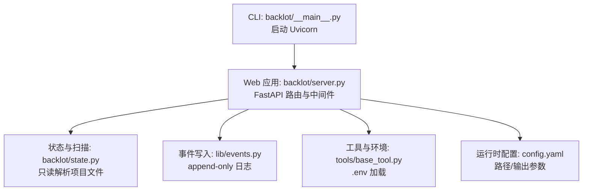
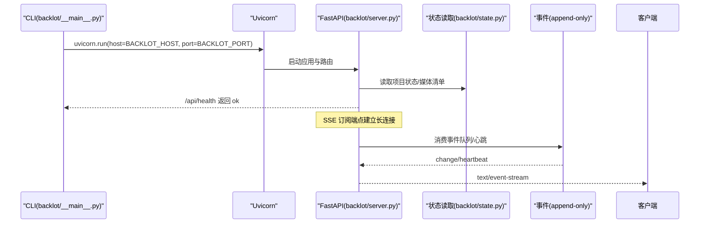
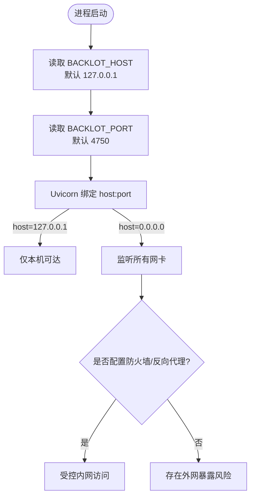
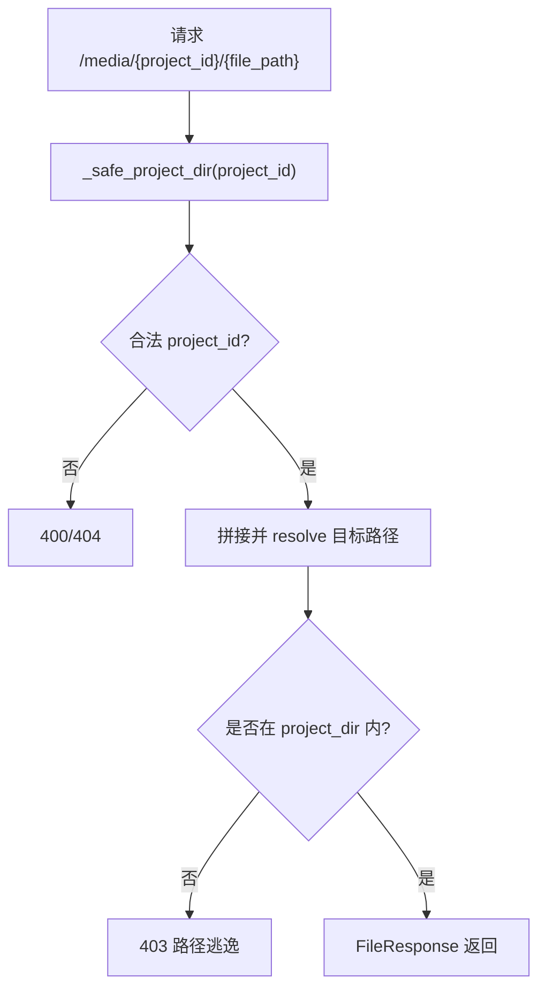
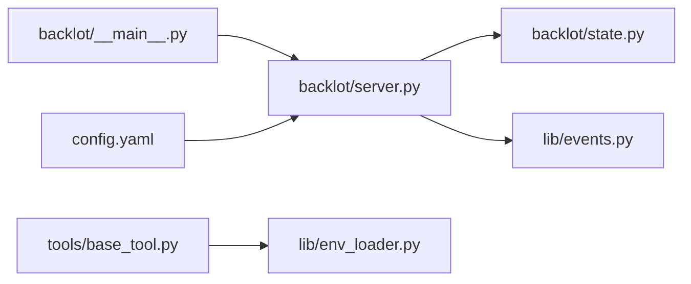

# 安全配置

<cite>
**本文引用的文件**   
- [backlot/__main__.py](file://backlot/__main__.py)
- [backlot/server.py](file://backlot/server.py)
- [lib/env_loader.py](file://lib/env_loader.py)
- [tools/base_tool.py](file://tools/base_tool.py)
- [config.yaml](file://config.yaml)
- [backlot/state.py](file://backlot/state.py)
</cite>

## 目录
1. [简介](#简介)
2. [项目结构](#项目结构)
3. [核心组件](#核心组件)
4. [架构总览](#架构总览)
5. [详细组件分析](#详细组件分析)
6. [依赖关系分析](#依赖关系分析)
7. [性能考虑](#性能考虑)
8. [故障排查指南](#故障排查指南)
9. [结论](#结论)
10. [附录](#附录)

## 简介
本文件面向 OpenMontage-MV 的 Backlot Web 服务，聚焦“安全配置”主题，覆盖网络访问控制、API 访问控制与认证现状、CORS 与跨域策略、HTTPS/SSL 部署建议、敏感数据保护与配置文件加密、防火墙与安全组建议、审计与日志记录，以及常见威胁防护与最佳实践。内容基于仓库中实际代码与配置进行说明，并给出可操作的落地建议。

## 项目结构
Backlot 是一个基于 FastAPI + Uvicorn 的本地开发/内网预览服务，默认仅绑定回环地址，避免意外暴露到外部网络；通过环境变量 BACKLOT_HOST 可切换为 LAN 监听（如 0.0.0.0）。服务提供项目状态 API、SSE 事件流、媒体与缩略图静态资源、以及 Studio 聊天会话等能力。



**图示来源** 
- [backlot/__main__.py:110-117](file://backlot/__main__.py#L110-L117)
- [backlot/server.py:151-152](file://backlot/server.py#L151-L152)
- [backlot/state.py:1-10](file://backlot/state.py#L1-L10)
- [tools/base_tool.py:25-60](file://tools/base_tool.py#L25-L60)
- [config.yaml:1-20](file://config.yaml#L1-L20)

**章节来源**
- [backlot/__main__.py:110-117](file://backlot/__main__.py#L110-L117)
- [backlot/server.py:151-152](file://backlot/server.py#L151-L152)

## 核心组件
- 网络绑定与监听
  - 默认绑定 127.0.0.1，防止笔记本开发服务器被无意暴露。
  - 通过 BACKLOT_HOST=0.0.0.0 启用局域网访问（仅限可信内网）。
- API 路由与访问控制
  - 健康检查 /api/health 用于存活探测。
  - 项目状态、SSE 事件、媒体与缩略图接口均对 project_id 做路径校验，防止越权访问其他项目或跳出项目目录。
- 会话与聊天
  - 会话创建支持 permission_mode（auto/confirm），但当前未实现身份认证与会话鉴权。
- 事件与日志
  - events.jsonl 追加式写入，便于观察活动轨迹。
  - CLI 将 Uvicorn 子进程日志写入 .studio/server.log，并做大小轮转。

**章节来源**
- [backlot/__main__.py:110-117](file://backlot/__main__.py#L110-L117)
- [backlot/server.py:166-168](file://backlot/server.py#L166-L168)
- [backlot/server.py:329-347](file://backlot/server.py#L329-L347)
- [backlot/server.py:252-300](file://backlot/server.py#L252-L300)
- [backlot/__main__.py:24-51](file://backlot/__main__.py#L24-L51)

## 架构总览
下图展示请求从 CLI 启动到 FastAPI 处理的关键路径，以及 SSE 事件推送流程。



**图示来源** 
- [backlot/__main__.py:110-117](file://backlot/__main__.py#L110-L117)
- [backlot/server.py:151-152](file://backlot/server.py#L151-L152)
- [backlot/server.py:185-214](file://backlot/server.py#L185-L214)
- [backlot/state.py:586-656](file://backlot/state.py#L586-L656)

## 详细组件分析

### 网络访问控制（默认 localhost 与 LAN 访问）
- 默认行为：Uvicorn 以 127.0.0.1 启动，仅本机可达。
- LAN 访问：设置 BACKLOT_HOST=0.0.0.0 后，服务将在所有网卡监听，需配合防火墙/反向代理限制来源。
- 端口：BACKLOT_PORT 控制端口，默认 4750。



**图示来源** 
- [backlot/__main__.py:110-117](file://backlot/__main__.py#L110-L117)
- [backlot/__init__.py:14-17](file://backlot/__init__.py#L14-L17)

**章节来源**
- [backlot/__main__.py:110-117](file://backlot/__main__.py#L110-L117)
- [backlot/__init__.py:14-17](file://backlot/__init__.py#L14-L17)

### API 访问控制与认证机制
- 现状：
  - 无全局认证中间件，无 JWT/Session 鉴权。
  - 会话管理（chat/sessions）支持 permission_mode，但未与身份绑定。
  - 项目级访问通过 project_id 路径参数与 _safe_project_dir 校验，确保只能访问自身项目目录。
- 建议：
  - 引入统一鉴权中间件（如基于 Token/JWT），在网关层或反向代理侧完成。
  - 对写操作（如消息发送、审批）增加权限校验与速率限制。
  - 对 SSE 长连接增加连接数限制与超时回收。

```mermaid
classDiagram
class Server {
+"/api/health"
+"/api/projects"
+"/api/project/{id}/state"
+"/api/chat/*"
+"/media/{id}/{path}"
+"/thumb/{id}/{path}"
}
class SafeProjectDir {
+"_safe_project_dir(project_id)"
+"校验非法字符/越界路径"
}
Server --> SafeProjectDir : "调用"
```

**图示来源** 
- [backlot/server.py:166-168](file://backlot/server.py#L166-L168)
- [backlot/server.py:174-177](file://backlot/server.py#L174-L177)
- [backlot/server.py:252-300](file://backlot/server.py#L252-L300)
- [backlot/server.py:329-347](file://backlot/server.py#L329-L347)
- [backlot/server.py:409-417](file://backlot/server.py#L409-L417)

**章节来源**
- [backlot/server.py:166-168](file://backlot/server.py#L166-L168)
- [backlot/server.py:252-300](file://backlot/server.py#L252-L300)
- [backlot/server.py:409-417](file://backlot/server.py#L409-L417)

### CORS 与跨域安全
- 现状：
  - 未在应用中显式配置 CORS 中间件。浏览器同源策略由服务端响应头决定。
  - UI 资源通过 /ui 静态挂载，SSE 使用 text/event-stream。
- 建议：
  - 若前端与后端分离部署，应在反向代理或应用层配置严格的 CORS（限定来源域名、方法、头部）。
  - 禁止 Access-Control-Allow-Origin: * 在生产环境使用。

[本节为概念性说明，不直接分析具体文件]

### HTTPS 与 SSL 证书管理
- 现状：
  - 服务通过 Uvicorn 启动，未内置 HTTPS 终止。
- 建议：
  - 在反向代理（Nginx/Traefik/Caddy）终止 TLS，并将 HTTP 强制重定向到 HTTPS。
  - 使用自动续期证书（Let’s Encrypt），最小化证书管理复杂度。
  - 禁用旧版协议与弱密码套件，启用 HSTS。

[本节为概念性说明，不直接分析具体文件]

### 敏感数据保护与配置文件加密
- 环境变量加载：
  - tools/base_tool.py 在导入时加载 .env，仅设置尚未存在的变量，适合注入 API Key 等敏感信息。
  - lib/env_loader.py 提供 .env 加载与 get_env/require_env 工具函数。
- 配置文件：
  - config.yaml 存储运行时参数（输出格式、路径等），不包含密钥。
- 建议：
  - 将 .env 加入 .gitignore，避免泄露。
  - 生产环境使用密钥管理服务（如 Vault、云 KMS）注入环境变量。
  - 对磁盘上的敏感文件（如会话 JSONL）限制文件系统权限。

**章节来源**
- [tools/base_tool.py:25-60](file://tools/base_tool.py#L25-L60)
- [lib/env_loader.py:15-35](file://lib/env_loader.py#L15-L35)
- [config.yaml:1-20](file://config.yaml#L1-L20)

### 路径与资源访问安全
- 项目路径校验：
  - _safe_project_dir 拒绝包含 / \ : 及 . .. 的非法 project_id，并校验目标路径在项目根目录下，防止目录穿越。
- 媒体与缩略图：
  - /media 与 /thumb 均先校验 project_id，再 resolve 目标路径并进行相对性检查，避免越权读取。
  - 视频缩略图失败时不会回退为原始视频字节，降低 F-03 风险。



**图示来源** 
- [backlot/server.py:409-417](file://backlot/server.py#L409-L417)
- [backlot/server.py:351-361](file://backlot/server.py#L351-L361)
- [backlot/server.py:329-347](file://backlot/server.py#L329-L347)

**章节来源**
- [backlot/server.py:409-417](file://backlot/server.py#L409-L417)
- [backlot/server.py:329-347](file://backlot/server.py#L329-L347)
- [backlot/server.py:351-361](file://backlot/server.py#L351-L361)

### 审计与访问日志记录
- 事件日志：
  - events.jsonl 作为 append-only 的事件源，供看板与 SSE 消费。
- 进程日志：
  - CLI 将 Uvicorn 子进程 stdout/stderr 写入 .studio/server.log，超过阈值后轮转备份。
- 建议：
  - 集中收集日志（如 ELK/Loki），对敏感字段脱敏。
  - 对 SSE 与媒体访问增加结构化访问日志（含 IP、User-Agent、耗时）。

**章节来源**
- [backlot/__main__.py:24-51](file://backlot/__main__.py#L24-L51)
- [lib/events.py:1-43](file://lib/events.py#L1-L43)

## 依赖关系分析
- 启动链路：CLI → Uvicorn → FastAPI → 路由/中间件 → 状态/事件模块。
- 关键耦合：
  - server.py 依赖 state.py 进行只读状态推导。
  - base_tool.py 负责 .env 加载，影响后续工具运行时的凭据可用性。
  - env_loader.py 提供通用环境变量读取能力。



**图示来源** 
- [backlot/__main__.py:110-117](file://backlot/__main__.py#L110-L117)
- [backlot/server.py:151-152](file://backlot/server.py#L151-L152)
- [backlot/state.py:1-10](file://backlot/state.py#L1-L10)
- [tools/base_tool.py:25-60](file://tools/base_tool.py#L25-L60)
- [lib/env_loader.py:15-35](file://lib/env_loader.py#L15-L35)
- [config.yaml:1-20](file://config.yaml#L1-L20)

**章节来源**
- [backlot/__main__.py:110-117](file://backlot/__main__.py#L110-L117)
- [backlot/server.py:151-152](file://backlot/server.py#L151-L152)

## 性能考虑
- SSE 心跳与去抖：SSE 心跳间隔与批量合并减少带宽占用。
- 缩略图缓存：按源文件 mtime/size/宽度生成哈希缓存，避免重复计算。
- 只读状态推导：state.py 采用防御性读取，异常降级不中断服务。

[本节为一般性讨论，不直接分析具体文件]

## 故障排查指南
- 无法访问服务
  - 确认 BACKLOT_HOST 与 BACKLOT_PORT 设置是否正确。
  - 若设置为 0.0.0.0，检查主机防火墙与安全组放行。
- 403/404 错误
  - 检查 project_id 是否包含非法字符或尝试目录穿越。
  - 确认媒体文件是否存在于项目目录内。
- 日志位置
  - 查看 .studio/server.log 获取 Uvicorn 启动与请求日志。
  - 关注 events.jsonl 中的事件序列，定位卡住或失败的步骤。

**章节来源**
- [backlot/__main__.py:24-51](file://backlot/__main__.py#L24-L51)
- [backlot/server.py:329-347](file://backlot/server.py#L329-L347)
- [backlot/server.py:409-417](file://backlot/server.py#L409-L417)

## 结论
当前 Backlot 服务在设计上遵循“默认仅本机可达”的安全基线，并通过严格的项目路径校验保障资源访问边界。生产环境中应补充统一的认证与授权、CORS 白名单、HTTPS 终止、集中日志与审计，并结合防火墙/安全组与反向代理加固边界。敏感数据通过 .env 注入，建议结合企业级密钥管理系统提升安全性。

[本节为总结性内容，不直接分析具体文件]

## 附录
- 环境变量参考
  - BACKLOT_HOST：监听地址，默认 127.0.0.1，设为 0.0.0.0 开启 LAN。
  - BACKLOT_PORT：服务端口，默认 4750。
- 配置文件
  - config.yaml：运行时路径与输出参数，不含密钥。
- 建议的反向代理要点
  - 强制 HTTPS、HSTS、限流、IP 白名单、访问日志采集。

[本节为概念性说明，不直接分析具体文件]