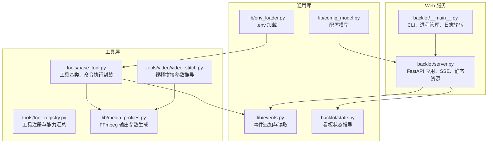
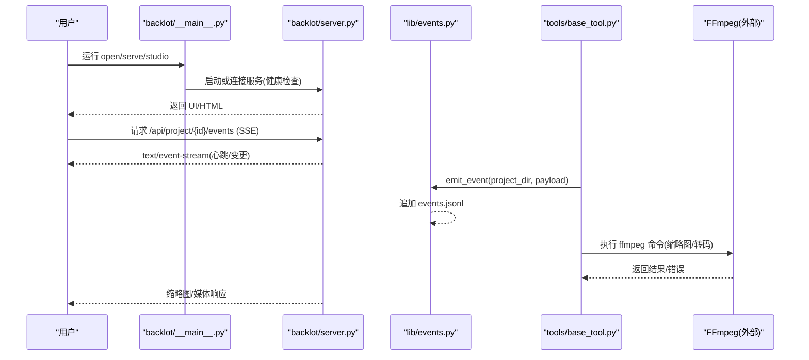
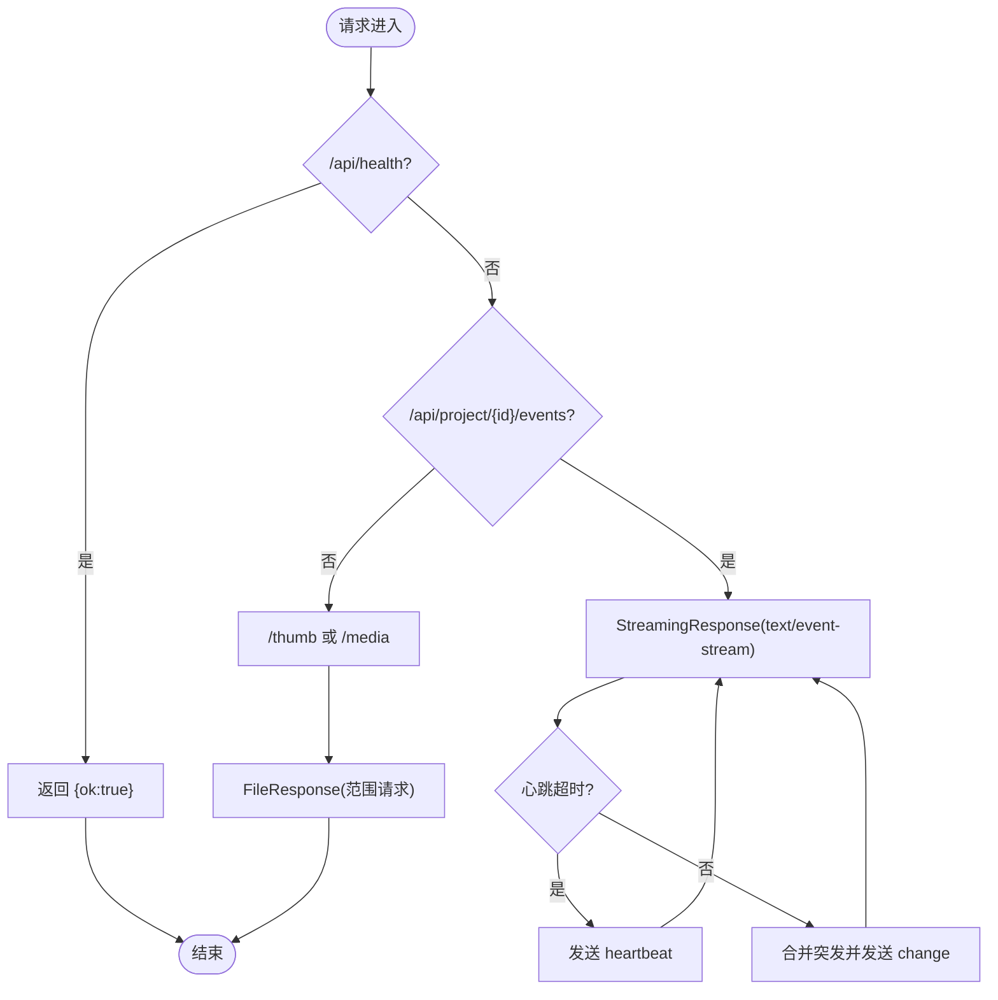
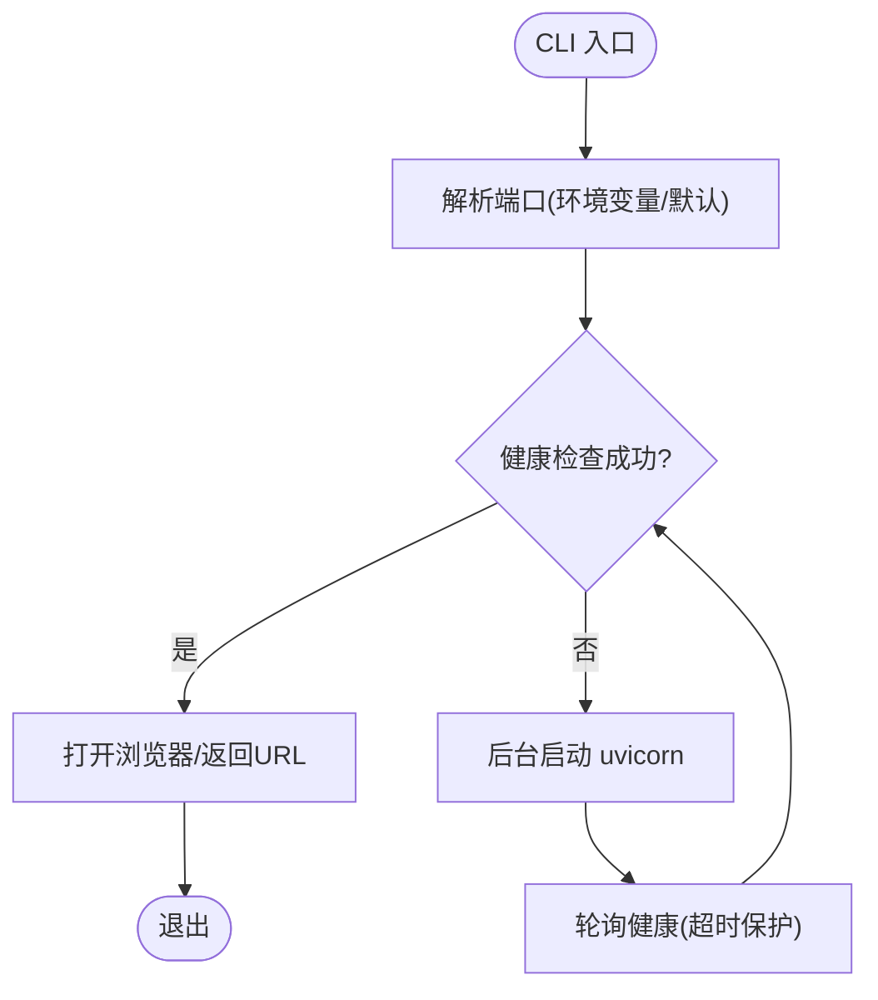
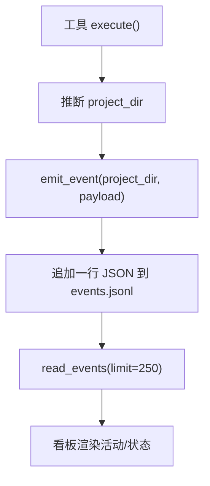
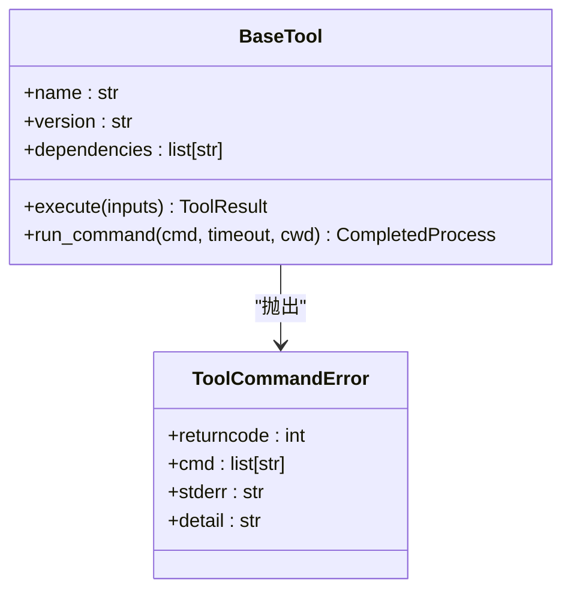
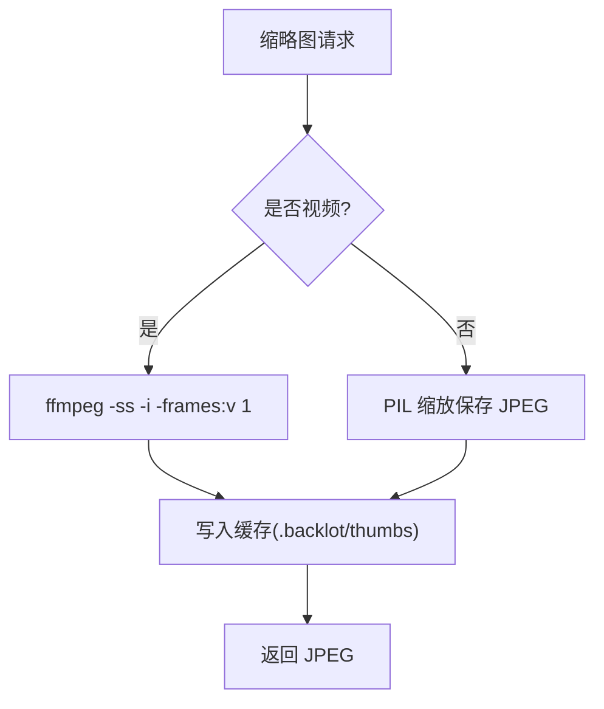
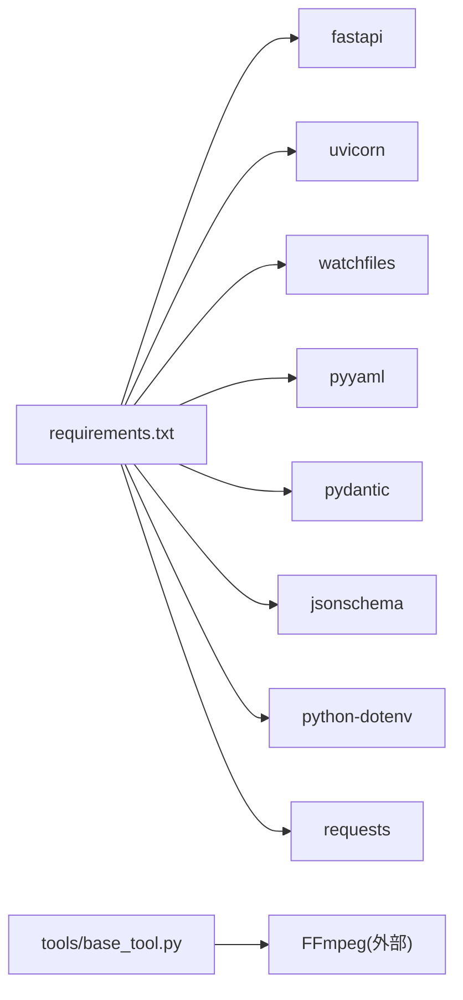

# 故障排除

<cite>
**本文引用的文件**
- [backlot/server.py](file://backlot/server.py)
- [backlot/__main__.py](file://backlot/__main__.py)
- [lib/config_model.py](file://lib/config_model.py)
- [lib/env_loader.py](file://lib/env_loader.py)
- [lib/events.py](file://lib/events.py)
- [backlot/state.py](file://backlot/state.py)
- [tools/base_tool.py](file://tools/base_tool.py)
- [tools/tool_registry.py](file://tools/tool_registry.py)
- [lib/media_profiles.py](file://lib/media_profiles.py)
- [tools/video/video_stitch.py](file://tools/video/video_stitch.py)
- [.agents/skills/ffmpeg/SKILL.md](file://.agents/skills/ffmpeg/SKILL.md)
- [.agents/skills/ffmpeg/reference.md](file://.agents/skills/ffmpeg/reference.md)
- [config.yaml](file://config.yaml)
- [requirements.txt](file://requirements.txt)
</cite>

## 目录
1. [简介](#简介)
2. [项目结构](#项目结构)
3. [核心组件](#核心组件)
4. [架构总览](#架构总览)
5. [详细组件分析](#详细组件分析)
6. [依赖分析](#依赖分析)
7. [性能考虑](#性能考虑)
8. [故障排除指南](#故障排除指南)
9. [结论](#结论)
10. [附录](#附录)

## 简介
本故障排除文档面向 OpenMontage-MV 的使用者与开发者，聚焦于常见问题定位与解决，包括：
- 服务器启动失败、端口冲突、权限问题
- 日志分析方法与问题定位技巧
- 性能瓶颈识别与优化建议
- 依赖包版本冲突与兼容性排查
- FFmpeg 集成与音视频处理错误排查
- 内存泄漏与资源耗尽诊断
- 网络通信与 SSE 连接异常处理
- 调试工具与开发模式使用指南

## 项目结构
本项目采用分层组织：
- backlot：Web 服务（FastAPI）、SSE 事件推送、UI 静态资源、后台进程管理
- lib：配置模型、环境变量加载、事件写入、媒体配置等通用库
- tools：工具基类、注册表、视频/音频处理工具
- schemas：JSON Schema 校验定义
- .agents/skills：FFmpeg 技能参考与示例
- config.yaml：运行时配置
- requirements.txt：Python 依赖

**图表来源**
- [backlot/server.py:151-406](file://backlot/server.py#L151-L406)
- [backlot/__main__.py:24-117](file://backlot/__main__.py#L24-L117)
- [lib/config_model.py:44-70](file://lib/config_model.py#L44-L70)
- [lib/env_loader.py:15-35](file://lib/env_loader.py#L15-L35)
- [lib/events.py:77-118](file://lib/events.py#L77-L118)
- [backlot/state.py:586-656](file://backlot/state.py#L586-L656)
- [tools/base_tool.py:411-454](file://tools/base_tool.py#L411-L454)
- [tools/tool_registry.py:453-492](file://tools/tool_registry.py#L453-L492)
- [tools/video/video_stitch.py:410-439](file://tools/video/video_stitch.py#L410-L439)
- [lib/media_profiles.py:155-165](file://lib/media_profiles.py#L155-L165)

**章节来源**
- [backlot/server.py:151-406](file://backlot/server.py#L151-L406)
- [backlot/__main__.py:24-117](file://backlot/__main__.py#L24-L117)
- [lib/config_model.py:44-70](file://lib/config_model.py#L44-L70)
- [lib/env_loader.py:15-35](file://lib/env_loader.py#L15-L35)
- [lib/events.py:77-118](file://lib/events.py#L77-L118)
- [backlot/state.py:586-656](file://backlot/state.py#L586-L656)
- [tools/base_tool.py:411-454](file://tools/base_tool.py#L411-L454)
- [tools/tool_registry.py:453-492](file://tools/tool_registry.py#L453-L492)
- [tools/video/video_stitch.py:410-439](file://tools/video/video_stitch.py#L410-L439)
- [lib/media_profiles.py:155-165](file://lib/media_profiles.py#L155-L165)

## 核心组件
- FastAPI 应用与 SSE：提供健康检查、项目列表、状态查询、SSE 事件流、缩略图与媒体访问。
- CLI 与进程管理：自动拉起服务、端口探测、日志轮转、跨平台后台运行。
- 配置与环境：YAML 配置模型、.env 加载、路径解析。
- 事件系统：append-only 事件日志，用于看板活动追踪与“正在生成”状态。
- 工具基类：统一工具契约、依赖检测、子进程调用封装、错误包装。
- 媒体与 FFmpeg：媒体配置文件、FFmpeg 参数生成、视频拼接目标参数推导。

**章节来源**
- [backlot/server.py:151-406](file://backlot/server.py#L151-L406)
- [backlot/__main__.py:24-117](file://backlot/__main__.py#L24-L117)
- [lib/config_model.py:44-70](file://lib/config_model.py#L44-L70)
- [lib/env_loader.py:15-35](file://lib/env_loader.py#L15-L35)
- [lib/events.py:77-118](file://lib/events.py#L77-L118)
- [tools/base_tool.py:411-454](file://tools/base_tool.py#L411-L454)
- [lib/media_profiles.py:155-165](file://lib/media_profiles.py#L155-L165)
- [tools/video/video_stitch.py:410-439](file://tools/video/video_stitch.py#L410-L439)

## 架构总览
下图展示从 CLI 到 Web 服务、事件系统与工具层的交互关系，以及 FFmpeg 的集成点。

**图表来源**
- [backlot/__main__.py:81-117](file://backlot/__main__.py#L81-L117)
- [backlot/server.py:185-242](file://backlot/server.py#L185-L242)
- [lib/events.py:77-118](file://lib/events.py#L77-L118)
- [tools/base_tool.py:411-454](file://tools/base_tool.py#L411-L454)
- [backlot/server.py:460-500](file://backlot/server.py#L460-L500)

## 详细组件分析

### 服务器与 SSE（FastAPI）
- 健康检查端点用于存活探测；SSE 接口通过队列与心跳维持长连接；缩略图与媒体通过 FileResponse 提供范围请求支持。
- 常见故障：端口占用、SSE 断开未重连、缓存导致 UI 不更新。

**图表来源**
- [backlot/server.py:166-242](file://backlot/server.py#L166-L242)
- [backlot/server.py:329-361](file://backlot/server.py#L329-L361)

**章节来源**
- [backlot/server.py:166-242](file://backlot/server.py#L166-L242)
- [backlot/server.py:329-361](file://backlot/server.py#L329-L361)

### CLI 与进程管理
- 自动拉起服务、轮询健康端点、跨平台后台运行、日志文件轮转。
- 常见故障：服务启动超时、日志文件权限不足、端口被占用。

**图表来源**
- [backlot/__main__.py:28-117](file://backlot/__main__.py#L28-L117)

**章节来源**
- [backlot/__main__.py:28-117](file://backlot/__main__.py#L28-L117)

### 事件系统（events.jsonl）
- 工具执行时自动追加事件，看板据此显示“正在生成”与活动记录。
- 常见故障：事件未写入、乱码行、并发写竞争。

**图表来源**
- [lib/events.py:46-118](file://lib/events.py#L46-L118)

**章节来源**
- [lib/events.py:46-118](file://lib/events.py#L46-L118)

### 工具基类与命令执行
- 统一依赖检测、子进程封装、错误包装为 ToolCommandError，便于捕获 stderr/stdout。
- 常见故障：外部命令缺失、编码问题、超时。

**图表来源**
- [tools/base_tool.py:227-454](file://tools/base_tool.py#L227-L454)
- [tools/base_tool.py:456-480](file://tools/base_tool.py#L456-L480)

**章节来源**
- [tools/base_tool.py:227-454](file://tools/base_tool.py#L227-L454)
- [tools/base_tool.py:456-480](file://tools/base_tool.py#L456-L480)

### 媒体与 FFmpeg 集成
- 缩略图生成调用 FFmpeg 提取帧；媒体输出参数由 media_profiles 生成；视频拼接根据 profile/输入推导目标分辨率与编码器。
- 常见故障：FFmpeg 未安装、参数非法、编解码器不支持、输出路径无权限。

**图表来源**
- [backlot/server.py:460-500](file://backlot/server.py#L460-L500)
- [lib/media_profiles.py:155-165](file://lib/media_profiles.py#L155-L165)
- [tools/video/video_stitch.py:410-439](file://tools/video/video_stitch.py#L410-L439)

**章节来源**
- [backlot/server.py:460-500](file://backlot/server.py#L460-L500)
- [lib/media_profiles.py:155-165](file://lib/media_profiles.py#L155-L165)
- [tools/video/video_stitch.py:410-439](file://tools/video/video_stitch.py#L410-L439)

## 依赖分析
- Python 依赖：fastapi、uvicorn、watchfiles、pyyaml、pydantic、jsonschema、python-dotenv、requests。
- 外部依赖：FFmpeg（二进制），某些工具可能要求 GPU/网络。

**图表来源**
- [requirements.txt:1-12](file://requirements.txt#L1-L12)
- [tools/base_tool.py:304-328](file://tools/base_tool.py#L304-L328)

**章节来源**
- [requirements.txt:1-12](file://requirements.txt#L1-L12)
- [tools/base_tool.py:304-328](file://tools/base_tool.py#L304-L328)

## 性能考虑
- SSE 心跳与队列合并：避免突发消息风暴，降低前端压力。
- 缩略图缓存：按内容哈希缓存，减少重复转码。
- 事件读取限制：limit=250 控制历史事件大小。
- 文件系统扫描：仅扫描必要目录，忽略噪声目录。
- 建议：
  - 监控 CPU/GPU/内存占用，必要时限制并发任务数。
  - 调整 SSE_HEARTBEAT_SECONDS 以平衡实时性与带宽。
  - 对大项目启用更严格的 SCAN_EXCLUDE 策略。

[本节为通用指导，无需特定文件引用]

## 故障排除指南

### 服务器启动失败
- 症状：open/serve 无法访问健康端点，或 CLI 提示服务未在时限内启动。
- 排查步骤：
  - 检查端口占用：BACKLOT_PORT 环境变量或 --port 参数是否与已有进程冲突。
  - 查看日志：.studio/server.log 是否有启动错误或依赖缺失。
  - 手动启动：在终端运行 serve 命令观察 uvicorn 输出。
  - 防火墙/代理：确认本地回环地址未被拦截。
- 解决方案：
  - 释放端口或更换端口；清理残留进程。
  - 修复依赖（如 fastapi/uvicorn 版本）。
  - 确保 .studio 目录可写。

**章节来源**
- [backlot/__main__.py:28-117](file://backlot/__main__.py#L28-L117)
- [backlot/server.py:166-169](file://backlot/server.py#L166-L169)

### 端口冲突
- 症状：服务启动时报端口占用，或 health 检查失败。
- 排查步骤：
  - 使用 netstat/lsof 查找占用进程。
  - 检查 BACKLOT_HOST/BACKLOT_PORT 设置。
- 解决方案：
  - 修改端口或终止占用进程；重启服务。

**章节来源**
- [backlot/__main__.py:28-33](file://backlot/__main__.py#L28-L33)

### 权限问题
- 症状：日志写入失败、缩略图缓存不可写、事件文件无法追加。
- 排查步骤：
  - 检查 .studio、.backlot/thumbs、项目目录的读写权限。
  - 确认当前用户对路径有创建/写入权限。
- 解决方案：
  - 修正目录权限；以具备权限的用户运行；避免将项目置于只读挂载点。

**章节来源**
- [backlot/__main__.py:43-51](file://backlot/__main__.py#L43-L51)
- [backlot/server.py:476-497](file://backlot/server.py#L476-L497)
- [lib/events.py:77-95](file://lib/events.py#L77-L95)

### 日志分析方法与问题定位
- 关键日志位置：
  - .studio/server.log：服务启动与运行日志（含轮转）。
  - 项目 events.jsonl：工具执行事件（start/finish/error）。
- 分析方法：
  - 过滤 error 事件，结合时间戳定位失败阶段。
  - 对比 last_activity 与 STALL_WINDOW_SECONDS 判断是否卡死。
  - 查看缩略图缓存是否存在，验证 FFmpeg 调用是否成功。
- 定位技巧：
  - 使用 grep/awk 筛选关键字段（tool、scene_id、error）。
  - 结合看板“活动”面板与 SSE 心跳确认连接状态。

**章节来源**
- [backlot/__main__.py:43-51](file://backlot/__main__.py#L43-L51)
- [lib/events.py:98-118](file://lib/events.py#L98-L118)
- [backlot/state.py:624-636](file://backlot/state.py#L624-L636)

### 性能瓶颈识别与优化建议
- 指标：
  - SSE 心跳间隔、队列长度、事件写入延迟。
  - 缩略图生成耗时、缓存命中率。
  - 文件系统扫描耗时（大项目）。
- 优化建议：
  - 增大 SSE_HEARTBEAT_SECONDS 以降低频率。
  - 增加缩略图缓存目录容量与清理策略。
  - 限制并发任务数，避免 IO/CPU 争用。
  - 使用更快的存储介质存放 .backlot/thumbs。

[本节为通用指导，无需特定文件引用]

### 依赖包版本冲突与兼容性
- 症状：导入失败、API 不兼容、功能异常。
- 排查步骤：
  - 核对 requirements.txt 中版本约束。
  - 检查 Python 环境与依赖安装情况。
  - 使用 pip check 或虚拟环境隔离测试。
- 解决方案：
  - 升级/降级至兼容版本；重新安装依赖。
  - 针对 Windows 平台注意编码与路径差异。

**章节来源**
- [requirements.txt:1-12](file://requirements.txt#L1-L12)
- [tools/base_tool.py:304-328](file://tools/base_tool.py#L304-L328)

### FFmpeg 集成与音视频处理错误
- 症状：缩略图生成失败、转码报错、编解码器不支持。
- 排查步骤：
  - 确认 FFmpeg 已安装且在 PATH 中。
  - 检查输入文件格式与编码是否受支持。
  - 查看 run_command 抛出的 ToolCommandError 中的 stderr。
- 解决方案：
  - 安装/更新 FFmpeg；选择兼容编解码器（如 libx264/aac）。
  - 调整参数（分辨率、帧率、滤镜链）；避免非法 filter。
  - 确保输出路径存在且可写。

**章节来源**
- [backlot/server.py:460-500](file://backlot/server.py#L460-L500)
- [tools/base_tool.py:411-454](file://tools/base_tool.py#L411-L454)
- [.agents/skills/ffmpeg/reference.md:1-57](file://.agents/skills/ffmpeg/reference.md#L1-L57)
- [.agents/skills/ffmpeg/SKILL.md:63-118](file://.agents/skills/ffmpeg/SKILL.md#L63-L118)

### 内存泄漏与资源耗尽诊断
- 症状：进程内存持续增长、文件句柄泄露、磁盘空间耗尽。
- 排查步骤：
  - 监控进程内存与句柄数（top/htop、Windows 任务管理器）。
  - 检查缩略图缓存目录是否无限增长。
  - 审查事件写入与临时文件清理逻辑。
- 解决方案：
  - 限制并发任务；定期清理缓存与历史文件。
  - 使用资源上下文管理器；避免长时间持有文件句柄。

[本节为通用指导，无需特定文件引用]

### 网络通信与 SSE 连接异常
- 症状：SSE 连接频繁断开、心跳未到达、前端未收到变更。
- 排查步骤：
  - 检查服务端 SSE 接口是否正常返回心跳。
  - 确认客户端重连逻辑与队列消费。
  - 查看中间件（反向代理/CDN）是否缓冲或缓存了事件流。
- 解决方案：
  - 禁用代理缓存（Cache-Control: no-cache、X-Accel-Buffering: no）。
  - 调整心跳间隔；实现客户端指数退避重连。

**章节来源**
- [backlot/server.py:185-242](file://backlot/server.py#L185-L242)
- [backlot/server.py:306-325](file://backlot/server.py#L306-L325)

### 调试工具与开发模式
- CLI 命令：
  - open：自动拉起服务并打开浏览器。
  - serve：前台运行服务，便于查看 uvicorn 日志。
  - studio：打开 Studio 工作区。
- 开发建议：
  - 使用 serve 模式直接观察控制台输出。
  - 通过 /api/health 快速验证服务可用性。
  - 利用 events.jsonl 与看板活动面板进行问题复现。

**章节来源**
- [backlot/__main__.py:120-140](file://backlot/__main__.py#L120-L140)
- [backlot/server.py:166-169](file://backlot/server.py#L166-L169)

## 结论
通过系统化地检查服务器启动、端口与权限、日志与事件、依赖与 FFmpeg 集成、性能与资源使用、网络与 SSE 连接，可以快速定位并解决大多数问题。建议结合看板与事件日志进行持续监控，并在生产环境中实施缓存清理与并发限制策略。

[本节为总结，无需特定文件引用]

## 附录
- 配置项说明：
  - checkpoint.policy/storage_dir：检查点策略与存储目录。
  - output.*：默认格式、编解码器、分辨率、帧率、CRF。
  - paths.*：pipeline/library/styles/skills/output 目录路径。
- 常用命令：
  - python -m backlot open [project-id]
  - python -m backlot serve --port N
  - python -m backlot studio

**章节来源**
- [config.yaml:1-20](file://config.yaml#L1-L20)
- [lib/config_model.py:22-49](file://lib/config_model.py#L22-L49)
- [backlot/__main__.py:120-140](file://backlot/__main__.py#L120-L140)