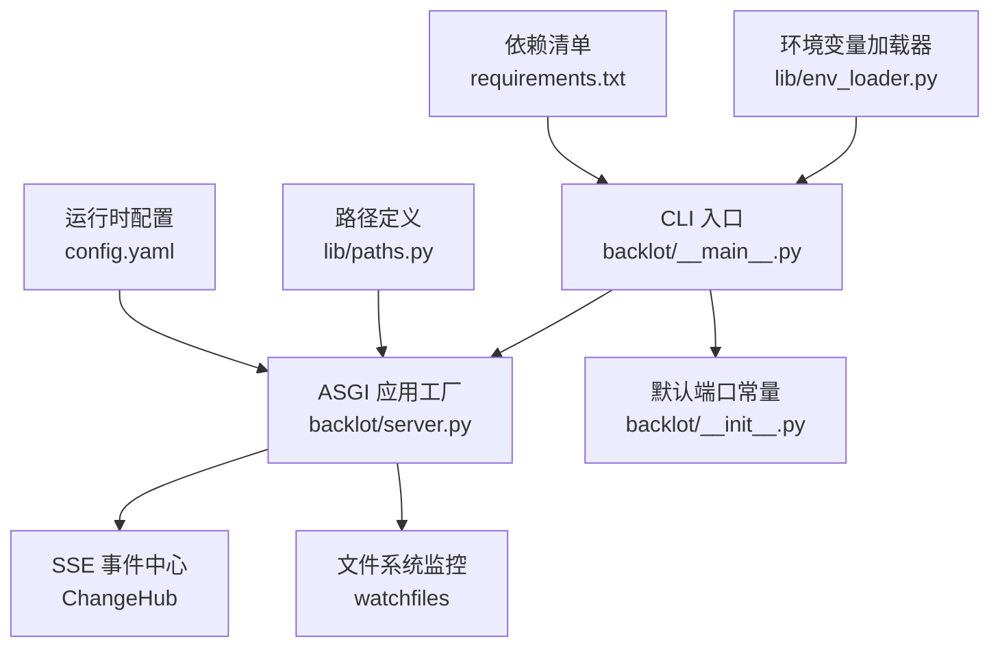
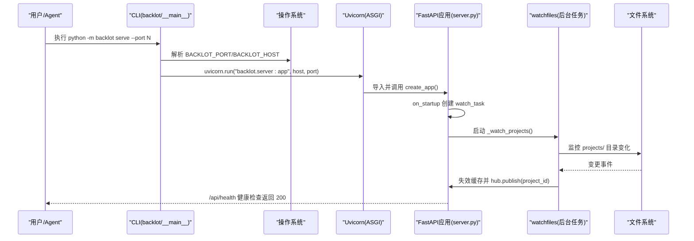
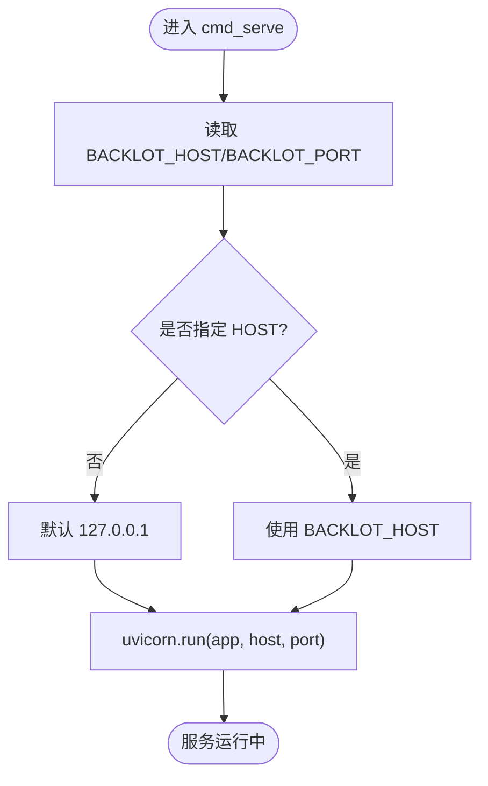
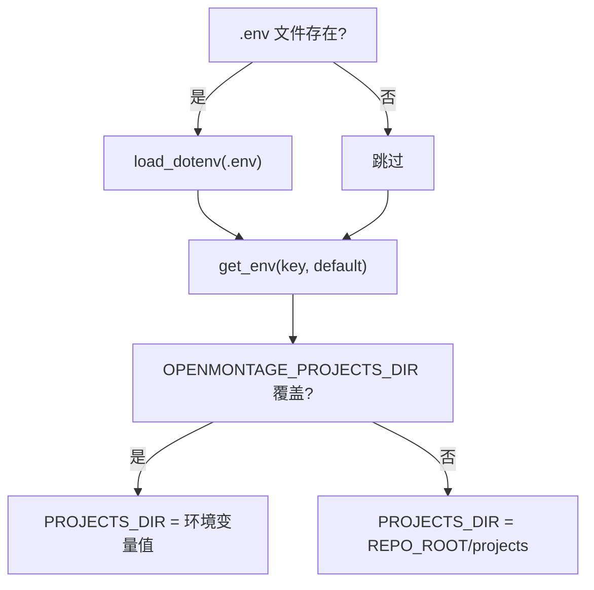
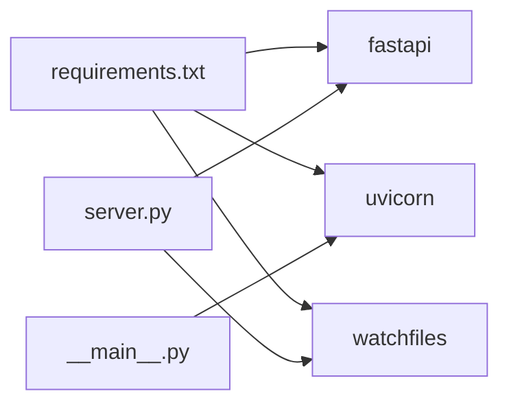

# 生产环境部署

<cite>
**本文引用的文件**   
- [backlot/__main__.py](file://backlot/__main__.py)
- [backlot/server.py](file://backlot/server.py)
- [backlot/__init__.py](file://backlot/__init__.py)
- [lib/env_loader.py](file://lib/env_loader.py)
- [lib/paths.py](file://lib/paths.py)
- [config.yaml](file://config.yaml)
- [requirements.txt](file://requirements.txt)
- [.gitignore](file://.gitignore)
</cite>

## 目录
1. [简介](#简介)
2. [项目结构](#项目结构)
3. [核心组件](#核心组件)
4. [架构总览](#架构总览)
5. [详细组件分析](#详细组件分析)
6. [依赖关系分析](#依赖关系分析)
7. [性能与容量规划](#性能与容量规划)
8. [故障排查指南](#故障排查指南)
9. [结论](#结论)
10. [附录](#附录)

## 简介
本文件面向生产环境的部署与运维，聚焦于 Backlot（基于 FastAPI + Uvicorn 的 ASGI 服务）的启动、进程管理、环境变量配置、端口绑定策略、后台进程守护、Docker 容器化、systemd/supervisor 系统服务集成、多实例与负载均衡等主题。文档内容严格依据仓库中的源码与配置文件进行说明，确保可落地执行。

## 项目结构
- backlot：Web 服务与 CLI 入口，包含服务器实现、UI 静态资源、状态管理与 SSE 事件分发。
- lib：通用库，包括环境变量加载、路径定义等。
- config.yaml：运行时配置（输出格式、编解码、路径等）。
- requirements.txt：Python 依赖清单（FastAPI、Uvicorn、watchfiles 等）。
- .gitignore：忽略产物与敏感信息（如 .env、.backlot 缓存）。



**图示来源** 
- [backlot/__main__.py:110-117](file://backlot/__main__.py#L110-L117)
- [backlot/server.py:151-163](file://backlot/server.py#L151-L163)
- [backlot/server.py:43-74](file://backlot/server.py#L43-L74)
- [backlot/server.py:132-149](file://backlot/server.py#L132-L149)
- [backlot/__init__.py:14-16](file://backlot/__init__.py#L14-L16)
- [lib/env_loader.py:15-22](file://lib/env_loader.py#L15-L22)
- [lib/paths.py:13-17](file://lib/paths.py#L13-L17)
- [config.yaml:1-20](file://config.yaml#L1-L20)
- [requirements.txt:8-11](file://requirements.txt#L8-L11)

**章节来源**
- [backlot/__main__.py:1-144](file://backlot/__main__.py#L1-L144)
- [backlot/server.py:1-504](file://backlot/server.py#L1-L504)
- [backlot/__init__.py:1-17](file://backlot/__init__.py#L1-L17)
- [lib/env_loader.py:1-35](file://lib/env_loader.py#L1-L35)
- [lib/paths.py:1-17](file://lib/paths.py#L1-L17)
- [config.yaml:1-20](file://config.yaml#L1-L20)
- [requirements.txt:1-12](file://requirements.txt#L1-L12)

## 核心组件
- CLI 与进程管理：提供 serve/open/studio 子命令；serve 以 Uvicorn 运行 ASGI 应用；open 自动检测并拉起后台服务，写入日志并轮转。
- ASGI 应用：FastAPI 应用工厂 create_app，注册 API、SSE、媒体与 UI 路由；启动时创建 watch 任务，关闭时取消。
- 事件与缓存：ChangeHub 负责按项目过滤的事件广播；项目摘要缓存并在文件变更时失效。
- 环境变量与路径：支持从 .env 加载变量；PROJECTS_DIR 可通过环境变量覆盖；BACKLOT_HOST/PORT 控制监听地址与端口。
- 运行时配置：config.yaml 定义输出与路径等运行时参数。

**章节来源**
- [backlot/__main__.py:28-33](file://backlot/__main__.py#L28-L33)
- [backlot/__main__.py:54-78](file://backlot/__main__.py#L54-L78)
- [backlot/__main__.py:110-117](file://backlot/__main__.py#L110-L117)
- [backlot/server.py:151-163](file://backlot/server.py#L151-L163)
- [backlot/server.py:43-74](file://backlot/server.py#L43-L74)
- [lib/env_loader.py:15-22](file://lib/env_loader.py#L15-L22)
- [lib/paths.py:13-17](file://lib/paths.py#L13-L17)
- [config.yaml:1-20](file://config.yaml#L1-L20)

## 架构总览
下图展示了生产环境下 Backlot 的启动流程、进程模型与关键依赖关系。



**图示来源** 
- [backlot/__main__.py:110-117](file://backlot/__main__.py#L110-L117)
- [backlot/server.py:151-163](file://backlot/server.py#L151-L163)
- [backlot/server.py:132-149](file://backlot/server.py#L132-L149)

## 详细组件分析

### CLI 与进程管理（serve/open/studio）
- serve：以 Uvicorn 前台运行 ASGI 应用；默认绑定 127.0.0.1，可通过 BACKLOT_HOST 改为 0.0.0.0 暴露到局域网；端口通过 --port 或 BACKLOT_PORT 指定，未设置回退至默认端口。
- open：若目标端口无健康响应则后台拉起 serve；将标准输出重定向到 .studio/server.log 并按大小轮转；Windows 使用新进程组与分离标志，Unix 使用 start_new_session。
- studio：快捷打开 /studio 页面（同样会按需拉起服务）。



**图示来源** 
- [backlot/__main__.py:110-117](file://backlot/__main__.py#L110-L117)
- [backlot/__init__.py:14-16](file://backlot/__init__.py#L14-L16)

**章节来源**
- [backlot/__main__.py:28-33](file://backlot/__main__.py#L28-L33)
- [backlot/__main__.py:54-78](file://backlot/__main__.py#L54-L78)
- [backlot/__main__.py:110-117](file://backlot/__main__.py#L110-L117)
- [backlot/__init__.py:14-16](file://backlot/__init__.py#L14-L16)

### ASGI 应用与事件分发（server.py）
- create_app：构建 FastAPI 应用，禁用 docs/redoc；在 startup/shutdown 生命周期中管理 watch 任务。
- ChangeHub：为每个订阅者维护独立队列，按 project_id 过滤广播，避免无关项目风暴。
- 文件监控：_watch_projects 使用 watchfiles 异步监听 projects/ 根目录，批量去重后失效对应项目的摘要缓存并通过 hub.publish 通知。
- 安全校验：/_safe_project_dir 对 project_id 做路径穿越防护，非法字符直接拒绝。

```mermaid
classDiagram
class ChangeHub {
+subscribe(project_id) asyncio.Queue
+unsubscribe(queue) void
+publish(project_id) void
-_subscribers dict
}
class ServerApp {
+create_app() FastAPI
+on_startup()
+on_shutdown()
+/api/health()
+/api/project/{id}/events()
+/api/library/events()
}
ServerApp --> ChangeHub : "使用"
```

**图示来源** 
- [backlot/server.py:43-74](file://backlot/server.py#L43-L74)
- [backlot/server.py:151-163](file://backlot/server.py#L151-L163)
- [backlot/server.py:132-149](file://backlot/server.py#L132-L149)
- [backlot/server.py:409-417](file://backlot/server.py#L409-L417)

**章节来源**
- [backlot/server.py:151-163](file://backlot/server.py#L151-L163)
- [backlot/server.py:43-74](file://backlot/server.py#L43-L74)
- [backlot/server.py:132-149](file://backlot/server.py#L132-L149)
- [backlot/server.py:409-417](file://backlot/server.py#L409-L417)

### 环境变量与路径配置
- 环境变量加载：lib/env_loader.py 提供 load_env/get_env/require_env，便于从 .env 加载配置。
- 路径覆盖：lib/paths.py 定义 REPO_ROOT 与 PROJECTS_DIR，后者可通过 OPENMONTAGE_PROJECTS_DIR 覆盖。
- 服务绑定：BACKLOT_HOST 控制监听地址（默认 127.0.0.1），BACKLOT_PORT 控制端口（默认 4750）。



**图示来源** 
- [lib/env_loader.py:15-22](file://lib/env_loader.py#L15-L22)
- [lib/env_loader.py:24-34](file://lib/env_loader.py#L24-L34)
- [lib/paths.py:13-17](file://lib/paths.py#L13-L17)

**章节来源**
- [lib/env_loader.py:1-35](file://lib/env_loader.py#L1-L35)
- [lib/paths.py:1-17](file://lib/paths.py#L1-L17)

### 运行时配置（config.yaml）
- checkpoint/output/paths 等键用于控制流水线与输出行为，例如默认编码、分辨率、帧率、CRF、各目录路径等。
- 该配置由上层工具链读取，Backlot 作为只读看板不修改这些文件。

**章节来源**
- [config.yaml:1-20](file://config.yaml#L1-L20)

## 依赖关系分析
- Python 依赖：fastapi、uvicorn、watchfiles 等由 requirements.txt 声明。
- 运行时依赖：ffmpeg（缩略图生成）、PIL（图像处理）在服务端按需调用。
- 外部接口：/api/health 用于健康检查；SSE 接口用于实时事件推送。



**图示来源** 
- [requirements.txt:8-11](file://requirements.txt#L8-L11)
- [backlot/server.py:132-149](file://backlot/server.py#L132-L149)
- [backlot/__main__.py:110-117](file://backlot/__main__.py#L110-L117)

**章节来源**
- [requirements.txt:1-12](file://requirements.txt#L1-L12)

## 性能与容量规划
- 单进程 vs 多进程：Uvicorn 默认单工作进程；生产建议结合反向代理（Nginx/Caddy）与多 worker 模式提升并发能力。
- 内存与 CPU：watchfiles 监控大量文件变更时需关注 I/O 压力；ChangeHub 队列上限为 64，避免积压。
- 缓存策略：项目摘要缓存减少重复解析；缩略图缓存降低视频首帧抽取开销。
- 网络与安全：默认仅绑定 127.0.0.1，生产需经反向代理暴露，启用 HTTPS 与访问控制。

[本节为通用指导，无需代码引用]

## 故障排查指南
- 服务无法启动：检查 BACKLOT_PORT 是否被占用；确认 BACKLOT_HOST 是否正确；查看 .studio/server.log 是否有错误输出。
- 健康检查失败：curl http://127.0.0.1:<port>/api/health 应返回 200；若失败，检查 Uvicorn 是否成功加载 app。
- 文件监控无效：确认 watchfiles 已安装且 PROJECTS_DIR 存在；检查权限与路径是否被忽略（node_modules/.git 等）。
- 缩略图生成失败：确保 ffmpeg 可用；检查输入文件后缀是否为支持的图像/视频类型。

**章节来源**
- [backlot/__main__.py:54-78](file://backlot/__main__.py#L54-L78)
- [backlot/server.py:132-149](file://backlot/server.py#L132-L149)
- [backlot/server.py:460-500](file://backlot/server.py#L460-L500)

## 结论
Backlot 在生产环境中具备清晰的启动与进程管理模型、完善的环境变量与路径配置机制、健壮的 SSE 事件分发与文件监控能力。通过合理的反向代理、系统服务与容器化方案，可实现稳定、可扩展的生产部署。

[本节为总结性内容，无需代码引用]

## 附录

### 环境变量与端口绑定策略
- BACKLOT_HOST：监听地址，默认 127.0.0.1；生产建议通过反向代理暴露，不建议直接绑定 0.0.0.0。
- BACKLOT_PORT：监听端口，默认 4750；可通过命令行 --port 覆盖。
- OPENMONTAGE_PROJECTS_DIR：项目根目录，默认 REPO_ROOT/projects。
- .env：可选，用于集中管理环境变量。

**章节来源**
- [backlot/__main__.py:28-33](file://backlot/__main__.py#L28-L33)
- [backlot/__main__.py:110-117](file://backlot/__main__.py#L110-L117)
- [lib/env_loader.py:15-22](file://lib/env_loader.py#L15-L22)
- [lib/paths.py:13-17](file://lib/paths.py#L13-L17)

### 后台进程启动与守护
- 后台启动：open 子命令在未就绪时自动拉起 serve，并将输出写入 .studio/server.log，超过阈值自动轮转。
- 守护方案：推荐使用 systemd 或 supervisor 托管 serve 进程，确保崩溃重启与开机自启。

**章节来源**
- [backlot/__main__.py:54-78](file://backlot/__main__.py#L54-L78)

### Docker 容器化部署示例
- 基础镜像：选择包含 Python 与必要系统依赖（如 ffmpeg）的镜像。
- 依赖安装：pip install -r requirements.txt。
- 工作目录：复制项目代码，设置环境变量（BACKLOT_HOST、BACKLOT_PORT、OPENMONTAGE_PROJECTS_DIR）。
- 端口映射：将容器内端口映射到宿主机，配合反向代理与 TLS。
- 数据卷：挂载 projects/ 与 .backlot 缓存目录，持久化数据。

[本节为概念性指引，无需代码引用]

### 系统服务配置（systemd/supervisor）
- systemd：编写 service 单元，ExecStart 指向 python -m backlot serve --port <port>，设置 Restart=always、RestartSec、EnvironmentFile=.env。
- supervisor：配置程序名、command、user、autostart、autorestart、stdout_logfile 等。

[本节为概念性指引，无需代码引用]

### 多实例部署与负载均衡
- 多实例：在同一主机或集群上运行多个 Backlot 实例，各自绑定不同端口或同一端口（由进程管理器分配）。
- 负载均衡：通过 Nginx/Caddy 等反向代理进行请求分发与健康检查，统一入口并提供 HTTPS 终止。

[本节为概念性指引，无需代码引用]