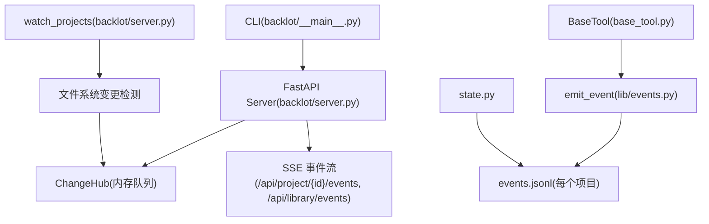
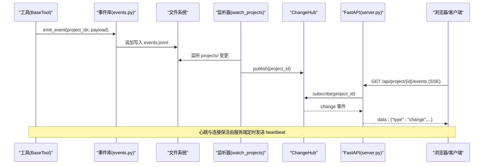
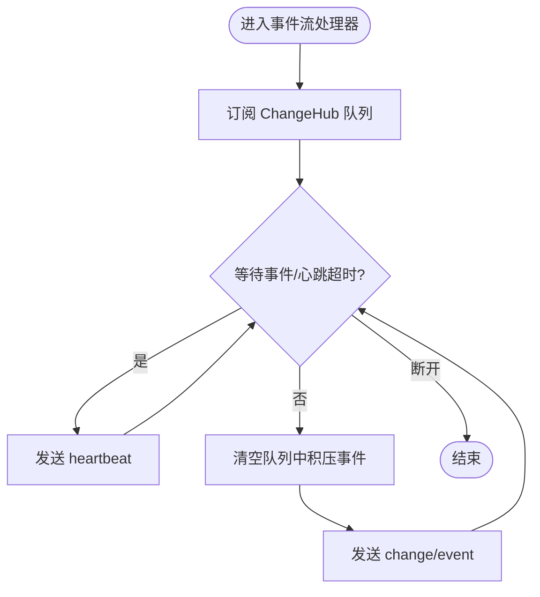
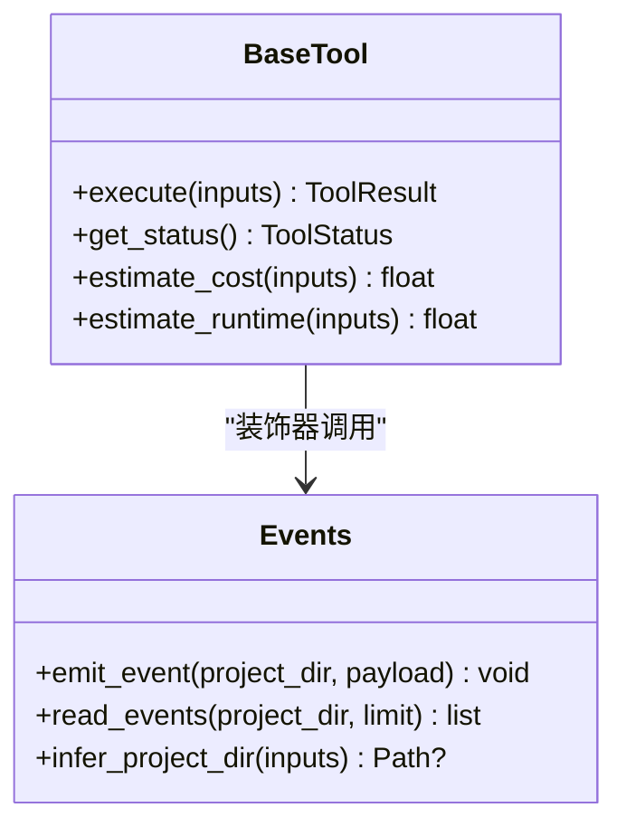
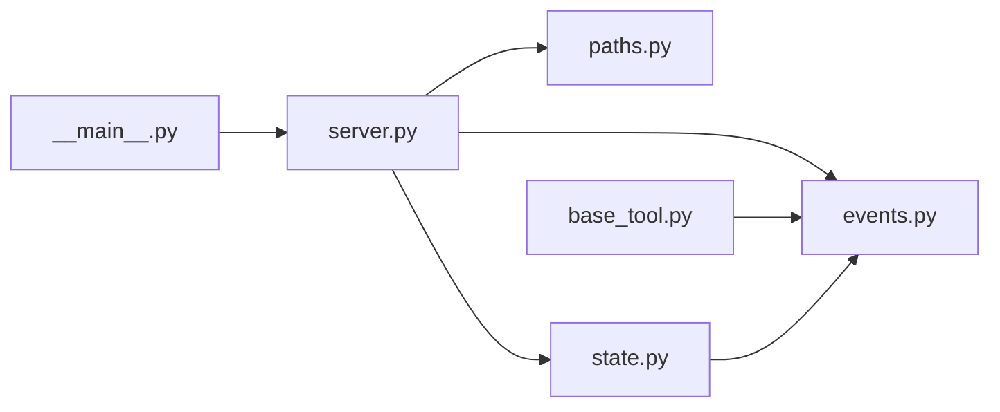

# 监控与日志

<cite>
**本文引用的文件**   
- [backlot/server.py](file://backlot/server.py)
- [backlot/__main__.py](file://backlot/__main__.py)
- [lib/events.py](file://lib/events.py)
- [lib/paths.py](file://lib/paths.py)
- [tools/base_tool.py](file://tools/base_tool.py)
- [backlot/state.py](file://backlot/state.py)
- [config.yaml](file://config.yaml)
</cite>

## 目录
1. [简介](#简介)
2. [项目结构](#项目结构)
3. [核心组件](#核心组件)
4. [架构总览](#架构总览)
5. [详细组件分析](#详细组件分析)
6. [依赖关系分析](#依赖关系分析)
7. [性能考量](#性能考量)
8. [故障排查指南](#故障排查指南)
9. [结论](#结论)
10. [附录](#附录)

## 简介
本文件面向 OpenMontage-MV 的监控与日志体系，覆盖以下目标：
- 日志文件管理机制：包括自动轮转与大小限制（5MB）的实现与使用。
- 健康检查端点 /api/health 的实现与调用方式。
- 事件驱动架构中的实时状态更新与 SSE 事件流监控。
- 关键业务指标收集与展示（工具执行耗时、成本、成功率等）。
- 日志收集与分析工具配置建议（ELK Stack、Prometheus）。
- 错误追踪与异常处理机制。
- 监控告警配置与通知策略建议。

## 项目结构
与监控与日志相关的关键位置如下：
- 服务器与 API：backlot/server.py（FastAPI 应用、SSE 事件流、健康检查）
- CLI 与进程管理：backlot/__main__.py（后台启动、日志轮转）
- 事件写入与读取：lib/events.py（events.jsonl 追加式日志）
- 路径常量：lib/paths.py（PROJECTS_DIR、REPO_ROOT）
- 工具执行埋点：tools/base_tool.py（execute 装饰器注入事件）
- 看板状态推导：backlot/state.py（基于 events.jsonl 的状态聚合）
- 运行时配置：config.yaml（输出与路径等配置）

图表来源 
- [backlot/server.py:132-149](file://backlot/server.py#L132-L149)
- [backlot/server.py:166-168](file://backlot/server.py#L166-L168)
- [backlot/server.py:185-242](file://backlot/server.py#L185-L242)
- [lib/events.py:77-118](file://lib/events.py#L77-L118)
- [tools/base_tool.py:148-224](file://tools/base_tool.py#L148-L224)
- [backlot/state.py:15-16](file://backlot/state.py#L15-L16)

章节来源
- [backlot/server.py:1-504](file://backlot/server.py#L1-L504)
- [backlot/__main__.py:1-145](file://backlot/__main__.py#L1-L145)
- [lib/events.py:1-119](file://lib/events.py#L1-L119)
- [lib/paths.py:1-18](file://lib/paths.py#L1-L18)
- [tools/base_tool.py:1-200](file://tools/base_tool.py#L1-L200)
- [backlot/state.py:1-200](file://backlot/state.py#L1-L200)
- [config.yaml:1-20](file://config.yaml#L1-L20)

## 核心组件
- 健康检查与健康探测
  - FastAPI 暴露 /api/health 返回 {"ok": True, "app": "backlot"}，用于进程存活探测与负载均衡探针。
  - CLI 在启动前通过 HTTP 请求该端点判断服务是否已运行。
- 事件驱动与 SSE 事件流
  - ChangeHub 维护 per-project 订阅队列，支持按 project_id 过滤广播。
  - /api/project/{project_id}/events 与 /api/library/events 提供 SSE 长连接，包含 hello、heartbeat、change/event 消息类型。
- 工具执行埋点与事件日志
  - BaseTool.execute 被装饰器包裹，自动记录 start/finish/error 事件到 events.jsonl。
  - emit_event 线程安全追加写入，read_events 容错读取。
- 文件系统监听与缓存失效
  - watch_projects 后台任务监听 projects/ 目录变化，去重后发布到 ChangeHub，并失效对应项目的摘要缓存。
- 日志文件管理与轮转
  - CLI 负责 .studio/server.log 的打开与轮转（超过 5MB 时替换为 .log.1），并将子进程 stdout/stderr 重定向至该文件。

章节来源
- [backlot/server.py:166-168](file://backlot/server.py#L166-L168)
- [backlot/server.py:185-242](file://backlot/server.py#L185-L242)
- [backlot/server.py:43-74](file://backlot/server.py#L43-L74)
- [lib/events.py:77-118](file://lib/events.py#L77-L118)
- [tools/base_tool.py:148-224](file://tools/base_tool.py#L148-L224)
- [backlot/server.py:132-149](file://backlot/server.py#L132-L149)
- [backlot/__main__.py:43-78](file://backlot/__main__.py#L43-L78)

## 架构总览
下图展示了从工具执行到前端实时更新的完整链路，以及健康检查与日志轮转的位置。

图表来源 
- [tools/base_tool.py:148-224](file://tools/base_tool.py#L148-L224)
- [lib/events.py:77-118](file://lib/events.py#L77-L118)
- [backlot/server.py:132-149](file://backlot/server.py#L132-L149)
- [backlot/server.py:185-242](file://backlot/server.py#L185-L242)

## 详细组件分析

### 健康检查端点 /api/health
- 功能：返回简单 JSON 表示服务可用。
- 用途：
  - 进程存活探测（如 Kubernetes liveness/readiness）。
  - CLI 启动前探测，避免重复启动。
- 调用示例：HTTP GET http://127.0.0.1:{port}/api/health

章节来源
- [backlot/server.py:166-168](file://backlot/server.py#L166-L168)
- [backlot/__main__.py:35-41](file://backlot/__main__.py#L35-L41)

### SSE 事件流与实时状态更新
- 端点：
  - /api/project/{project_id}/events：按项目过滤的事件流。
  - /api/library/events：全量项目变更事件流。
- 协议要点：
  - 首条 hello 消息携带上下文信息。
  - 无数据时周期性发送 heartbeat 保活。
  - 变更事件以 change 或 event 类型推送。
- 实现要点：
  - ChangeHub 使用 asyncio.Queue(maxsize=64)，满队时丢弃多余事件（保证至少一次唤醒）。
  - 服务端设置 no-cache 与禁用缓冲响应头，确保实时性。

图表来源 
- [backlot/server.py:185-242](file://backlot/server.py#L185-L242)
- [backlot/server.py:43-74](file://backlot/server.py#L43-L74)

章节来源
- [backlot/server.py:185-242](file://backlot/server.py#L185-L242)

### 工具执行埋点与事件日志（events.jsonl）
- 埋点位置：BaseTool._instrument_execute 包装 execute，自动记录 start/finish/error。
- 事件字段：tool、scene_id、depth、event、output_path、success、cost_usd、duration_s、error 等。
- 写入策略：
  - 线程锁保护并发写入。
  - 仅对已有项目目录写入，防止误写。
  - 失败静默吞掉，不影响生产流程。
- 读取策略：
  - read_events 逐行解析，跳过损坏行，支持 limit 参数。

图表来源 
- [tools/base_tool.py:148-224](file://tools/base_tool.py#L148-L224)
- [lib/events.py:77-118](file://lib/events.py#L77-L118)

章节来源
- [tools/base_tool.py:148-224](file://tools/base_tool.py#L148-L224)
- [lib/events.py:1-119](file://lib/events.py#L1-L119)

### 文件系统监听与缓存失效
- watch_projects 使用 awatch 监听 projects/ 递归变更。
- 对变更路径进行归一化与忽略集合过滤，提取 project_id。
- 失效对应项目的摘要缓存，并向 ChangeHub 发布变更。

章节来源
- [backlot/server.py:111-149](file://backlot/server.py#L111-L149)

### 日志文件管理与轮转（5MB）
- 日志路径：.studio/server.log
- 轮转策略：当文件大小超过 5MB 时，将当前文件替换为 .log.1，再重新打开追加句柄。
- 进程启动：CLI 启动 uvicorn 子进程，将其 stdout/stderr 重定向到日志文件。

章节来源
- [backlot/__main__.py:43-78](file://backlot/__main__.py#L43-L78)

## 依赖关系分析
- backlot/server.py 依赖：
  - lib.events（事件读写）、lib.paths（路径常量）、backlot.state（状态汇总）、watchfiles（可选，用于监听）。
- tools/base_tool.py 依赖：
  - lib.events（事件写入）。
- backlot/state.py 依赖：
  - lib.events（读取 events.jsonl）、lib.paths（PROJECTS_DIR）。
- backlot/__main__.py 依赖：
  - uvicorn（运行 FastAPI）、urllib（健康检查）。

图表来源 
- [backlot/server.py:1-504](file://backlot/server.py#L1-L504)
- [lib/events.py:1-119](file://lib/events.py#L1-L119)
- [lib/paths.py:1-18](file://lib/paths.py#L1-L18)
- [backlot/state.py:1-200](file://backlot/state.py#L1-L200)
- [tools/base_tool.py:1-200](file://tools/base_tool.py#L1-L200)
- [backlot/__main__.py:1-145](file://backlot/__main__.py#L1-L145)

章节来源
- [backlot/server.py:1-504](file://backlot/server.py#L1-L504)
- [lib/events.py:1-119](file://lib/events.py#L1-L119)
- [lib/paths.py:1-18](file://lib/paths.py#L1-L18)
- [backlot/state.py:1-200](file://backlot/state.py#L1-L200)
- [tools/base_tool.py:1-200](file://tools/base_tool.py#L1-L200)
- [backlot/__main__.py:1-145](file://backlot/__main__.py#L1-L145)

## 性能考量
- SSE 队列容量与背压：
  - ChangeHub 队列 maxsize=64，满队时丢弃多余事件，避免阻塞生产者；消费者侧批量 drain 减少网络抖动。
- 心跳间隔：
  - SSE_HEARTBEAT_SECONDS=15，兼顾保活与带宽。
- 事件写入：
  - 单行追加写入，线程锁串行化，跨进程未同步但 O_APPEND 原子性保障基本正确性。
- 文件系统监听：
  - 变更路径归一化与忽略集合降低无效事件数量；批处理去重后再发布。
- 摘要缓存：
  - 项目级摘要缓存并在变更时失效，避免每次请求都全量解析。

[本节为通用指导，不直接分析具体文件]

## 故障排查指南
- 健康检查失败
  - 检查 /api/health 是否可达，确认端口与环境变量 BACKLOT_PORT/BACKLOT_HOST。
  - 若 CLI 无法启动服务，查看 .studio/server.log 获取启动错误。
- SSE 连接问题
  - 确认浏览器/客户端正确处理 text/event-stream 与 no-cache 头。
  - 观察 heartbeat 是否正常，断连后是否自动重连。
- 事件缺失或乱序
  - 检查 events.jsonl 是否存在且可读，read_events 会跳过损坏行。
  - 确认 ChangeHub 订阅是否正确按 project_id 过滤。
- 日志轮转异常
  - 确认 .studio 目录可写，轮转逻辑仅在超过 5MB 时触发。
- 工具执行异常
  - BaseTool 装饰器会在 error 事件中记录错误信息与耗时，便于定位。

章节来源
- [backlot/__main__.py:43-78](file://backlot/__main__.py#L43-L78)
- [lib/events.py:98-118](file://lib/events.py#L98-L118)
- [backlot/server.py:185-242](file://backlot/server.py#L185-L242)
- [tools/base_tool.py:196-221](file://tools/base_tool.py#L196-L221)

## 结论
本项目实现了轻量而健壮的监控与日志体系：
- 通过 events.jsonl 与 SSE 事件流，提供低耦合的实时状态更新能力。
- 健康检查与 CLI 自启机制简化运维。
- 日志轮转与大小限制保障磁盘空间可控。
- 工具执行埋点覆盖关键业务指标（耗时、成本、成功/失败），便于后续分析与告警。

[本节为总结，不直接分析具体文件]

## 附录

### 关键业务指标与采集建议
- 指标来源：
  - events.jsonl 中的 finish/error/start 事件，包含 duration_s、cost_usd、success、tool、scene_id 等。
- 采集方式：
  - 定期 tail 增量读取 events.jsonl，解析为结构化指标。
  - 可按 project_id、tool、scene_id 维度聚合。
- 可视化与告警：
  - 将指标导出到 Prometheus（自定义 exporter 或 sidecar）。
  - 在 ELK 中建立索引，构建仪表盘与告警规则（如错误率突增、长时间无活动）。

[本节为通用指导，不直接分析具体文件]

### ELK Stack 配置建议
- Filebeat：
  - 采集 .studio/server.log 与 projects/*/events.jsonl。
  - 配置多行合并（如需）与 JSON 解析。
- Logstash：
  - 清洗与字段映射（ts、tool、event、duration_s、cost_usd 等）。
- Elasticsearch：
  - 按日期分片，保留策略（如 30 天滚动）。
- Kibana：
  - 创建仪表盘：错误率、平均耗时、成本趋势、项目活跃度。

[本节为通用指导，不直接分析具体文件]

### Prometheus 集成建议
- 自建 Exporter：
  - 读取 events.jsonl，计算窗口内指标（QPS、错误率、P50/P95 耗时、成本累计）。
  - 暴露 /metrics 端点供 Prometheus 抓取。
- 告警规则：
  - 错误率阈值、长时间无心跳、单项目高错误率、成本异常增长。

[本节为通用指导，不直接分析具体文件]

### 监控告警与通知策略
- 告警源：
  - Prometheus 指标（错误率、延迟、资源使用）。
  - ELK 日志关键字（如 “error”、“timeout”、“rate limited”）。
- 通知渠道：
  - 企业微信/钉钉/邮件/短信，按严重级别分级。
- 降噪策略：
  - 聚合相同告警、抑制风暴、设置冷却时间。

[本节为通用指导，不直接分析具体文件]