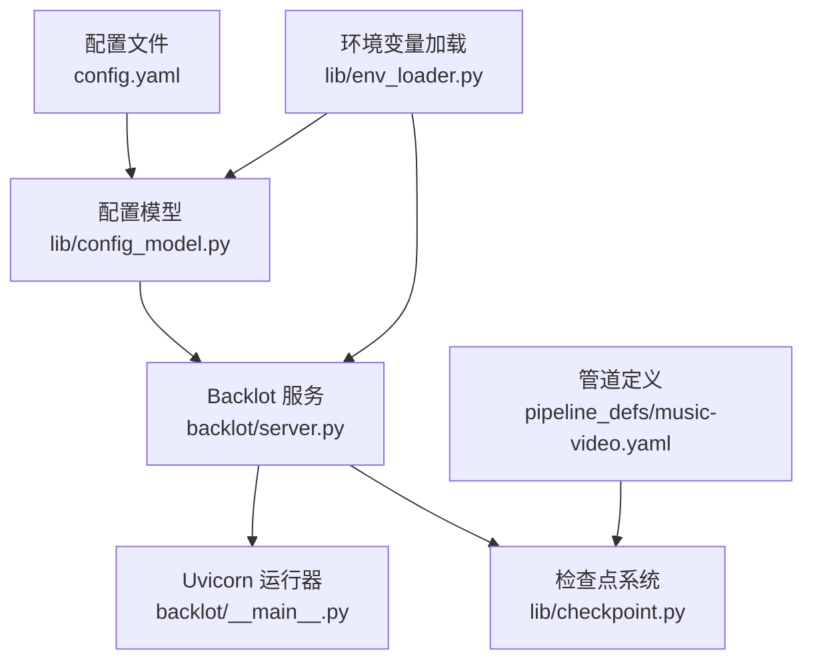
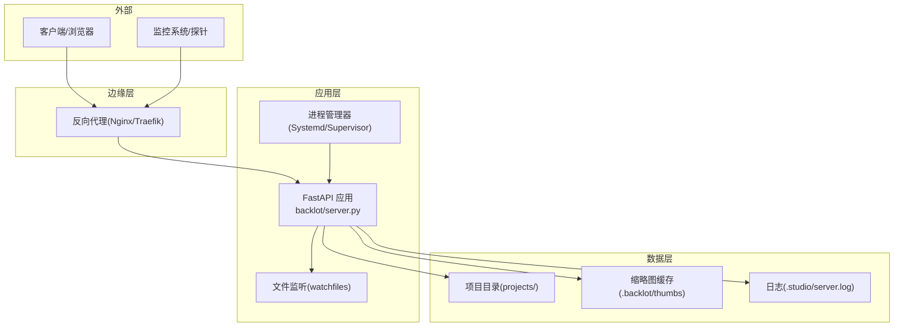
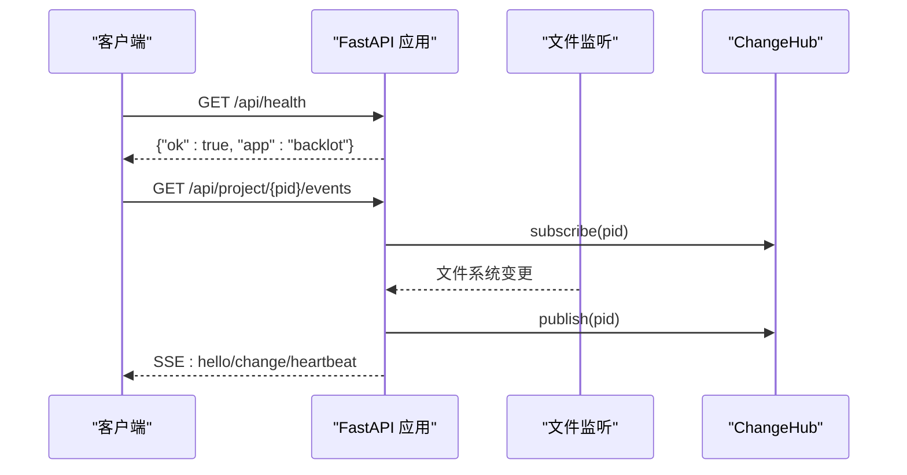
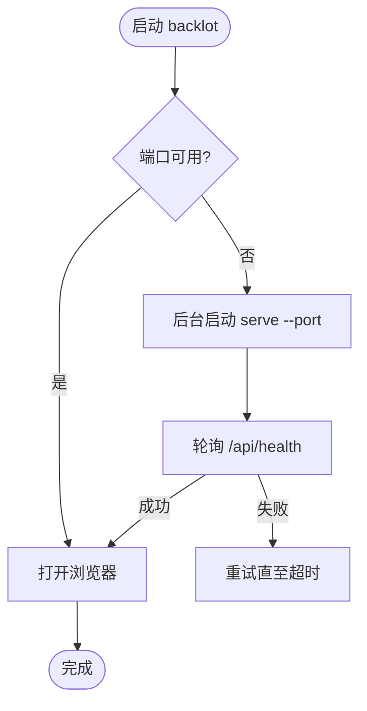
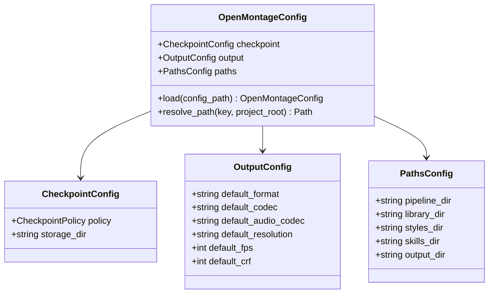
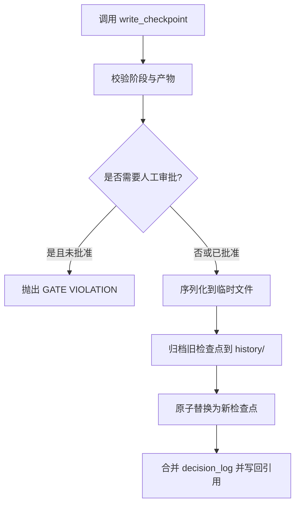
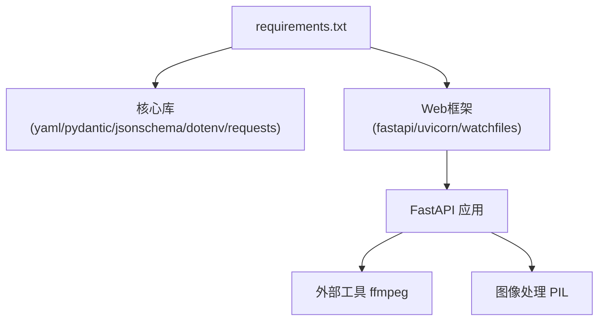

# 部署与运维

<cite>
**本文引用的文件**   
- [config.yaml](file://config.yaml)
- [requirements.txt](file://requirements.txt)
- [backlot/server.py](file://backlot/server.py)
- [backlot/__main__.py](file://backlot/__main__.py)
- [lib/config_model.py](file://lib/config_model.py)
- [lib/env_loader.py](file://lib/env_loader.py)
- [lib/checkpoint.py](file://lib/checkpoint.py)
- [pipeline_defs/music-video.yaml](file://pipeline_defs/music-video.yaml)
</cite>

## 目录
1. [简介](#简介)
2. [项目结构](#项目结构)
3. [核心组件](#核心组件)
4. [架构总览](#架构总览)
5. [详细组件分析](#详细组件分析)
6. [依赖关系分析](#依赖关系分析)
7. [性能考虑](#性能考虑)
8. [故障排除指南](#故障排除指南)
9. [结论](#结论)
10. [附录](#附录)

## 简介
本文件面向生产环境的部署与运维，覆盖容器化部署、进程管理、监控与健康检查、日志收集、备份恢复与数据迁移、安全加固与访问控制、故障排除与性能优化、扩展性与负载均衡、以及CI/CD流水线配置示例。文档基于仓库中的实际代码与配置进行说明，确保可落地执行。

## 项目结构
OpenMontage-MV 由以下关键部分组成：
- Backlot 服务：基于 FastAPI + Uvicorn 的本地看板与媒体服务，提供健康检查、SSE 事件流、缩略图生成与媒体访问等能力。
- 运行时配置：通过 YAML 与环境变量加载，统一输出参数、路径与检查点策略。
- 管道定义：以 YAML 描述音乐视频制作流程的阶段、产物与工具依赖。
- 检查点系统：用于阶段状态持久化、历史归档与门禁校验。

**图表来源** 
- [config.yaml:1-20](file://config.yaml#L1-L20)
- [lib/config_model.py:1-70](file://lib/config_model.py#L1-L70)
- [lib/env_loader.py:1-35](file://lib/env_loader.py#L1-L35)
- [backlot/server.py:1-504](file://backlot/server.py#L1-L504)
- [backlot/__main__.py:1-145](file://backlot/__main__.py#L1-L145)
- [pipeline_defs/music-video.yaml:1-187](file://pipeline_defs/music-video.yaml#L1-L187)
- [lib/checkpoint.py:1-537](file://lib/checkpoint.py#L1-L537)

**章节来源**
- [config.yaml:1-20](file://config.yaml#L1-L20)
- [requirements.txt:1-12](file://requirements.txt#L1-L12)
- [backlot/server.py:1-504](file://backlot/server.py#L1-L504)
- [backlot/__main__.py:1-145](file://backlot/__main__.py#L1-L145)
- [lib/config_model.py:1-70](file://lib/config_model.py#L1-L70)
- [lib/env_loader.py:1-35](file://lib/env_loader.py#L1-L35)
- [lib/checkpoint.py:1-537](file://lib/checkpoint.py#L1-L537)
- [pipeline_defs/music-video.yaml:1-187](file://pipeline_defs/music-video.yaml#L1-L187)

## 核心组件
- Backlot 服务（FastAPI）：提供 /api/health 健康检查、项目状态查询、SSE 事件流、缩略图与媒体访问、UI 静态资源托管。
- 启动器（CLI）：支持后台启动、端口探测、日志轮转与浏览器打开。
- 配置模型：从 config.yaml 与环境变量加载并校验运行时配置。
- 检查点系统：阶段状态持久化、历史归档、门禁校验与决策日志合并。
- 管道定义：music-video 管道的阶段顺序、产物与工具依赖。

**章节来源**
- [backlot/server.py:1-504](file://backlot/server.py#L1-L504)
- [backlot/__main__.py:1-145](file://backlot/__main__.py#L1-L145)
- [lib/config_model.py:1-70](file://lib/config_model.py#L1-L70)
- [lib/checkpoint.py:1-537](file://lib/checkpoint.py#L1-L537)
- [pipeline_defs/music-video.yaml:1-187](file://pipeline_defs/music-video.yaml#L1-L187)

## 架构总览
下图展示生产环境下的主要组件交互：外部请求进入反向代理（如 Nginx），转发到 Uvicorn 运行的 FastAPI 应用；应用读取配置与管道定义，读写检查点与项目目录；SSE 事件驱动前端实时更新；缩略图与媒体通过服务端响应。

**图表来源** 
- [backlot/server.py:1-504](file://backlot/server.py#L1-L504)
- [backlot/__main__.py:1-145](file://backlot/__main__.py#L1-L145)
- [lib/config_model.py:1-70](file://lib/config_model.py#L1-L70)
- [lib/env_loader.py:1-35](file://lib/env_loader.py#L1-L35)
- [lib/checkpoint.py:1-537](file://lib/checkpoint.py#L1-L537)

## 详细组件分析

### Backlot 服务（FastAPI）
- 健康检查：/api/health 返回 {"ok": True, "app": "backlot"}，适合容器就绪/存活探针。
- 项目状态与事件：/api/projects、/api/project/{project_id}/state、/api/project/{project_id}/events、/api/library/events 提供状态与 SSE 事件流。
- 缩略图与媒体：/thumb/{project_id}/{file_path} 与 /media/{project_id}/{file_path} 提供安全的文件访问与缩略图缓存。
- UI 静态资源：/ui 挂载静态目录，并对 SPA 页面设置 no-cache 头。
- 中间件与心跳：SSE 心跳间隔为固定秒数，避免连接超时。

**图表来源** 
- [backlot/server.py:166-242](file://backlot/server.py#L166-L242)
- [backlot/server.py:43-74](file://backlot/server.py#L43-L74)
- [backlot/server.py:132-149](file://backlot/server.py#L132-L149)

**章节来源**
- [backlot/server.py:1-504](file://backlot/server.py#L1-L504)

### 启动器与进程管理
- CLI 命令：serve 前台运行；open/studio 自动检测端口并启动后端，随后打开浏览器。
- 端口探测：通过 /api/health 判断服务是否存活。
- 日志轮转：.studio/server.log 超过阈值后自动重命名备份。
- 跨平台后台启动：Windows 使用新进程组与分离标志；Unix 使用 start_new_session。

**图表来源** 
- [backlot/__main__.py:35-117](file://backlot/__main__.py#L35-L117)
- [backlot/__main__.py:120-145](file://backlot/__main__.py#L120-L145)

**章节来源**
- [backlot/__main__.py:1-145](file://backlot/__main__.py#L1-L145)

### 配置与环境
- 运行时配置：config.yaml 定义 checkpoint、output、paths 等键值。
- 配置模型：lib/config_model.py 使用 Pydantic 校验并解析配置，支持相对路径解析。
- 环境变量：lib/env_loader.py 加载 .env 并提供 get_env/require_env 接口。
- 默认绑定：Uvicorn 默认绑定 127.0.0.1，可通过 BACKLOT_HOST=0.0.0.0 暴露局域网。

**图表来源** 
- [lib/config_model.py:22-70](file://lib/config_model.py#L22-L70)

**章节来源**
- [config.yaml:1-20](file://config.yaml#L1-L20)
- [lib/config_model.py:1-70](file://lib/config_model.py#L1-L70)
- [lib/env_loader.py:1-35](file://lib/env_loader.py#L1-L35)

### 检查点系统与门禁
- 写入流程：write_checkpoint 先序列化到临时文件，再原子替换；对已完成或待审批的检查点进行历史归档。
- 门禁校验：根据管道 manifest 的 human_approval_default 强制要求人工审批，否则抛出“GATE VIOLATION”。
- 决策日志：合并 decision_log 到项目级文件，并在相关产物中引用。
- 读取与恢复：read_checkpoint/get_latest_checkpoint/get_completed_stages/get_next_stage 支持断点续跑。

**图表来源** 
- [lib/checkpoint.py:336-467](file://lib/checkpoint.py#L336-L467)
- [lib/checkpoint.py:263-301](file://lib/checkpoint.py#L263-L301)
- [lib/checkpoint.py:306-334](file://lib/checkpoint.py#L306-L334)

**章节来源**
- [lib/checkpoint.py:1-537](file://lib/checkpoint.py#L1-L537)

### 管道定义（music-video）
- 阶段顺序：idea → proposal → storyboard → assets → edit → compose → publish。
- 产物与工具：每个阶段声明 produces、required_artifacts_in、tools_available/required_tools。
- 门禁与审查：human_approval_default 与 review_focus/success_criteria 明确验收标准。

**图表来源** 
- [pipeline_defs/music-video.yaml:36-187](file://pipeline_defs/music-video.yaml#L36-L187)

**章节来源**
- [pipeline_defs/music-video.yaml:1-187](file://pipeline_defs/music-video.yaml#L1-L187)

## 依赖关系分析
- 运行时依赖：pyyaml、pydantic、jsonschema、python-dotenv、requests、fastapi、uvicorn、watchfiles。
- 外部工具：ffmpeg（缩略图抽取）、PIL（图像处理）。
- 进程与网络：Uvicorn 作为 ASGI 服务器，默认仅监听 127.0.0.1，需反向代理暴露。

**图表来源** 
- [requirements.txt:1-12](file://requirements.txt#L1-L12)
- [backlot/server.py:460-500](file://backlot/server.py#L460-L500)

**章节来源**
- [requirements.txt:1-12](file://requirements.txt#L1-L12)
- [backlot/server.py:460-500](file://backlot/server.py#L460-L500)

## 性能考虑
- 缩略图缓存：按宽度与源文件元信息生成唯一键，命中则直接返回，减少重复处理。
- SSE 心跳与去抖：心跳间隔固定，队列满时丢弃冗余消息，避免阻塞。
- 只读扫描：BoardState 推导采用防御式读取，异常降级不崩溃。
- 静态资源缓存：SPA 页面设置 no-cache 保证更新可见，媒体响应保持正常缓存。

[本节为通用指导，无需特定文件来源]

## 故障排除指南
- 服务无法启动：
  - 检查端口占用与 BACKLOT_PORT 设置。
  - 查看 .studio/server.log 日志轮转后的内容。
  - 确认依赖安装完整（requirements.txt）。
- 健康检查失败：
  - 验证 /api/health 返回状态码与 JSON 字段。
  - 检查反向代理转发规则与超时设置。
- SSE 连接断开：
  - 确认客户端正确处理 heartbeat 与 change 事件。
  - 检查防火墙与代理是否允许长连接。
- 缩略图生成失败：
  - 确认 ffmpeg 与 PIL 可用。
  - 检查 .backlot/thumbs 目录权限。
- 检查点门禁错误：
  - 若出现“GATE VIOLATION”，需在需要人工审批的阶段先写入 awaiting_human 并经用户批准后再次写入 completed 并设置 human_approved=True。

**章节来源**
- [backlot/__main__.py:24-52](file://backlot/__main__.py#L24-L52)
- [backlot/server.py:166-169](file://backlot/server.py#L166-L169)
- [lib/checkpoint.py:378-406](file://lib/checkpoint.py#L378-L406)

## 结论
本项目的部署与运维围绕 FastAPI 服务、YAML 配置、检查点系统与管道定义展开。通过容器化与进程管理器实现稳定运行，结合健康检查、日志轮转与 SSE 事件流保障可观测性。在生产环境中建议配合反向代理、负载均衡与集中式日志采集，以实现高可用与可扩展的 MV 制作流水线。

[本节为总结，无需特定文件来源]

## 附录

### 容器化部署最佳实践
- 基础镜像：选择轻量 Python 镜像，安装 requirements.txt 依赖与 ffmpeg/PIL。
- 工作目录：将项目根目录挂载为卷，确保 projects、.backlot/thumbs、.studio 持久化。
- 环境变量：BACKLOT_HOST、BACKLOT_PORT、PYTHONUNBUFFERED 等。
- 健康检查：容器探针调用 /api/health。
- 资源限制：为 Uvicorn 进程设置 CPU/内存上限，避免影响宿主。

[本节为通用指导，无需特定文件来源]

### 进程管理与监控配置
- 进程管理器：Systemd/Supervisor 管理 Uvicorn 进程，设置重启策略与日志输出。
- 监控指标：暴露 /api/health 供 Prometheus Node Exporter 或自定义探针抓取。
- 告警规则：健康检查失败、SSE 长时间无心跳、磁盘空间不足。

[本节为通用指导，无需特定文件来源]

### 日志收集与性能监控
- 应用日志：.studio/server.log 自动轮转，建议接入集中式日志系统（如 Filebeat/Fluent Bit）。
- 性能监控：记录缩略图生成耗时、SSE 事件延迟、文件扫描时间。
- 指标采集：Uvicorn 内置指标可通过中间件导出。

[本节为通用指导，无需特定文件来源]

### 备份恢复策略与数据迁移
- 备份范围：projects 目录（含 artifacts、renders、history）、.backlot/thumbs、.studio/server.log。
- 恢复步骤：停止服务，还原数据目录，重启服务并验证健康检查。
- 迁移方案：版本化项目目录结构，确保 schema 兼容；必要时执行脚本转换。

[本节为通用指导，无需特定文件来源]

### 安全加固与访问控制
- 绑定地址：默认 127.0.0.1，生产环境通过反向代理暴露。
- 路径校验：/media 与 /thumb 严格限制在项目目录内，防止越权访问。
- 最小权限：容器运行用户非 root，限制文件系统写入范围。
- 输入校验：Pydantic 与 jsonschema 校验配置与产物，拒绝非法输入。

**章节来源**
- [backlot/server.py:409-417](file://backlot/server.py#L409-L417)
- [lib/config_model.py:52-63](file://lib/config_model.py#L52-L63)

### 扩展性与负载均衡
- 水平扩展：多实例共享同一 projects 目录（NFS/对象存储），通过反向代理分发请求。
- 会话隔离：SSE 订阅按 project_id 过滤，避免跨项目风暴。
- 缓存策略：缩略图缓存可迁移至分布式缓存（Redis/Memcached）。

[本节为通用指导，无需特定文件来源]

### CI/CD 流水线配置示例
- 构建阶段：安装依赖、运行 lint/test、构建镜像。
- 测试阶段：单元测试、集成测试（模拟项目目录与 SSE 事件）。
- 发布阶段：推送镜像到仓库，更新编排文件（Kubernetes/Docker Compose）。
- 部署阶段：滚动更新，健康检查通过后切换流量。

[本节为通用指导，无需特定文件来源]