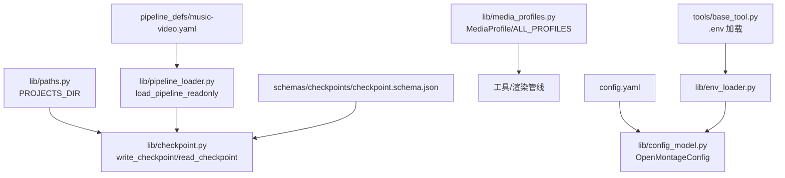
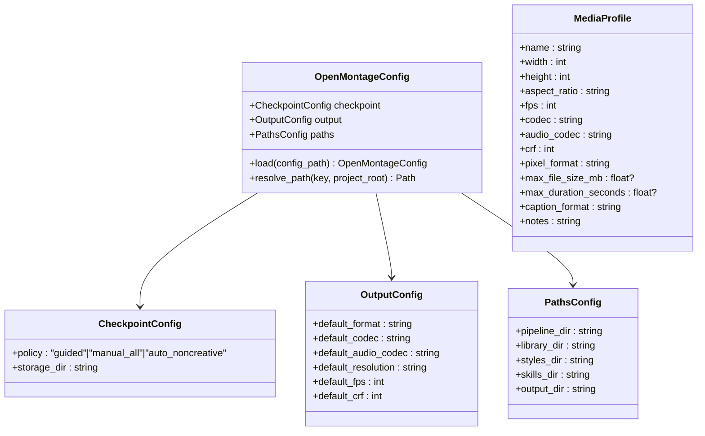
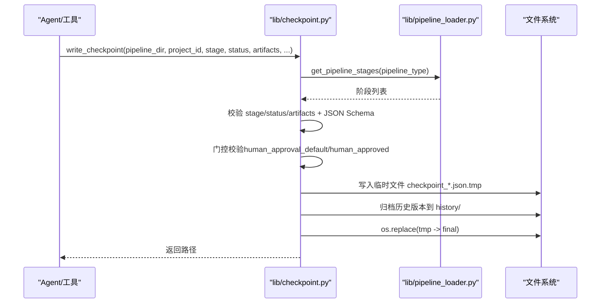
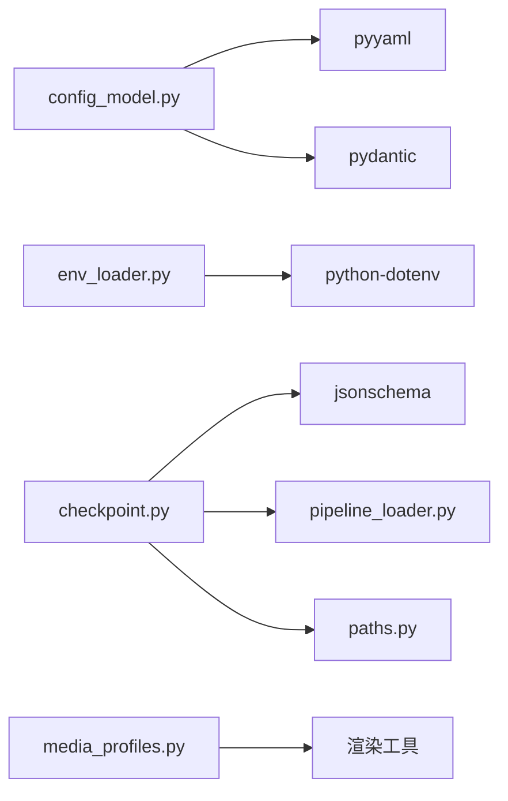

# 配置管理

<cite>
**本文引用的文件**   
- [config.yaml](file://config.yaml)
- [lib/config_model.py](file://lib/config_model.py)
- [lib/env_loader.py](file://lib/env_loader.py)
- [lib/paths.py](file://lib/paths.py)
- [lib/media_profiles.py](file://lib/media_profiles.py)
- [lib/checkpoint.py](file://lib/checkpoint.py)
- [lib/pipeline_loader.py](file://lib/pipeline_loader.py)
- [pipeline_defs/music-video.yaml](file://pipeline_defs/music-video.yaml)
- [schemas/checkpoints/checkpoint.schema.json](file://schemas/checkpoints/checkpoint.schema.json)
- [tools/base_tool.py](file://tools/base_tool.py)
- [requirements.txt](file://requirements.txt)
</cite>

## 目录
1. [简介](#简介)
2. [项目结构](#项目结构)
3. [核心组件](#核心组件)
4. [架构总览](#架构总览)
5. [详细组件分析](#详细组件分析)
6. [依赖关系分析](#依赖关系分析)
7. [性能考虑](#性能考虑)
8. [故障排查指南](#故障排查指南)
9. [结论](#结论)
10. [附录](#附录)

## 简介
本文件面向 OpenMontage-MV 的配置管理系统，系统性说明运行时配置的选项与默认值、环境变量加载机制与优先级、路径配置、媒体配置文件、检查点策略等关键设置；同时给出配置验证规则与错误处理策略，并提供不同部署环境的配置示例与最佳实践。文档还涵盖配置热重载与动态配置更新的实现方式与限制。

## 项目结构
配置相关代码集中在 lib 目录与根级配置文件：
- 根级运行时配置：config.yaml
- 配置模型与加载：lib/config_model.py
- 环境变量加载：lib/env_loader.py
- 仓库与项目根路径：lib/paths.py
- 媒体输出配置（平台预设）：lib/media_profiles.py
- 检查点策略与校验：lib/checkpoint.py
- 流水线清单加载与校验：lib/pipeline_loader.py
- 流水线定义示例：pipeline_defs/music-video.yaml
- 检查点 JSON Schema：schemas/checkpoints/checkpoint.schema.json
- 工具层 .env 加载与依赖校验：tools/base_tool.py
- 依赖声明：requirements.txt

图表来源 
- [config.yaml:1-20](file://config.yaml#L1-L20)
- [lib/config_model.py:1-70](file://lib/config_model.py#L1-L70)
- [lib/env_loader.py:1-35](file://lib/env_loader.py#L1-L35)
- [lib/paths.py:1-18](file://lib/paths.py#L1-L18)
- [lib/media_profiles.py:1-166](file://lib/media_profiles.py#L1-L166)
- [lib/checkpoint.py:1-537](file://lib/checkpoint.py#L1-L537)
- [lib/pipeline_loader.py:1-241](file://lib/pipeline_loader.py#L1-L241)
- [pipeline_defs/music-video.yaml:1-187](file://pipeline_defs/music-video.yaml#L1-L187)
- [schemas/checkpoints/checkpoint.schema.json:1-47](file://schemas/checkpoints/checkpoint.schema.json#L1-L47)
- [tools/base_tool.py:25-58](file://tools/base_tool.py#L25-L58)

章节来源
- [config.yaml:1-20](file://config.yaml#L1-L20)
- [lib/config_model.py:1-70](file://lib/config_model.py#L1-L70)
- [lib/env_loader.py:1-35](file://lib/env_loader.py#L1-L35)
- [lib/paths.py:1-18](file://lib/paths.py#L1-L18)
- [lib/media_profiles.py:1-166](file://lib/media_profiles.py#L1-L166)
- [lib/checkpoint.py:1-537](file://lib/checkpoint.py#L1-L537)
- [lib/pipeline_loader.py:1-241](file://lib/pipeline_loader.py#L1-L241)
- [pipeline_defs/music-video.yaml:1-187](file://pipeline_defs/music-video.yaml#L1-L187)
- [schemas/checkpoints/checkpoint.schema.json:1-47](file://schemas/checkpoints/checkpoint.schema.json#L1-L47)
- [tools/base_tool.py:25-58](file://tools/base_tool.py#L25-L58)

## 核心组件
- 运行时配置模型（Pydantic）
  - CheckpointConfig：检查点策略与存储目录
  - OutputConfig：默认输出格式、编解码器、分辨率、帧率、CRF
  - PathsConfig：各目录路径（pipeline_dir、library_dir、styles_dir、skills_dir、output_dir）
  - OpenMontageConfig：顶层配置，提供 load() 与 resolve_path()
- 环境变量加载
  - load_env()：从项目根加载 .env
  - get_env()/require_env()：安全读取必需或可选的环境变量
- 路径解析
  - REPO_ROOT：仓库根
  - PROJECTS_DIR：可通过 OPENMONTAGE_PROJECTS_DIR 覆盖的项目根
- 媒体配置文件
  - MediaProfile：平台化输出参数集合
  - ALL_PROFILES：内置平台预设字典
  - ffmpeg_output_args()：生成 FFmpeg 输出参数
- 检查点策略与校验
  - write_checkpoint()/read_checkpoint()：持久化阶段状态
  - validate_checkpoint()：基于 JSON Schema 与阶段契约校验
  - default_checkpoint_policy：由流水线清单决定

章节来源
- [lib/config_model.py:16-70](file://lib/config_model.py#L16-L70)
- [lib/env_loader.py:15-35](file://lib/env_loader.py#L15-L35)
- [lib/paths.py:13-18](file://lib/paths.py#L13-L18)
- [lib/media_profiles.py:22-166](file://lib/media_profiles.py#L22-L166)
- [lib/checkpoint.py:94-172](file://lib/checkpoint.py#L94-L172)
- [pipeline_defs/music-video.yaml:14](file://pipeline_defs/music-video.yaml#L14)

## 架构总览
配置系统以 config.yaml 为运行时主配置，通过 Pydantic 模型进行类型校验与默认值填充；环境变量通过 .env 与环境变量注入，覆盖部分行为（如项目根路径）。媒体输出使用内置的 MediaProfile 预设，检查点策略受流水线清单约束并在写入时强制校验。

图表来源 
- [lib/config_model.py:22-49](file://lib/config_model.py#L22-L49)
- [lib/media_profiles.py:22-38](file://lib/media_profiles.py#L22-L38)

章节来源
- [lib/config_model.py:1-70](file://lib/config_model.py#L1-L70)
- [lib/media_profiles.py:1-166](file://lib/media_profiles.py#L1-L166)

## 详细组件分析

### 运行时配置模型与默认值
- 检查点策略（checkpoint.policy）
  - 可选值：guided、manual_all、auto_noncreative
  - 默认值：guided（来自 config.yaml）
  - 运行时可被流水线清单中的 default_checkpoint_policy 覆盖（用于阶段门控）
- 输出配置（output.*）
  - 默认值：mp4/libx264/aac/1920x1080/30/23
- 路径配置（paths.*）
  - 默认值：pipeline/library/styles/skills/output
  - 通过 OpenMontageConfig.resolve_path() 将相对路径解析到项目根

章节来源
- [config.yaml:1-20](file://config.yaml#L1-L20)
- [lib/config_model.py:22-49](file://lib/config_model.py#L22-L49)

### 环境变量加载机制与优先级
- 加载顺序
  1) tools/base_tool.py 在导入时加载 .env（仅设置未存在的键）
  2) lib/env_loader.load_env() 再次加载 .env（若存在）
  3) 进程环境 os.environ 始终具有最高优先级
- 关键环境变量
  - OPENMONTAGE_PROJECTS_DIR：覆盖项目根路径（lib/paths.py）
  - 其他 API Key/凭据：由工具层依赖校验提示缺失并引导设置
- 建议
  - 开发环境使用 .env 管理密钥
  - 生产环境优先使用容器/平台注入的环境变量

章节来源
- [tools/base_tool.py:25-58](file://tools/base_tool.py#L25-L58)
- [lib/env_loader.py:15-35](file://lib/env_loader.py#L15-L35)
- [lib/paths.py:13-18](file://lib/paths.py#L13-L18)

### 路径配置与项目根
- REPO_ROOT：仓库根（不可变）
- PROJECTS_DIR：项目根，默认 REPO_ROOT/projects，可通过 OPENMONTAGE_PROJECTS_DIR 覆盖
- Backlot 看板与检查点读写均基于 PROJECTS_DIR

章节来源
- [lib/paths.py:13-18](file://lib/paths.py#L13-L18)
- [lib/checkpoint.py:88-91](file://lib/checkpoint.py#L88-L91)

### 媒体配置文件与输出参数
- MediaProfile：封装分辨率、宽高比、帧率、编解码器、CRF、像素格式、大小/时长限制、字幕格式等
- ALL_PROFILES：内置平台预设（YouTube/TikTok/Instagram/LinkedIn/Cinematic/Generic HD）
- ffmpeg_output_args(profile)：生成 FFmpeg 输出参数列表

章节来源
- [lib/media_profiles.py:22-166](file://lib/media_profiles.py#L22-L166)

### 检查点策略与校验流程
- 策略来源
  - config.yaml 中 checkpoint.policy 提供默认策略
  - pipeline manifest 中 default_checkpoint_policy 作为绑定来源
- 写入流程要点
  - 校验 stage/status/artifacts 与 JSON Schema
  - 门控校验：若阶段需要人工审批，则禁止直接写入 completed 且 human_approved=False
  - 原子写入：先写临时文件，再归档旧版本至 history/，最后替换
- 读取与恢复
  - read_checkpoint/get_latest_checkpoint 支持按 mtime 获取最新检查点
  - get_completed_stages/get_next_stage 驱动流水线推进

图表来源 
- [lib/checkpoint.py:336-467](file://lib/checkpoint.py#L336-L467)
- [lib/pipeline_loader.py:125-182](file://lib/pipeline_loader.py#L125-L182)
- [schemas/checkpoints/checkpoint.schema.json:1-47](file://schemas/checkpoints/checkpoint.schema.json#L1-L47)

章节来源
- [lib/checkpoint.py:94-172](file://lib/checkpoint.py#L94-L172)
- [lib/checkpoint.py:336-467](file://lib/checkpoint.py#L336-L467)
- [pipeline_defs/music-video.yaml:14](file://pipeline_defs/music-video.yaml#L14)
- [schemas/checkpoints/checkpoint.schema.json:1-47](file://schemas/checkpoints/checkpoint.schema.json#L1-L47)

### 流水线清单与默认策略
- music-video.yaml 定义了 stages、required_artifacts、human_approval_default 等
- default_checkpoint_policy 指定该流水线的默认检查点策略
- 阶段门控：human_approval_default 为 true 的阶段必须经人工批准才能标记 completed

章节来源
- [pipeline_defs/music-video.yaml:1-187](file://pipeline_defs/music-video.yaml#L1-L187)
- [lib/pipeline_loader.py:173-182](file://lib/pipeline_loader.py#L173-L182)

## 依赖关系分析
- 运行时依赖
  - pyyaml、pydantic、jsonschema、python-dotenv、requests
  - FastAPI/Uvicorn/watchfiles（Backlot 看板）
- 模块耦合
  - config_model 依赖 yaml/pydantic
  - env_loader 依赖 dotenv
  - checkpoint 依赖 jsonschema、pipeline_loader、paths
  - media_profiles 独立，供渲染工具链使用

图表来源 
- [requirements.txt:1-12](file://requirements.txt#L1-L12)
- [lib/config_model.py:1-13](file://lib/config_model.py#L1-L13)
- [lib/env_loader.py:1-12](file://lib/env_loader.py#L1-L12)
- [lib/checkpoint.py:15-18](file://lib/checkpoint.py#L15-L18)
- [lib/pipeline_loader.py:12-14](file://lib/pipeline_loader.py#L12-L14)

章节来源
- [requirements.txt:1-12](file://requirements.txt#L1-L12)

## 性能考虑
- 流水线清单缓存：load_pipeline_readonly 使用 lru_cache 避免重复解析与校验
- 检查点写入原子性：临时文件+os.replace 减少损坏风险
- 历史归档：history/ 保留变更轨迹，但应避免频繁重跑导致历史膨胀
- 媒体参数：合理选择 CRF/分辨率/帧率平衡质量与体积

[本节为通用指导，不直接分析具体文件]

## 故障排查指南
- 常见错误
  - 缺少必需环境变量：工具依赖校验会抛出 DependencyError 并提示缺失的 env 键
  - 检查点校验失败：stage/status/artifacts 不符合 Schema 或阶段契约
  - 门控违规：对需人工审批的阶段写入 completed 且 human_approved=False 将触发 GATE VIOLATION
- 定位方法
  - 查看 .env 是否加载成功（tools/base_tool.py 导入时加载）
  - 确认 OPENMONTAGE_PROJECTS_DIR 指向正确的项目根
  - 检查 pipeline manifest 的 default_checkpoint_policy 与 human_approval_default
  - 查看 checkpoint schema 与 artifact schema 的校验错误信息

章节来源
- [tools/base_tool.py:304-327](file://tools/base_tool.py#L304-L327)
- [lib/checkpoint.py:140-172](file://lib/checkpoint.py#L140-L172)
- [lib/checkpoint.py:378-405](file://lib/checkpoint.py#L378-L405)
- [schemas/checkpoints/checkpoint.schema.json:1-47](file://schemas/checkpoints/checkpoint.schema.json#L1-L47)

## 结论
OpenMontage-MV 的配置系统以 Pydantic 模型为核心，结合 .env 与环境变量注入，提供强类型与默认值保障；媒体输出通过 MediaProfile 标准化；检查点策略受流水线清单约束并在写入时严格校验。遵循本文档的路径与策略约定，可在多环境中稳定运行并快速定位问题。

[本节为总结，不直接分析具体文件]

## 附录

### 配置项参考表
- 检查点策略（checkpoint.policy）
  - 取值：guided、manual_all、auto_noncreative
  - 默认：guided（config.yaml）
- 输出配置（output.*）
  - 默认：mp4、libx264、aac、1920x1080、30、23
- 路径配置（paths.*）
  - 默认：pipeline、library、styles、skills、output
- 环境变量
  - OPENMONTAGE_PROJECTS_DIR：覆盖项目根

章节来源
- [config.yaml:1-20](file://config.yaml#L1-L20)
- [lib/config_model.py:22-49](file://lib/config_model.py#L22-L49)
- [lib/paths.py:13-18](file://lib/paths.py#L13-L18)

### 不同部署环境的配置示例与最佳实践
- 本地开发
  - 使用 .env 存放 API Key
  - 保持默认路径，便于 Backlot 看板监控
- 测试/预发
  - 通过 OPENMONTAGE_PROJECTS_DIR 指向隔离目录
  - 使用 manual_all 策略强化人工审核
- 生产环境
  - 通过平台注入环境变量（不使用 .env）
  - 根据平台选择合适 MediaProfile（如 youtube_landscape、tiktok）
  - 合理设置 CRF/分辨率/帧率控制成本与质量

[本节为概念性指导，不直接分析具体文件]

### 配置热重载与动态更新
- 当前实现
  - 流水线清单加载使用 lru_cache，进程内不会自动热重载
  - 检查点写入与读取为即时 IO，无需额外缓存
- 建议方案
  - 重启服务以重新加载清单（推荐）
  - 如需进程内热重载，可在调用处显式清除 _load_manifest_schema/_load_pipeline_cached 的缓存后重新加载
  - 运行时配置（config.yaml）目前由 Pydantic 模型一次性加载，建议在启动时加载一次，后续通过环境变量覆盖关键路径与策略

章节来源
- [lib/pipeline_loader.py:27-46](file://lib/pipeline_loader.py#L27-L46)
- [lib/config_model.py:52-62](file://lib/config_model.py#L52-L62)