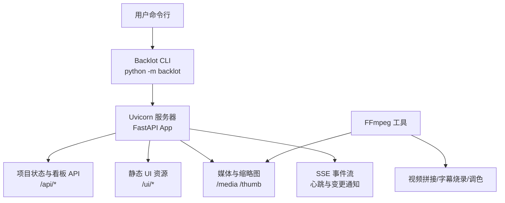
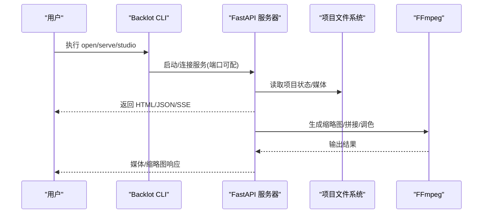
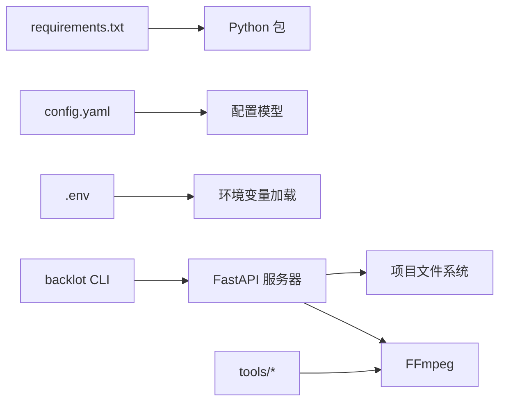

# 快速开始指南

<cite>
**本文引用的文件**   
- [requirements.txt](file://requirements.txt)
- [config.yaml](file://config.yaml)
- [backlot/__main__.py](file://backlot/__main__.py)
- [backlot/server.py](file://backlot/server.py)
- [lib/config_model.py](file://lib/config_model.py)
- [lib/env_loader.py](file://lib/env_loader.py)
- [lib/media_profiles.py](file://lib/media_profiles.py)
- [tools/video/video_stitch.py](file://tools/video/video_stitch.py)
- [tools/enhancement/color_grade.py](file://tools/enhancement/color_grade.py)
- [pipeline_defs/music-video.yaml](file://pipeline_defs/music-video.yaml)
- [AGENT_GUIDE.md](file://AGENT_GUIDE.md)
- [tests/README.md](file://tests/README.md)
</cite>

## 目录
1. [简介](#简介)
2. [项目结构](#项目结构)
3. [核心组件](#核心组件)
4. [架构总览](#架构总览)
5. [详细组件分析](#详细组件分析)
6. [依赖关系分析](#依赖关系分析)
7. [性能注意事项](#性能注意事项)
8. [故障排除指南](#故障排除指南)
9. [结论](#结论)
10. [附录](#附录)

## 简介
本指南面向首次接触 OpenMontage-MV 的用户，目标是在 30 分钟内完成环境准备、安装依赖、配置运行，并成功启动本地看板服务与示例流程。OpenMontage-MV 是一个以 ASS 卡拉 OK 歌词驱动的音乐视频制作流水线，通过 Backlot 看板提供可视化状态与媒体预览，使用 FFmpeg 作为统一渲染后端。

## 项目结构
- backlot：本地看板服务器（FastAPI + Uvicorn），提供项目库浏览、实时事件、媒体与缩略图服务、Studio 聊天工作台等。
- lib：运行时配置模型与环境变量加载器，集中管理 config.yaml 与 .env。
- tools：工具集（视频拼接、音频混音、色彩分级等），均基于 FFmpeg 或 Python 模块实现。
- pipeline_defs：流水线清单（music-video.yaml），定义阶段、产物、工具与质量门禁。
- skills/.agents/skills：导演技能与外部工艺文档，指导 AI Agent 按步骤执行。
- config.yaml：运行时配置（检查点策略、输出参数、路径映射）。
- requirements.txt：Python 依赖清单。

图表来源
- [backlot/__main__.py](file://backlot/__main__.py)
- [backlot/server.py](file://backlot/server.py)
- [tools/video/video_stitch.py](file://tools/video/video_stitch.py)
- [tools/enhancement/color_grade.py](file://tools/enhancement/color_grade.py)

章节来源
- [backlot/__main__.py](file://backlot/__main__.py)
- [backlot/server.py](file://backlot/server.py)

## 核心组件
- Backlot CLI：用于启动/打开看板与 Studio，支持后台进程管理与日志轮转。
- FastAPI 应用：提供健康检查、项目列表、项目状态、SSE 事件、媒体访问、UI 页面路由。
- 配置模型：从 config.yaml 加载并校验 checkpoint/output/paths 等配置项。
- 环境变量加载：自动加载 .env 文件，供工具发现与鉴权使用。
- 媒体处理工具：视频拼接、音频混音、色彩分级，均依赖 FFmpeg。

章节来源
- [backlot/__main__.py](file://backlot/__main__.py)
- [backlot/server.py](file://backlot/server.py)
- [lib/config_model.py](file://lib/config_model.py)
- [lib/env_loader.py](file://lib/env_loader.py)

## 架构总览
OpenMontage-MV 的运行时由“CLI → 服务器 → 文件系统 → 工具”构成闭环。CLI 负责启动/打开服务；服务器监听项目目录变化并通过 SSE 推送更新；媒体与缩略图生成依赖 FFmpeg；配置与路径由 config.yaml 与 .env 统一管理。

图表来源
- [backlot/__main__.py](file://backlot/__main__.py)
- [backlot/server.py](file://backlot/server.py)
- [tools/video/video_stitch.py](file://tools/video/video_stitch.py)
- [tools/enhancement/color_grade.py](file://tools/enhancement/color_grade.py)

## 详细组件分析

### 环境与依赖安装
- Python 版本：建议使用 3.10+（Pydantic v2、FastAPI、uvicorn 等要求较新）。
- 系统工具：必须安装 FFmpeg，并确保在 PATH 中可用（视频缩略图、拼接、字幕烧录、调色均依赖）。
- Python 依赖：通过 requirements.txt 安装。

常用命令
- 创建虚拟环境（可选但推荐）
  - python -m venv .venv && source .venv/bin/activate（Linux/macOS）
  - python -m venv .venv && .venv\Scripts\activate（Windows）
- 安装依赖
  - pip install -r requirements.txt
- 验证 FFmpeg
  - ffmpeg -version

章节来源
- [requirements.txt](file://requirements.txt)
- [tools/video/video_stitch.py](file://tools/video/video_stitch.py)
- [tools/enhancement/color_grade.py](file://tools/enhancement/color_grade.py)

### 配置文件设置
- config.yaml：定义检查点策略、默认输出格式/编码/分辨率/FPS/CRF，以及 pipeline/library/styles/skills/output 等路径。
- .env：存放 API Key 等敏感信息，会被工具注册表与环境加载器自动读取。

建议操作
- 复制或编辑根目录下的 config.yaml，按需调整 output 与 paths。
- 如需设置环境变量（如 API Key），在项目根目录创建 .env 文件，键值对形式保存。

章节来源
- [config.yaml](file://config.yaml)
- [lib/config_model.py](file://lib/config_model.py)
- [lib/env_loader.py](file://lib/env_loader.py)
- [tools/tool_registry.py](file://tools/tool_registry.py)

### 启动服务器与打开项目库
- 前台运行服务器
  - python -m backlot serve --port 8000
- 后台启动并打开浏览器看板
  - python -m backlot open
- 打开 Studio 聊天工作台
  - python -m backlot studio

说明
- 若服务未运行，open/studio 会自动拉起后台进程并等待就绪后打开浏览器。
- 可通过 BACKLOT_PORT 与 BACKLOT_HOST 环境变量控制端口与绑定地址。

章节来源
- [backlot/__main__.py](file://backlot/__main__.py)
- [backlot/server.py](file://backlot/server.py)

### 运行音乐视频流水线（概念流程）
- 准备输入：ASS 歌词文件与歌曲音频（可在 music_library/ 放置）。
- 初始化项目工作区并写入 project.json。
- 依次执行 idea → proposal → storyboard → assets → edit → compose → publish。
- 最终产出：projects/<project-id>/renders/final.mp4 与 storyboard.md/json。

注意
- 所有生产必须走 music-video 流水线，遵循 AGENT_GUIDE 的规则与阶段技能。
- 若无音频，可降级为仅输出 storyboard。

章节来源
- [pipeline_defs/music-video.yaml](file://pipeline_defs/music-video.yaml)
- [AGENT_GUIDE.md](file://AGENT_GUIDE.md)

### 媒体与缩略图
- 媒体访问：/media/{project_id}/{file_path}
- 缩略图：/thumb/{project_id}/{file_path}?w=640（视频会抽取一帧，图片会缩放缓存）
- 缩略图缓存：.backlot/thumbs

章节来源
- [backlot/server.py](file://backlot/server.py)

## 依赖关系分析
- Python 依赖：pyyaml、pydantic、jsonschema、python-dotenv、requests、fastapi、uvicorn、watchfiles。
- 系统依赖：FFmpeg（二进制命令）。
- 运行时依赖：config.yaml（路径与输出参数）、.env（环境变量）。

图表来源
- [requirements.txt](file://requirements.txt)
- [lib/config_model.py](file://lib/config_model.py)
- [lib/env_loader.py](file://lib/env_loader.py)
- [backlot/__main__.py](file://backlot/__main__.py)
- [backlot/server.py](file://backlot/server.py)
- [tools/video/video_stitch.py](file://tools/video/video_stitch.py)
- [tools/enhancement/color_grade.py](file://tools/enhancement/color_grade.py)

章节来源
- [requirements.txt](file://requirements.txt)
- [lib/config_model.py](file://lib/config_model.py)
- [lib/env_loader.py](file://lib/env_loader.py)
- [backlot/__main__.py](file://backlot/__main__.py)
- [backlot/server.py](file://backlot/server.py)

## 性能注意事项
- 缩略图与媒体响应采用缓存与范围请求优化，避免重复计算与大文件传输。
- watchfiles 监控项目目录变更，批量去抖后通过 SSE 推送，减少前端刷新压力。
- FFmpeg 调用尽量复用预设与参数，避免不必要的重编码。

章节来源
- [backlot/server.py](file://backlot/server.py)
- [lib/media_profiles.py](file://lib/media_profiles.py)
- [tools/video/video_stitch.py](file://tools/video/video_stitch.py)
- [tools/enhancement/color_grade.py](file://tools/enhancement/color_grade.py)

## 故障排除指南
- FFmpeg 未安装或不在 PATH
  - 症状：缩略图生成失败、视频拼接/字幕烧录报错。
  - 解决：安装 FFmpeg 并加入 PATH，再次尝试。
- 端口占用或无法启动服务
  - 症状：open/studio 提示服务未就绪。
  - 解决：更换 BACKLOT_PORT，或关闭占用进程后重试。
- .env 未生效
  - 症状：工具报缺少环境变量或 API Key。
  - 解决：确认 .env 位于项目根目录且键名正确，重启服务。
- 项目目录权限问题
  - 症状：读写 artifacts/checkpoints 失败。
  - 解决：确保 projects/ 与 output_dir 有读写权限。
- 流水线阶段卡住
  - 症状：in_progress 长时间无活动。
  - 解决：查看 events.jsonl 与 server.log，确认是否阻塞或外部依赖不可用。

章节来源
- [backlot/server.py](file://backlot/server.py)
- [tools/base_tool.py](file://tools/base_tool.py)
- [tools/tool_registry.py](file://tools/tool_registry.py)
- [tests/README.md](file://tests/README.md)

## 结论
通过以上步骤，你可以在 30 分钟内完成 OpenMontage-MV 的环境搭建、配置与服务启动，并使用 Backlot 看板观察项目状态与媒体预览。后续按照 music-video 流水线逐步推进，即可产出完整的音乐视频与故事板。

## 附录

### 常用命令速查
- 安装依赖
  - pip install -r requirements.txt
- 启动服务（前台）
  - python -m backlot serve --port 8000
- 打开看板（自动启动服务）
  - python -m backlot open
- 打开 Studio
  - python -m backlot studio
- 验证 FFmpeg
  - ffmpeg -version

章节来源
- [backlot/__main__.py](file://backlot/__main__.py)
- [requirements.txt](file://requirements.txt)