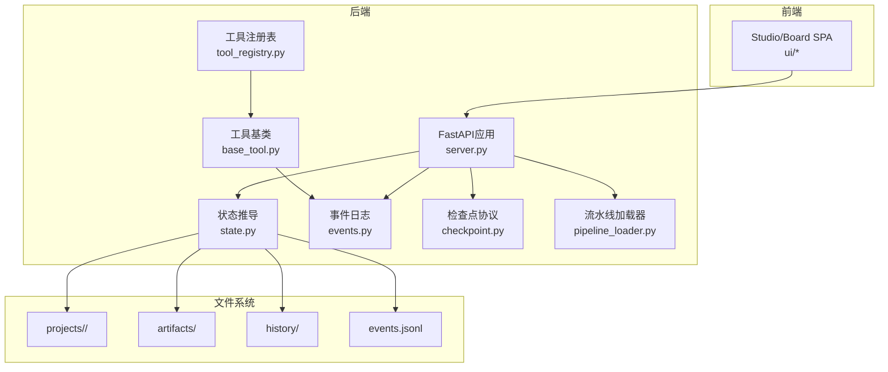
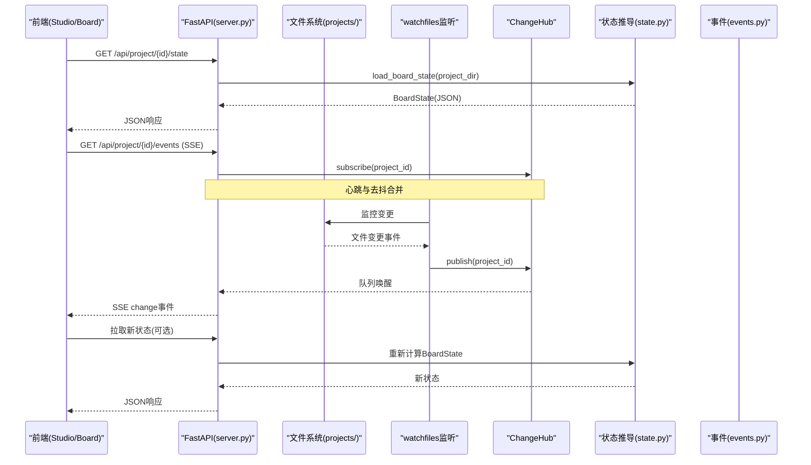
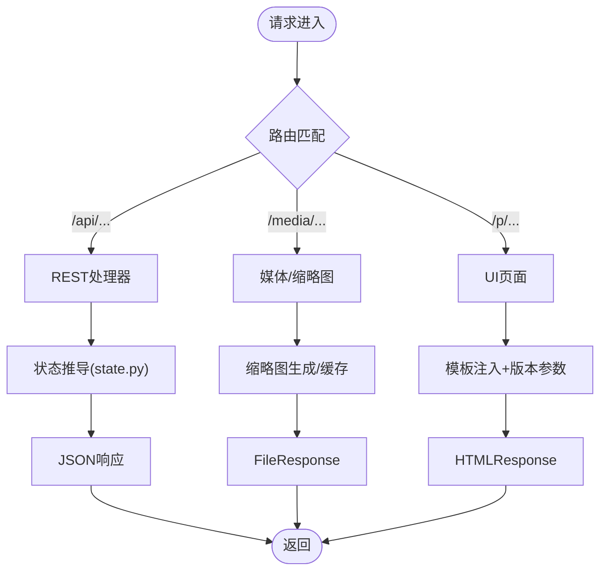
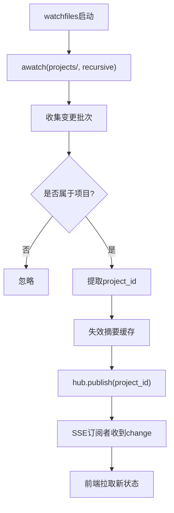
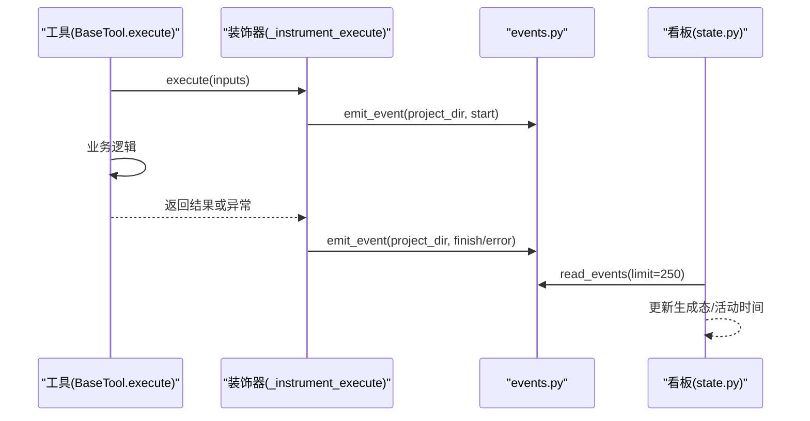
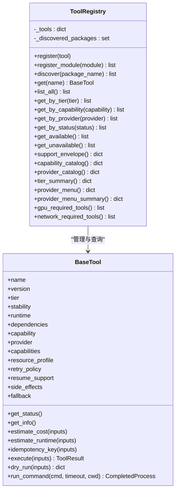
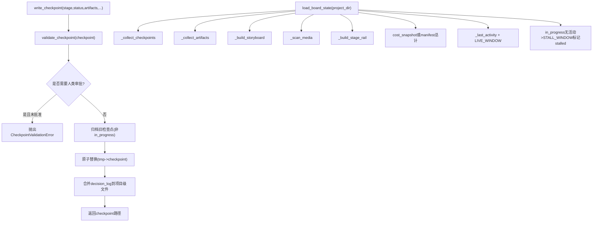
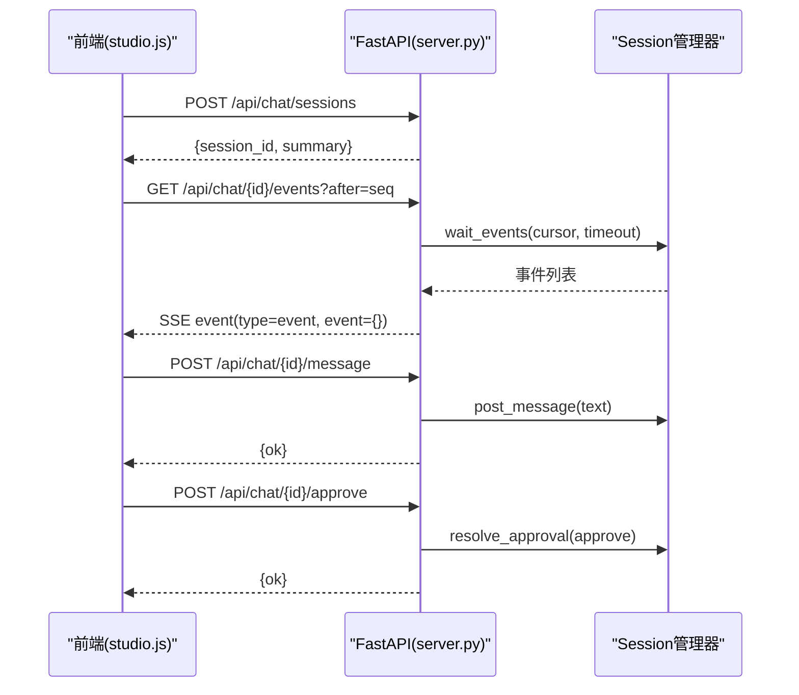
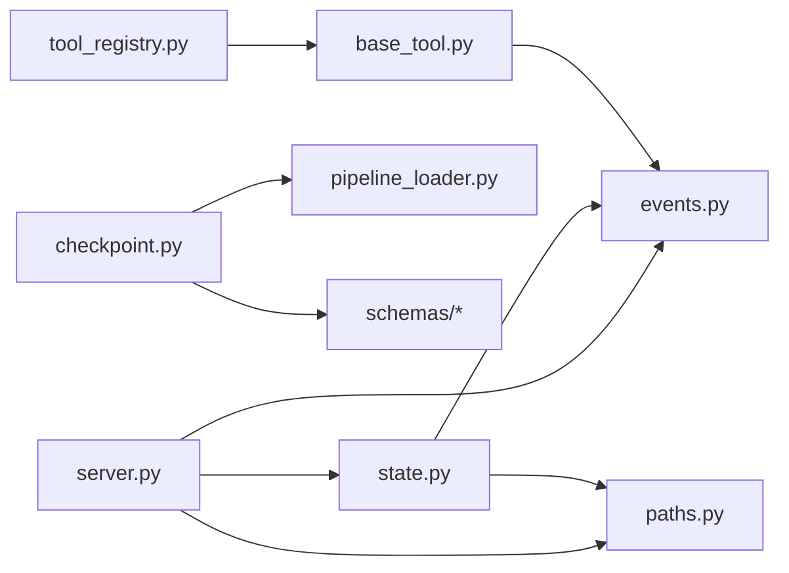

# 技术架构概览

<cite>
**本文引用的文件**   
- [backlot/server.py](file://backlot/server.py)
- [backlot/state.py](file://backlot/state.py)
- [lib/events.py](file://lib/events.py)
- [lib/checkpoint.py](file://lib/checkpoint.py)
- [tools/base_tool.py](file://tools/base_tool.py)
- [tools/tool_registry.py](file://tools/tool_registry.py)
- [lib/pipeline_loader.py](file://lib/pipeline_loader.py)
- [pipeline_defs/music-video.yaml](file://pipeline_defs/music-video.yaml)
- [config.yaml](file://config.yaml)
- [lib/paths.py](file://lib/paths.py)
- [backlot/ui/studio.js](file://backlot/ui/studio.js)
</cite>

## 目录
1. [简介](#简介)
2. [项目结构](#项目结构)
3. [核心组件](#核心组件)
4. [架构总览](#架构总览)
5. [详细组件分析](#详细组件分析)
6. [依赖关系分析](#依赖关系分析)
7. [性能考量](#性能考量)
8. [故障排查指南](#故障排查指南)
9. [结论](#结论)
10. [附录](#附录)

## 简介
本技术文档面向OpenMontage-MV项目的开发者与架构师，系统性阐述基于FastAPI的后端服务、事件驱动的实时通信机制、插件化工具系统、MVC设计模式的应用、AI流水线编排引擎（技能定义、检查点协议、状态管理）、前后端分离架构（REST API + SSE事件流），以及以文件系统为单一数据源的设计与watchfiles实现的实时监听机制。文档包含架构图与交互时序图，帮助读者理解整体设计与技术选型原因。

## 项目结构
- 后端服务：backlot/server.py提供FastAPI应用、SSE事件流、媒体与缩略图服务、UI页面路由。
- 状态与看板：backlot/state.py将项目目录转换为可渲染的BoardState，聚合阶段轨道、制品、故事板、媒体与事件。
- 事件系统：lib/events.py维护每个项目的append-only事件日志events.jsonl，供看板实时刷新与生成态展示。
- 检查点协议：lib/checkpoint.py实现阶段检查点的写入、校验、归档与人类审批门控。
- 工具系统与注册表：tools/base_tool.py定义统一工具契约；tools/tool_registry.py负责自动发现、能力报告与降级策略。
- 流水线编排：lib/pipeline_loader.py加载并校验pipeline manifest；pipeline_defs/*.yaml声明阶段顺序、产物、工具与人类审批默认值。
- 路径与配置：lib/paths.py集中定义仓库根与projects根；config.yaml给出运行时默认输出与路径配置。
- 前端：backlot/ui/*提供SPA界面，通过REST与SSE与后端交互。

图表来源
- [backlot/server.py:151-406](file://backlot/server.py#L151-L406)
- [backlot/state.py:586-656](file://backlot/state.py#L586-L656)
- [lib/events.py:77-119](file://lib/events.py#L77-L119)
- [lib/checkpoint.py:336-467](file://lib/checkpoint.py#L336-L467)
- [tools/base_tool.py:227-397](file://tools/base_tool.py#L227-L397)
- [tools/tool_registry.py:55-134](file://tools/tool_registry.py#L55-L134)
- [lib/pipeline_loader.py:49-70](file://lib/pipeline_loader.py#L49-L70)

章节来源
- [backlot/server.py:151-406](file://backlot/server.py#L151-L406)
- [backlot/state.py:586-656](file://backlot/state.py#L586-L656)
- [lib/events.py:77-119](file://lib/events.py#L77-L119)
- [lib/checkpoint.py:336-467](file://lib/checkpoint.py#L336-L467)
- [tools/base_tool.py:227-397](file://tools/base_tool.py#L227-L397)
- [tools/tool_registry.py:55-134](file://tools/tool_registry.py#L55-L134)
- [lib/pipeline_loader.py:49-70](file://lib/pipeline_loader.py#L49-L70)

## 核心组件
- FastAPI服务层：暴露REST API与SSE事件流，挂载静态UI，处理缩略图与媒体范围请求。
- 文件系统驱动的状态机：以projects/<id>为唯一数据源，读取checkpoints、artifacts、events.jsonl，组合出BoardState。
- 事件总线：ChangeHub按项目过滤广播变更，配合watchfiles监听文件系统变化，触发SSE推送。
- 工具契约与注册表：BaseTool统一execute接口与元数据；Registry自动发现、能力汇总、降级与菜单生成。
- 检查点协议：校验阶段、状态、产物与人类审批门控，支持历史归档与决策日志合并。
- 流水线编排：YAML清单定义阶段顺序、产物、工具与人类审批默认值；加载器提供缓存与扩展权限控制。

章节来源
- [backlot/server.py:151-406](file://backlot/server.py#L151-L406)
- [backlot/state.py:586-656](file://backlot/state.py#L586-L656)
- [lib/events.py:77-119](file://lib/events.py#L77-L119)
- [lib/checkpoint.py:336-467](file://lib/checkpoint.py#L336-L467)
- [tools/base_tool.py:227-397](file://tools/base_tool.py#L227-L397)
- [tools/tool_registry.py:55-134](file://tools/tool_registry.py#L55-L134)
- [lib/pipeline_loader.py:49-70](file://lib/pipeline_loader.py#L49-L70)

## 架构总览
系统采用前后端分离与文件系统作为单一数据源的架构。后端通过FastAPI提供REST API与SSE事件流；前端通过浏览器EventSource订阅事件，实现实时反馈。watchfiles在后台持续监听projects目录，变更时通过ChangeHub广播，前端拉取最新状态或增量事件。

图表来源
- [backlot/server.py:185-242](file://backlot/server.py#L185-L242)
- [backlot/server.py:132-149](file://backlot/server.py#L132-L149)
- [backlot/state.py:586-656](file://backlot/state.py#L586-L656)
- [lib/events.py:77-119](file://lib/events.py#L77-L119)

## 详细组件分析

### 后端服务与实时通信（FastAPI + SSE）
- REST API：健康检查、项目列表、项目状态、作品集扫描、缩略图与媒体访问、聊天会话管理等。
- SSE事件流：项目级与库级事件流，心跳保活，批量合并去抖，断线重连友好。
- UI路由：返回HTML并注入资源版本参数，强制no-cache避免缓存问题。
- 缩略图：对图片缩放与视频抽帧，结果缓存到磁盘，并发安全。

图表来源
- [backlot/server.py:166-242](file://backlot/server.py#L166-L242)
- [backlot/server.py:329-361](file://backlot/server.py#L329-L361)
- [backlot/server.py:365-406](file://backlot/server.py#L365-L406)

章节来源
- [backlot/server.py:151-406](file://backlot/server.py#L151-L406)

### 文件系统为单一数据源与watchfiles实时监听
- projects/<id>目录结构：checkpoint_*.json、artifacts/*.json、events.jsonl、renders、snapshots等。
- state.py只读解析，容错处理损坏JSON与缺失文件，保证“永不阻塞、永不崩溃”。
- watchfiles后台任务监听projects目录，过滤噪声路径，按项目ID广播变更，失效摘要缓存。

图表来源
- [backlot/server.py:132-149](file://backlot/server.py#L132-L149)
- [backlot/state.py:586-656](file://backlot/state.py#L586-L656)

章节来源
- [backlot/server.py:132-149](file://backlot/server.py#L132-L149)
- [backlot/state.py:586-656](file://backlot/state.py#L586-L656)

### 事件驱动的工具执行与实时活动
- BaseTool.execute被装饰器包装，自动推断项目归属，记录start/finish/error事件到events.jsonl。
- events.py线程安全追加，容忍损坏行，read_events限制条数用于看板。
- 看板根据最近事件判断场景生成态与活跃性。

图表来源
- [tools/base_tool.py:148-224](file://tools/base_tool.py#L148-L224)
- [lib/events.py:77-119](file://lib/events.py#L77-L119)
- [backlot/state.py:401-493](file://backlot/state.py#L401-L493)

章节来源
- [tools/base_tool.py:148-224](file://tools/base_tool.py#L148-L224)
- [lib/events.py:77-119](file://lib/events.py#L77-L119)
- [backlot/state.py:401-493](file://backlot/state.py#L401-L493)

### 插件化工具系统（BaseTool + Registry）
- BaseTool定义统一的元数据、能力描述、资源需求、重试策略、成本估算、幂等键、执行模式等。
- ToolRegistry自动发现tools包下的具体工具类，构建能力目录、提供者菜单、GPU/网络需求统计。
- 支持fallback工具链与可用性状态切换。

图表来源
- [tools/base_tool.py:227-481](file://tools/base_tool.py#L227-L481)
- [tools/tool_registry.py:55-493](file://tools/tool_registry.py#L55-L493)

章节来源
- [tools/base_tool.py:227-481](file://tools/base_tool.py#L227-L481)
- [tools/tool_registry.py:55-493](file://tools/tool_registry.py#L55-L493)

### AI流水线编排引擎（技能、检查点协议、状态管理）
- 技能定义：pipeline_defs/music-video.yaml声明阶段顺序、产物、工具、人类审批默认值与审查焦点。
- 检查点协议：write_checkpoint校验阶段、状态、产物与人类审批门控；历史归档与决策日志合并；schema验证。
- 状态管理：load_board_state聚合checkpoints、artifacts、events、storyboard、media，计算活跃性与停滞检测。

图表来源
- [lib/checkpoint.py:336-467](file://lib/checkpoint.py#L336-L467)
- [lib/checkpoint.py:140-172](file://lib/checkpoint.py#L140-L172)
- [backlot/state.py:586-656](file://backlot/state.py#L586-L656)
- [pipeline_defs/music-video.yaml:36-187](file://pipeline_defs/music-video.yaml#L36-L187)

章节来源
- [lib/checkpoint.py:336-467](file://lib/checkpoint.py#L336-L467)
- [backlot/state.py:586-656](file://backlot/state.py#L586-L656)
- [pipeline_defs/music-video.yaml:36-187](file://pipeline_defs/music-video.yaml#L36-L187)

### 前后端分离与REST+SSE结合
- 前端通过GET获取状态与页面，通过EventSource订阅SSE事件流，处理hello/heartbeat/change/event消息类型。
- Studio聊天会话通过/api/chat/*与SSE事件流交互，支持中断、审批、事件回放。

图表来源
- [backlot/server.py:252-326](file://backlot/server.py#L252-L326)
- [backlot/ui/studio.js:1-200](file://backlot/ui/studio.js#L1-L200)

章节来源
- [backlot/server.py:252-326](file://backlot/server.py#L252-L326)
- [backlot/ui/studio.js:1-200](file://backlot/ui/studio.js#L1-L200)

## 依赖关系分析
- server.py依赖state.py进行状态推导，依赖events.py进行事件读写，依赖watchfiles进行文件系统监听。
- checkpoint.py依赖pipeline_loader.py获取阶段顺序与人类审批默认值，依赖schemas进行校验。
- base_tool.py与tool_registry.py构成工具生态，registry自动发现工具并生成能力目录。
- paths.py集中定义REPO_ROOT与PROJECTS_DIR，确保全链路路径一致性。

图表来源
- [backlot/server.py:151-406](file://backlot/server.py#L151-L406)
- [backlot/state.py:586-656](file://backlot/state.py#L586-L656)
- [lib/checkpoint.py:336-467](file://lib/checkpoint.py#L336-L467)
- [lib/pipeline_loader.py:49-70](file://lib/pipeline_loader.py#L49-L70)
- [tools/base_tool.py:227-397](file://tools/base_tool.py#L227-L397)
- [tools/tool_registry.py:55-134](file://tools/tool_registry.py#L55-L134)
- [lib/paths.py:1-18](file://lib/paths.py#L1-L18)

章节来源
- [backlot/server.py:151-406](file://backlot/server.py#L151-L406)
- [backlot/state.py:586-656](file://backlot/state.py#L586-L656)
- [lib/checkpoint.py:336-467](file://lib/checkpoint.py#L336-L467)
- [lib/pipeline_loader.py:49-70](file://lib/pipeline_loader.py#L49-L70)
- [tools/base_tool.py:227-397](file://tools/base_tool.py#L227-L397)
- [tools/tool_registry.py:55-134](file://tools/tool_registry.py#L55-L134)
- [lib/paths.py:1-18](file://lib/paths.py#L1-L18)

## 性能考量
- 文件系统监听：watchfiles使用异步迭代与批处理，避免频繁I/O；ChangeHub按项目过滤，防止无关项目风暴。
- 状态推导：load_board_state仅读取必要文件，limit事件条数，缓存项目摘要并在变更时失效。
- 缩略图：并发安全的临时文件命名与原子替换，避免竞争条件；缓存命中减少重复计算。
- SSE心跳：固定间隔心跳保持连接活跃，超时后发送心跳，客户端可据此做重连与去抖。
- 流水线加载：lru_cache缓存manifest与schema，降低热路径开销。

[本节为通用指导，不直接分析具体文件]

## 故障排查指南
- 事件丢失：检查events.jsonl是否存在与可读；read_events容忍损坏行，确认limit设置合理。
- 状态不一致：确认watchfiles是否可用；若不可用，前端需手动刷新；检查summary缓存失效逻辑。
- 检查点失败：查看CheckpointValidationError信息，确认stage/status/artifacts符合schema与门控要求。
- 工具不可用：通过ToolRegistry.get_unavailable()与provider_menu_summary()定位缺失依赖与环境变量。
- SSE断连：前端应处理断线重连与序列号去重；服务端心跳间隔可调。

章节来源
- [lib/events.py:98-119](file://lib/events.py#L98-L119)
- [backlot/server.py:132-149](file://backlot/server.py#L132-L149)
- [lib/checkpoint.py:140-172](file://lib/checkpoint.py#L140-L172)
- [tools/tool_registry.py:316-471](file://tools/tool_registry.py#L316-L471)

## 结论
OpenMontage-MV以文件系统为单一数据源，结合FastAPI与SSE实现高内聚、低耦合的实时协作体验。工具系统通过统一契约与注册表实现插件化扩展，流水线编排通过YAML清单与检查点协议保障流程可控与可审计。该设计兼顾了可扩展性、可观测性与鲁棒性，适合复杂的多阶段媒体生产流水线。

[本节为总结，不直接分析具体文件]

## 附录
- 配置项：config.yaml定义输出格式、编解码、分辨率、FPS、CRF与路径映射。
- 路径约定：lib/paths.py集中定义REPO_ROOT与PROJECTS_DIR，环境变量覆盖便于测试与部署。

章节来源
- [config.yaml:1-20](file://config.yaml#L1-L20)
- [lib/paths.py:1-18](file://lib/paths.py#L1-L18)