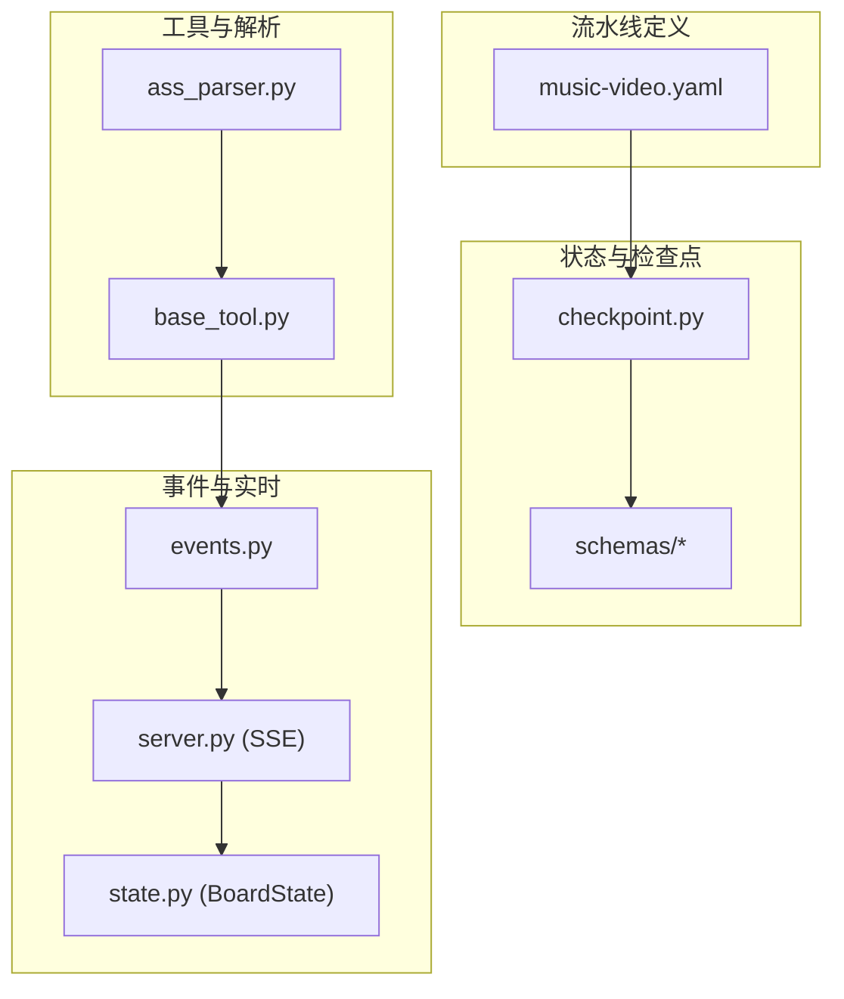
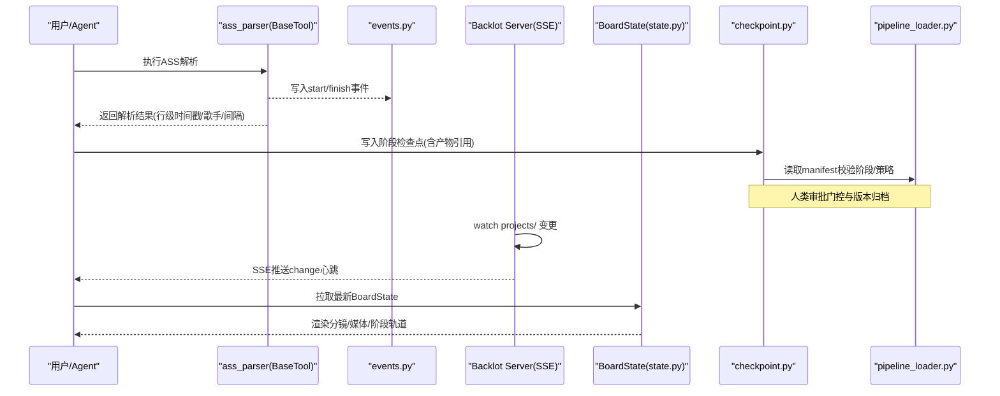
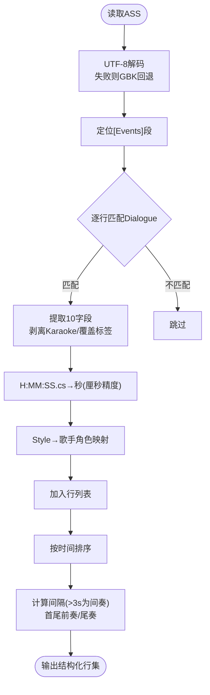
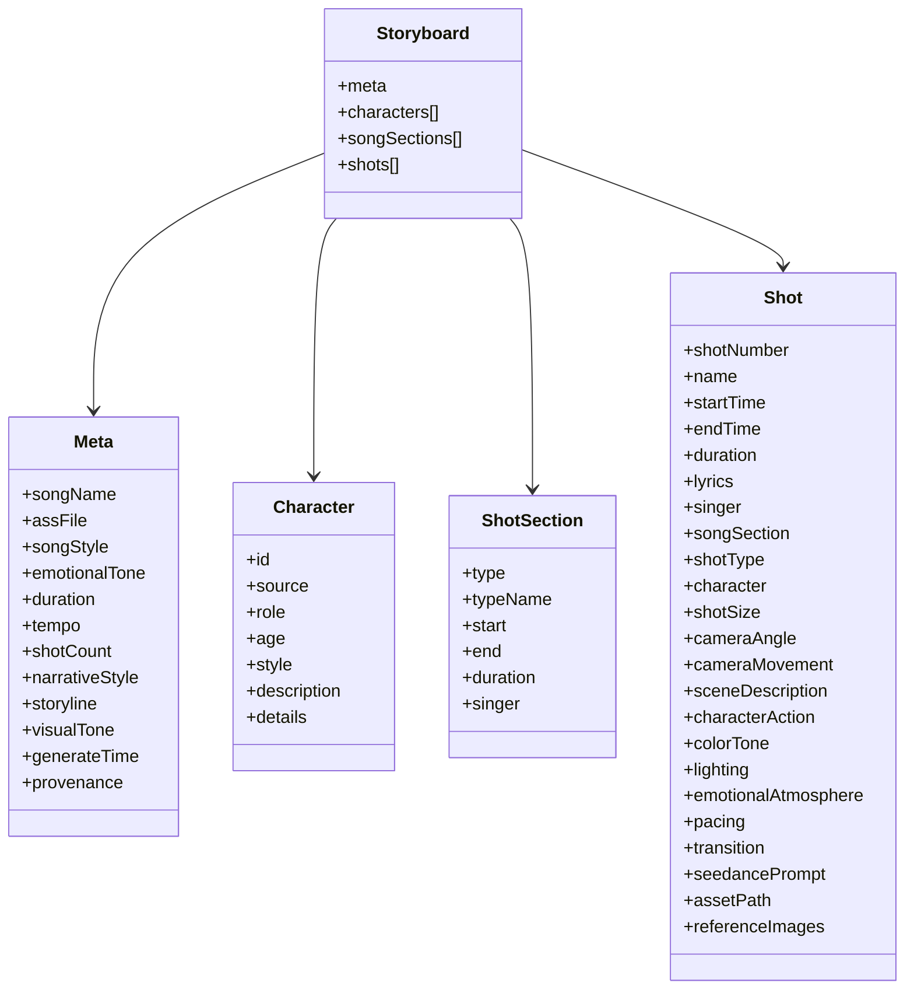
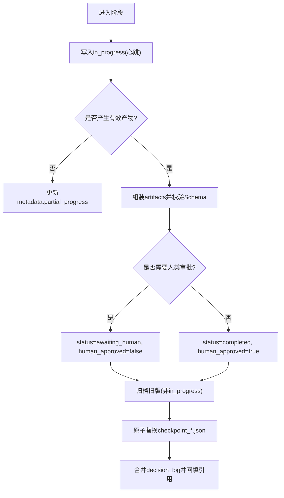
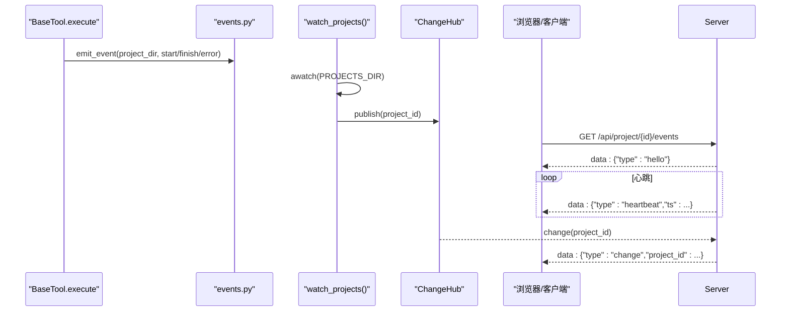
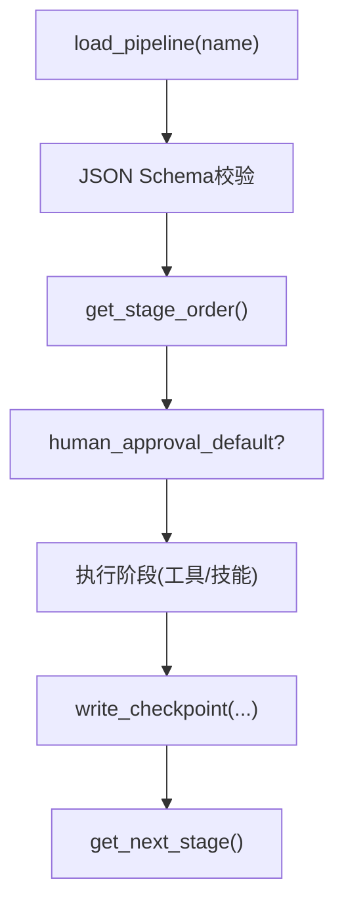
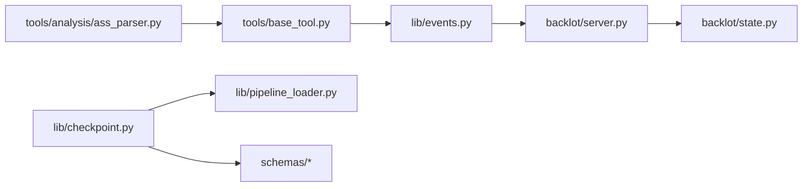

# 核心概念解析

<cite>
**本文引用的文件**   
- [lib/checkpoint.py](file://lib/checkpoint.py)
- [tools/analysis/ass_parser.py](file://tools/analysis/ass_parser.py)
- [lib/pipeline_loader.py](file://lib/pipeline_loader.py)
- [schemas/artifacts/storyboard.schema.json](file://schemas/artifacts/storyboard.schema.json)
- [schemas/checkpoints/checkpoint.schema.json](file://schemas/checkpoints/checkpoint.schema.json)
- [schemas/pipelines/pipeline_manifest.schema.json](file://schemas/pipelines/pipeline_manifest.schema.json)
- [pipeline_defs/music-video.yaml](file://pipeline_defs/music-video.yaml)
- [lib/events.py](file://lib/events.py)
- [backlot/server.py](file://backlot/server.py)
- [skills/meta/checkpoint-protocol.md](file://skills/meta/checkpoint-protocol.md)
- [.agents/skills/mv-storyboard/SKILL.md](file://.agents/skills/mv-storyboard/SKILL.md)
- [tools/base_tool.py](file://tools/base_tool.py)
- [backlot/state.py](file://backlot/state.py)
</cite>

## 目录
1. [引言](#引言)
2. [项目结构](#项目结构)
3. [核心组件](#核心组件)
4. [架构总览](#架构总览)
5. [详细组件分析](#详细组件分析)
6. [依赖关系分析](#依赖关系分析)
7. [性能考量](#性能考量)
8. [故障排查指南](#故障排查指南)
9. [结论](#结论)
10. [附录](#附录)

## 引言
本文件面向OpenMontage-MV的开发者与使用者，系统化阐述以下核心概念：ASS歌词文件格式规范、分镜脚本（Storyboard）生成机制、检查点（Checkpoint）状态快照与恢复策略、制品（Artifact）生命周期与元数据规范、SSE实时协作推送、以及流水线（Pipeline）定义格式与执行机制。文档以仓库中的实际实现为依据，配合结构化图示帮助读者从“语法—语义—工程”三层理解系统设计与落地细节。

## 项目结构
OpenMontage-MV采用“声明式流水线 + 工具化能力 + 可观测事件 + 可视化看板”的分层组织方式：
- 流水线定义：pipeline_defs/*.yaml 描述阶段、产物、工具与策略
- 工具与解析：tools/* 提供具体能力（如ASS解析、音视频处理）
- 状态与检查点：lib/checkpoint.py 管理阶段快照与版本归档
- 事件与实时：lib/events.py 记录工具调用事件；backlot/server.py 通过SSE推送变更
- 规范与约束：schemas/* 对Checkpoint、Artifact、Pipeline Manifest进行JSON Schema校验
- 技能与流程：.agents/skills/* 和 skills/* 指导Agent行为与编排

**图表来源** 
- [pipeline_defs/music-video.yaml:1-187](file://pipeline_defs/music-video.yaml#L1-L187)
- [tools/analysis/ass_parser.py:1-244](file://tools/analysis/ass_parser.py#L1-L244)
- [tools/base_tool.py:1-481](file://tools/base_tool.py#L1-L481)
- [lib/checkpoint.py:1-537](file://lib/checkpoint.py#L1-L537)
- [lib/events.py:1-119](file://lib/events.py#L1-L119)
- [backlot/server.py:1-504](file://backlot/server.py#L1-L504)
- [backlot/state.py:1-714](file://backlot/state.py#L1-L714)

**章节来源**
- [pipeline_defs/music-video.yaml:1-187](file://pipeline_defs/music-video.yaml#L1-L187)
- [lib/checkpoint.py:1-537](file://lib/checkpoint.py#L1-L537)
- [tools/analysis/ass_parser.py:1-244](file://tools/analysis/ass_parser.py#L1-L244)
- [lib/events.py:1-119](file://lib/events.py#L1-L119)
- [backlot/server.py:1-504](file://backlot/server.py#L1-L504)
- [backlot/state.py:1-714](file://backlot/state.py#L1-L714)

## 核心组件
- 流水线（Pipeline）：以YAML声明的阶段序列、产物、工具与策略，驱动端到端生产流程
- 检查点（Checkpoint）：每个阶段完成后的可恢复快照，含状态、产物、审批标记与审计历史
- 制品（Artifact）：阶段产出的结构化数据或文件路径，受Schema强约束
- 分镜脚本（Storyboard）：基于ASS歌词生成的MV分镜，包含时间戳、镜头语言、角色与Seedance优化Prompt
- SSE实时协作：服务器监听文件系统变化，向订阅者推送变更事件，驱动前端实时更新
- 工具基座（BaseTool）：统一工具契约，自动注入事件追踪、成本估算与幂等键

**章节来源**
- [lib/pipeline_loader.py:1-241](file://lib/pipeline_loader.py#L1-L241)
- [lib/checkpoint.py:1-537](file://lib/checkpoint.py#L1-L537)
- [schemas/artifacts/storyboard.schema.json:1-289](file://schemas/artifacts/storyboard.schema.json#L1-L289)
- [tools/base_tool.py:1-481](file://tools/base_tool.py#L1-L481)

## 架构总览
下图展示从ASS歌词到分镜脚本、再到制品归档与实时更新的完整链路。

**图表来源** 
- [tools/analysis/ass_parser.py:153-244](file://tools/analysis/ass_parser.py#L153-L244)
- [tools/base_tool.py:148-224](file://tools/base_tool.py#L148-L224)
- [lib/events.py:77-119](file://lib/events.py#L77-L119)
- [backlot/server.py:132-242](file://backlot/server.py#L132-L242)
- [backlot/state.py:586-656](file://backlot/state.py#L586-L656)
- [lib/checkpoint.py:336-467](file://lib/checkpoint.py#L336-L467)
- [lib/pipeline_loader.py:39-70](file://lib/pipeline_loader.py#L39-L70)

## 详细组件分析

### ASS歌词文件格式与解析
- 标准要点
  - 段落：[Script Info]、[V4+ Styles]、[Events]
  - 仅关注[Events]中的Dialogue行，字段顺序固定（图层、开始、结束、样式、名称、边距、效果、文本）
  - 时间戳H:MM:SS.cs，厘秒精度保留
  - Karaoke标签{\K28}/{\k28}与其他覆盖标签需剥离，得到纯歌词
  - Style字段用于识别歌手角色（男/女/合唱/配唱/默认）
- 解析器实现
  - 编码检测：UTF-8优先，GBK回退；BOM处理；控制字符与CJK存在性启发
  - 正则提取Dialogue十段，过滤空行与非法时间戳
  - 输出：行级对象（start/end/singer/style/text/raw）、总时长、歌手集合、关键间隔（前奏/间奏/尾奏）

**图表来源** 
- [tools/analysis/ass_parser.py:46-100](file://tools/analysis/ass_parser.py#L46-L100)
- [tools/analysis/ass_parser.py:102-244](file://tools/analysis/ass_parser.py#L102-L244)

**章节来源**
- [tools/analysis/ass_parser.py:1-244](file://tools/analysis/ass_parser.py#L1-L244)
- [.agents/skills/mv-storyboard/SKILL.md:37-126](file://.agents/skills/mv-storyboard/SKILL.md#L37-L126)

### 分镜脚本（Storyboard）结构与生成
- 数据结构（Schema）
  - meta：歌曲名、ASS源、风格、情感基调、时长、节奏、分镜数、叙事风格、视觉基调、生成时间与复现信息
  - characters：人物配置（来源、角色、年龄、风格、描述、细节）
  - songSections：段落结构（类型、起止、时长、主唱）
  - shots：分镜数组（≤23条，每条时长整数秒且4-15秒），包含歌词、歌手、段落、镜头类型/景别/角度/运镜、场景/动作/色调/光影/情绪/节奏/转场、Seedance Prompt、资产路径与参考图
- 生成流程（Skill）
  - Step1 解析ASS → Step2 三段信号段落识别 → Step3 叙事风格匹配 → Step4 人物库匹配 → Step5 分镜编排（时长约束、连贯性） → Step6 Seedance Prompt八大要素 → Step7 双格式输出（Markdown+JSON）

**图表来源** 
- [schemas/artifacts/storyboard.schema.json:1-289](file://schemas/artifacts/storyboard.schema.json#L1-L289)

**章节来源**
- [schemas/artifacts/storyboard.schema.json:1-289](file://schemas/artifacts/storyboard.schema.json#L1-L289)
- [.agents/skills/mv-storyboard/SKILL.md:314-598](file://.agents/skills/mv-storyboard/SKILL.md#L314-L598)

### 检查点（Checkpoint）机制
- 设计目标
  - 阶段完成后写快照，支持失败恢复、人类审批门控、审计回溯
  - 非致命写入：即使事件/归档失败也不中断主流程
- 关键字段
  - version/project_id/pipeline_type/stage/status/timestamp/artifacts
  - checkpoint_policy/human_approval_required/human_approved/review/cost_snapshot/error/metadata
- 核心流程
  - init_project：创建项目布局与project.json标记
  - write_checkpoint：校验阶段与产物、强制人类审批门控、归档旧版、原子替换
  - read_checkpoint/get_latest_checkpoint：读取并校验
  - get_completed_stages/get_next_stage：根据已完成快照决定下一步
- 版本与归档
  - history/目录保存被覆盖的completed/awaiting_human快照，in_progress作为心跳不归档
  - decision_log合并与引用回填

**图表来源** 
- [lib/checkpoint.py:178-227](file://lib/checkpoint.py#L178-L227)
- [lib/checkpoint.py:336-467](file://lib/checkpoint.py#L336-L467)
- [lib/checkpoint.py:263-300](file://lib/checkpoint.py#L263-L300)
- [lib/checkpoint.py:306-334](file://lib/checkpoint.py#L306-L334)

**章节来源**
- [lib/checkpoint.py:1-537](file://lib/checkpoint.py#L1-L537)
- [skills/meta/checkpoint-protocol.md:1-201](file://skills/meta/checkpoint-protocol.md#L1-L201)
- [schemas/checkpoints/checkpoint.schema.json:1-47](file://schemas/checkpoints/checkpoint.schema.json#L1-L47)

### 制品（Artifact）生命周期与元数据
- 命名与位置
  - artifacts/*.json为主存储，checkpoint.artifacts可内联或引用相对路径（限制在项目目录内）
  - decision_log同时兼容根目录与artifacts下
- 校验与发现
  - ARTIFACT_NAMES枚举与validate_artifact确保Schema合规
  - state._collect_artifacts合并artifacts与checkpoint嵌入产物
- 典型制品
  - brief/proposal_packet/storyboard/asset_manifest/edit_decisions/render_report/final_review/publish_log/review/decision_log

**章节来源**
- [schemas/artifacts/__init__.py:1-44](file://schemas/artifacts/__init__.py#L1-L44)
- [backlot/state.py:229-264](file://backlot/state.py#L229-L264)

### SSE（Server-Sent Events）实时协作
- 事件写入
  - tools/base_tool.py在执行execute时自动注入start/finish/error事件到events.jsonl
  - lib/events.py负责推断项目归属、线程安全追加、容错丢弃
- 事件消费
  - backlot/server.py使用watchfiles监听projects/变更，发布ChangeHub队列
  - /api/project/{id}/events与/api/library/events提供SSE流，心跳保活，批量合并突发
- 看板状态
  - backlot/state.py将checkpoints/history/artifacts/events聚合为BoardState，供前端渲染

**图表来源** 
- [tools/base_tool.py:148-224](file://tools/base_tool.py#L148-L224)
- [lib/events.py:77-119](file://lib/events.py#L77-L119)
- [backlot/server.py:132-242](file://backlot/server.py#L132-L242)

**章节来源**
- [tools/base_tool.py:148-224](file://tools/base_tool.py#L148-L224)
- [lib/events.py:1-119](file://lib/events.py#L1-L119)
- [backlot/server.py:1-504](file://backlot/server.py#L1-L504)

### 流水线（Pipeline）定义与执行
- 声明式YAML
  - name/version/description/category/stability/default_checkpoint_policy
  - stages：name/skill/required_artifacts_in/optional_artifacts_in/produces/tools_available/review_focus/success_criteria/sub_stages/human_approval_default
  - extensions：custom_scripts/custom_playbooks/custom_skills/custom_tools
- 加载与校验
  - pipeline_loader.load_pipeline(name)读取YAML并通过JSON Schema验证
  - get_stage_order获取阶段顺序（含子阶段）
  - get_stage_human_approval_default用于门控策略
- 音乐视频流水线
  - idea→proposal→storyboard→assets→edit→compose→publish
  - 各阶段明确产物与工具可用性，review_focus与success_criteria约束质量

**图表来源** 
- [lib/pipeline_loader.py:49-70](file://lib/pipeline_loader.py#L49-L70)
- [lib/pipeline_loader.py:125-149](file://lib/pipeline_loader.py#L125-L149)
- [lib/pipeline_loader.py:173-182](file://lib/pipeline_loader.py#L173-L182)
- [pipeline_defs/music-video.yaml:1-187](file://pipeline_defs/music-video.yaml#L1-L187)

**章节来源**
- [lib/pipeline_loader.py:1-241](file://lib/pipeline_loader.py#L1-L241)
- [schemas/pipelines/pipeline_manifest.schema.json:1-162](file://schemas/pipelines/pipeline_manifest.schema.json#L1-L162)
- [pipeline_defs/music-video.yaml:1-187](file://pipeline_defs/music-video.yaml#L1-L187)

## 依赖关系分析
- 组件耦合
  - checkpoint.py依赖pipeline_loader.py获取阶段与门控策略，依赖schemas校验artifact
  - base_tool.py通过events.py注入可观测性，server.py消费events与文件系统变更
  - state.py聚合checkpoints/history/artifacts/events生成BoardState
- 外部依赖
  - YAML解析（pipeline manifest）、JSON Schema校验、watchfiles监听、FastAPI SSE

**图表来源** 
- [tools/base_tool.py:148-224](file://tools/base_tool.py#L148-L224)
- [lib/events.py:77-119](file://lib/events.py#L77-L119)
- [backlot/server.py:132-242](file://backlot/server.py#L132-L242)
- [backlot/state.py:586-656](file://backlot/state.py#L586-L656)
- [lib/checkpoint.py:336-467](file://lib/checkpoint.py#L336-L467)
- [lib/pipeline_loader.py:39-70](file://lib/pipeline_loader.py#L39-L70)
- [tools/analysis/ass_parser.py:153-244](file://tools/analysis/ass_parser.py#L153-L244)

**章节来源**
- [tools/base_tool.py:1-481](file://tools/base_tool.py#L1-L481)
- [lib/events.py:1-119](file://lib/events.py#L1-L119)
- [backlot/server.py:1-504](file://backlot/server.py#L1-L504)
- [backlot/state.py:1-714](file://backlot/state.py#L1-L714)
- [lib/checkpoint.py:1-537](file://lib/checkpoint.py#L1-L537)
- [lib/pipeline_loader.py:1-241](file://lib/pipeline_loader.py#L1-L241)
- [tools/analysis/ass_parser.py:1-244](file://tools/analysis/ass_parser.py#L1-L244)

## 性能考量
- 事件写入与读取
  - events.jsonl采用线程锁串行追加，读端容忍畸形行，避免阻塞主流程
- SSE推送
  - ChangeHub队列限长，超时心跳保活，批量合并突发，降低前端抖动
- 检查点归档
  - 仅归档非in_progress版本，避免频繁I/O；原子替换减少损坏风险
- 流水线加载
  - lru_cache缓存manifest与schema，热路径避免重复解析
- 资源画像
  - BaseTool的ResourceProfile与estimate_runtime便于调度与预算控制

[本节为通用指导，不直接分析具体文件]

## 故障排查指南
- ASS解析失败
  - 检查编码（UTF-8/GBK）、BOM、[Events]段是否存在、Dialogue正则匹配
- 检查点校验失败
  - 确认stage在manifest中有效、artifacts符合Schema、人类审批门控满足
- SSE无推送
  - 确认watchfiles可用、projects/目录存在、事件写入成功、订阅未断开
- BoardState异常
  - 检查checkpoint_*.json与history/可读性、artifacts路径是否在project内

**章节来源**
- [tools/analysis/ass_parser.py:153-204](file://tools/analysis/ass_parser.py#L153-L204)
- [lib/checkpoint.py:140-171](file://lib/checkpoint.py#L140-L171)
- [lib/checkpoint.py:388-406](file://lib/checkpoint.py#L388-L406)
- [backlot/server.py:132-149](file://backlot/server.py#L132-L149)
- [backlot/state.py:40-48](file://backlot/state.py#L40-L48)

## 结论
OpenMontage-MV以“声明式流水线 + 强约束Schema + 可恢复检查点 + 可观测事件 + 实时SSE”为核心，构建了从ASS歌词到MV分镜与制品的全链路自动化体系。其设计强调确定性、可审计性与可恢复性，既满足AI驱动的创意生成，又保障工程化的稳定交付。

[本节为总结性内容，不直接分析具体文件]

## 附录
- 关键术语对照
  - 流水线（Pipeline）：阶段序列与策略的声明式定义
  - 检查点（Checkpoint）：阶段快照与版本归档
  - 制品（Artifact）：阶段产物与元数据
  - 分镜脚本（Storyboard）：MV分镜的结构化描述
  - SSE：服务器推送事件，支撑实时协作
  - 门控（Gate）：人类审批策略，保证关键节点可控

[本节为补充说明，不直接分析具体文件]