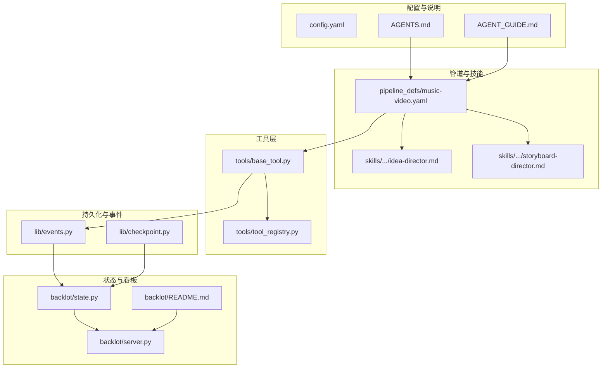
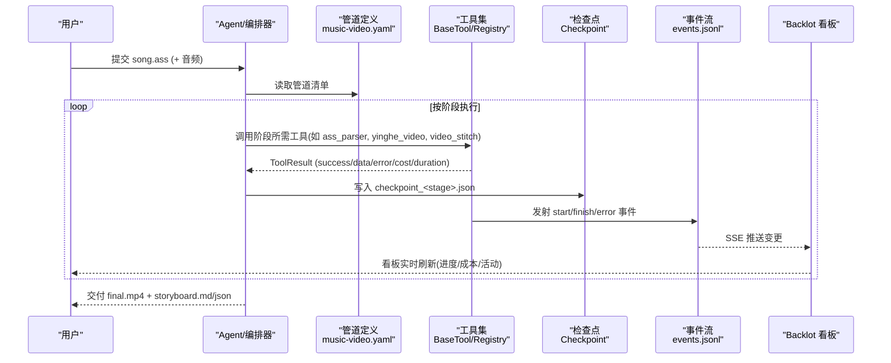
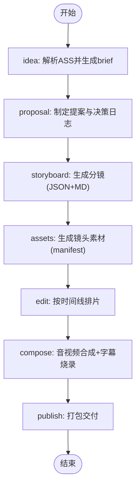
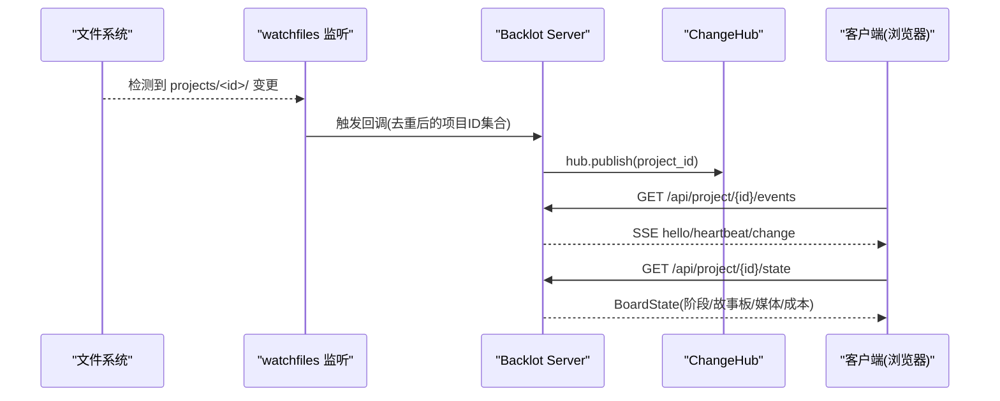
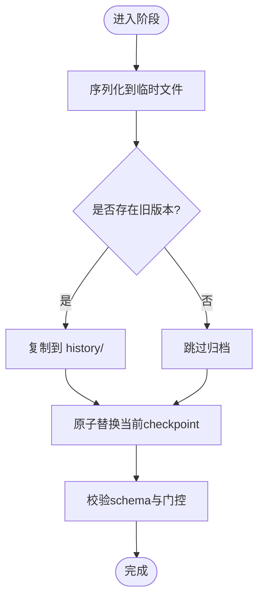
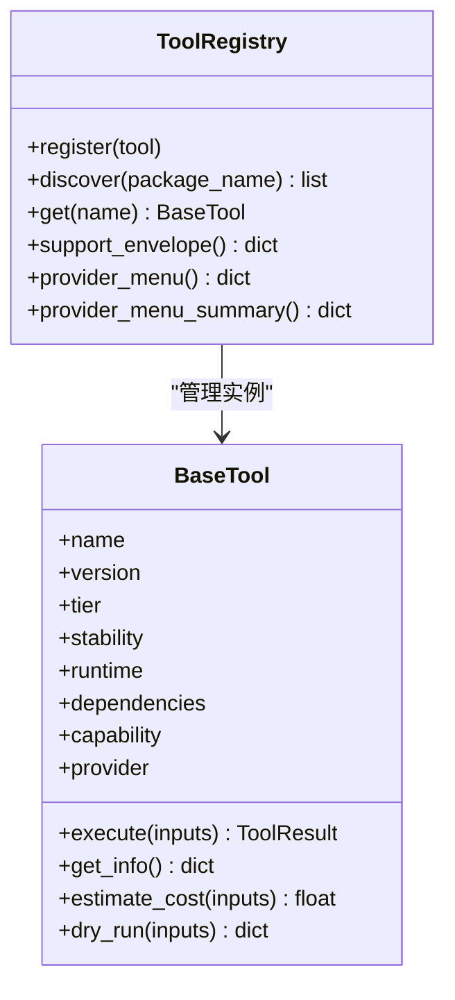
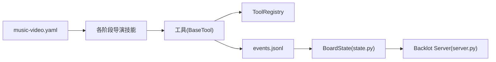

# 系统介绍与核心特性

<cite>
**本文引用的文件**   
- [AGENTS.md](file://AGENTS.md)
- [AGENT_GUIDE.md](file://AGENT_GUIDE.md)
- [config.yaml](file://config.yaml)
- [pipeline_defs/music-video.yaml](file://pipeline_defs/music-video.yaml)
- [backlot/README.md](file://backlot/README.md)
- [backlot/server.py](file://backlot/server.py)
- [backlot/state.py](file://backlot/state.py)
- [lib/checkpoint.py](file://lib/checkpoint.py)
- [tools/base_tool.py](file://tools/base_tool.py)
- [tools/tool_registry.py](file://tools/tool_registry.py)
- [skills/pipelines/music-video/idea-director.md](file://skills/pipelines/music-video/idea-director.md)
- [skills/pipelines/music-video/storyboard-director.md](file://skills/pipelines/music-video/storyboard-director.md)
- [lib/events.py](file://lib/events.py)
</cite>

## 目录
1. [简介](#简介)
2. [项目结构](#项目结构)
3. [核心组件](#核心组件)
4. [架构总览](#架构总览)
5. [详细组件分析](#详细组件分析)
6. [依赖关系分析](#依赖关系分析)
7. [性能考量](#性能考量)
8. [故障排查指南](#故障排查指南)
9. [结论](#结论)
10. [附录](#附录)

## 简介
OpenMontage-MV 是一个“单一目标”的 AI 驱动音乐视频制作系统：输入一个 ASS 卡拉OK歌词文件（以及歌曲音频），通过一条固定管道，自动产出完整的 MV。系统的核心理念是“智能在技能中，而非代码里”。Python 仅提供工具、持久化与编排基础设施；创意决策、分镜编排、质量门禁等全部由“导演技能”和“分层知识文档”驱动。

该流水线包含七个制作阶段：idea → proposal → storyboard → assets → edit → compose → publish。每个阶段都有明确的输入、输出、可用工具、检查点策略与成功标准。Backlot 看板作为“活的分镜”，通过 SSE 实时更新多用户协作状态，提供实时进度、成本、事件流与回放能力。

## 项目结构
- 顶层配置与说明
  - config.yaml：运行时默认输出格式、编码、分辨率、帧率、CRF 等
  - AGENTS.md / AGENT_GUIDE.md：Agent 运行契约、前置检查、管道规则、命名约定、决策沟通协议、审查与检查点协议
- 管道定义与技能
  - pipeline_defs/music-video.yaml：music-video 管道的完整定义（阶段顺序、产物、工具、审查焦点、成功标准）
  - skills/pipelines/music-video/*-director.md：各阶段的“导演技能”（如何工作、参考 Layer 3 文档、Checkpoint 写入要求）
- 工具与注册
  - tools/base_tool.py：工具基类、执行包装、事件发射、资源与重试策略
  - tools/tool_registry.py：工具发现、能力目录、提供者菜单、支持信封
- 状态与看板
  - backlot/server.py：FastAPI 服务、SSE 事件流、媒体与缩略图接口、UI 路由
  - backlot/state.py：从磁盘读取 checkpoint/artifacts/events，构建 BoardState（舞台轨道、故事板卡片、媒体扫描、停滞检测）
  - backlot/README.md：看板使用方式、SSE 机制、回放能力
- 检查点与事件
  - lib/checkpoint.py：项目初始化、checkpoint 读写与归档、门控校验、决策日志合并
  - lib/events.py：append-only 事件日志，供 Backlot 实时消费

**图表来源** 
- [config.yaml:1-20](file://config.yaml#L1-L20)
- [AGENTS.md:1-8](file://AGENTS.md#L1-L8)
- [AGENT_GUIDE.md:1-236](file://AGENT_GUIDE.md#L1-L236)
- [pipeline_defs/music-video.yaml:1-187](file://pipeline_defs/music-video.yaml#L1-L187)
- [skills/pipelines/music-video/idea-director.md:1-81](file://skills/pipelines/music-video/idea-director.md#L1-L81)
- [skills/pipelines/music-video/storyboard-director.md:1-93](file://skills/pipelines/music-video/storyboard-director.md#L1-L93)
- [tools/base_tool.py:1-481](file://tools/base_tool.py#L1-L481)
- [tools/tool_registry.py:1-493](file://tools/tool_registry.py#L1-L493)
- [backlot/server.py:1-504](file://backlot/server.py#L1-L504)
- [backlot/state.py:1-714](file://backlot/state.py#L1-L714)
- [backlot/README.md:1-43](file://backlot/README.md#L1-L43)
- [lib/checkpoint.py:1-537](file://lib/checkpoint.py#L1-L537)
- [lib/events.py:1-119](file://lib/events.py#L1-L119)

**章节来源**
- [config.yaml:1-20](file://config.yaml#L1-L20)
- [AGENTS.md:1-8](file://AGENTS.md#L1-L8)
- [AGENT_GUIDE.md:1-236](file://AGENT_GUIDE.md#L1-L236)
- [pipeline_defs/music-video.yaml:1-187](file://pipeline_defs/music-video.yaml#L1-L187)

## 核心组件
- 管道与阶段
  - music-video 管道明确定义了 7 个阶段及其产物、工具、审查焦点与成功标准，确保端到端一致性
- 检查点与版本控制
  - 每个阶段完成后写入 checkpoint，历史版本归档至 history/，支持回滚与审计
- 工具与注册中心
  - 统一 BaseTool 接口，自动事件注入，集中发现与能力报告
- 看板与实时协作
  - Backlot 基于 watchfiles + SSE 实现无代理介入的实时刷新，支持多项目库视图与单项目看板

**章节来源**
- [pipeline_defs/music-video.yaml:36-187](file://pipeline_defs/music-video.yaml#L36-L187)
- [lib/checkpoint.py:178-467](file://lib/checkpoint.py#L178-L467)
- [tools/base_tool.py:227-481](file://tools/base_tool.py#L227-L481)
- [backlot/server.py:132-242](file://backlot/server.py#L132-L242)

## 架构总览
下图展示了从输入到输出的整体数据流与组件交互。

**图表来源** 
- [pipeline_defs/music-video.yaml:1-187](file://pipeline_defs/music-video.yaml#L1-L187)
- [tools/base_tool.py:148-224](file://tools/base_tool.py#L148-L224)
- [lib/events.py:77-119](file://lib/events.py#L77-L119)
- [lib/checkpoint.py:336-467](file://lib/checkpoint.py#L336-L467)
- [backlot/server.py:185-242](file://backlot/server.py#L185-L242)

## 详细组件分析

### 七阶段制作流程详解
- idea（构思）
  - 输入：ASS 歌词文件
  - 工具：ass_parser
  - 产物：brief（含段落映射、风格与情感判断、时长、歌手信息）
  - 关键规则：依据三段信号（停顿、重复、歌手切换）划分段落；所有风格/情感判断需引用歌词证据
- proposal（提案）
  - 输入：brief
  - 产物：proposal_packet + decision_log（叙事风格匹配、角色适配、音乐计划、提供者确认、交付形态）
  - 关键规则：若无音频则降级为仅交付 storyboard，并在提案中明确记录
- storyboard（分镜）
  - 输入：brief + proposal_packet
  - 产物：storyboard（JSON + Markdown 双格式）
  - 关键规则：≤23 个镜头，整数 4-15s，时间线连续；每镜头 8 元素 seedancePrompt；空镜服务于叙事
- assets（资产）
  - 输入：storyboard（可选 proposal_packet）
  - 工具：yinghe_video
  - 产物：asset_manifest（每镜头对应一段 clip，时长一致，角色一致性通过参考图绑定）
  - 关键规则：每次生成后刷新 partial_progress，保证看板实时进度
- edit（剪辑）
  - 输入：storyboard + asset_manifest
  - 产物：edit_decisions（按 storyboard 时间线排列片段，确认 ASS 字幕烧录计划）
- compose（合成）
  - 输入：edit_decisions + asset_manifest（可选 storyboard）
  - 工具：video_stitch、audio_mixer（可选 color_grade）
  - 产物：render_report + final_review（最终时长等于歌曲时长，音画同步，ASS 原文件烧录）
- publish（发布）
  - 输入：render_report + final_review（可选 storyboard）
  - 产物：publish_log（交付包包含 MV + storyboard.md + storyboard.json）

**图表来源** 
- [pipeline_defs/music-video.yaml:36-187](file://pipeline_defs/music-video.yaml#L36-L187)
- [skills/pipelines/music-video/idea-director.md:1-81](file://skills/pipelines/music-video/idea-director.md#L1-L81)
- [skills/pipelines/music-video/storyboard-director.md:1-93](file://skills/pipelines/music-video/storyboard-director.md#L1-L93)

**章节来源**
- [pipeline_defs/music-video.yaml:36-187](file://pipeline_defs/music-video.yaml#L36-L187)
- [skills/pipelines/music-video/idea-director.md:1-81](file://skills/pipelines/music-video/idea-director.md#L1-L81)
- [skills/pipelines/music-video/storyboard-director.md:1-93](file://skills/pipelines/music-video/storyboard-director.md#L1-L93)

### 实时协作看板（Backlot）
- 工作原理
  - 文件系统监听：watchfiles 监控 projects/ 下变更，去重后广播项目 ID
  - SSE 事件：浏览器订阅 /api/project/{id}/events，服务端周期性心跳与批量合并通知
  - 状态推导：state.py 从 checkpoint/artifacts/events 构建 BoardState（阶段轨道、故事板卡片、媒体扫描、停滞检测）
- 独特价值
  - 零代理介入：看板只读，不阻塞生产
  - 多用户协作：同一项目可被多个浏览器同时订阅
  - 状态同步：partial_progress 实时更新，生成中的镜头闪烁提示
  - 回放能力：基于 checkpoint 历史与事件时间戳，支持端到端回放

**图表来源** 
- [backlot/server.py:132-242](file://backlot/server.py#L132-L242)
- [backlot/state.py:586-656](file://backlot/state.py#L586-L656)
- [backlot/README.md:14-33](file://backlot/README.md#L14-L33)

**章节来源**
- [backlot/server.py:1-504](file://backlot/server.py#L1-L504)
- [backlot/state.py:1-714](file://backlot/state.py#L1-L714)
- [backlot/README.md:1-43](file://backlot/README.md#L1-L43)

### 检查点与版本控制
- 写入与归档
  - 写入前序列化到临时文件，原子替换；对已存在的非 in_progress 版本归档至 history/
  - 支持 decision_log 合并，避免重复条目
- 门控校验
  - 若 manifest 或调用方要求 human_approval，则 completed 必须附带 human_approved=True，否则抛出校验错误
- 恢复与下一步
  - 根据已完成阶段与管道顺序确定下一待执行阶段

**图表来源** 
- [lib/checkpoint.py:336-467](file://lib/checkpoint.py#L336-L467)

**章节来源**
- [lib/checkpoint.py:178-467](file://lib/checkpoint.py#L178-L467)

### 工具与注册中心
- BaseTool
  - 统一 execute() 接口，自动注入 Backlot 事件（start/finish/error）
  - 资源画像、重试策略、幂等键、成本估算、运行环境声明
- ToolRegistry
  - 自动发现 tools/ 下的工具类，生成能力目录、提供者菜单、支持信封
  - 提供 provider_menu_summary 用于 Agent 前置能力展示

**图表来源** 
- [tools/base_tool.py:227-481](file://tools/base_tool.py#L227-L481)
- [tools/tool_registry.py:55-493](file://tools/tool_registry.py#L55-L493)

**章节来源**
- [tools/base_tool.py:1-481](file://tools/base_tool.py#L1-L481)
- [tools/tool_registry.py:1-493](file://tools/tool_registry.py#L1-L493)

### 智能分镜与资产自动管理
- 智能分镜
  - 严格遵循 SKILL.md 的分镜原则：段落驱动、连续性、≤23 镜头、整数时长、八元素 prompt、强制约束包
  - 双格式输出：JSON（机器校验）+ Markdown（人类阅读）
- 资产自动管理
  - 每镜头生成一段 clip，时长与分镜一致；角色一致性通过 reference images 绑定
  - 生成过程中持续刷新 partial_progress，看板实时显示进度

**章节来源**
- [skills/pipelines/music-video/storyboard-director.md:1-93](file://skills/pipelines/music-video/storyboard-director.md#L1-L93)
- [pipeline_defs/music-video.yaml:99-120](file://pipeline_defs/music-video.yaml#L99-L120)

## 依赖关系分析
- 组件耦合
  - 管道定义驱动阶段执行；阶段技能指导具体操作；工具通过注册中心被发现与调用；检查点与事件支撑看板状态
- 外部依赖
  - ffmpeg（视频拼接、字幕烧录、缩略图抽取）
  - yinghe_video（唯一视频生成提供者）
  - watchfiles（文件系统监听）
  - FastAPI（Web 服务与 SSE）

**图表来源** 
- [pipeline_defs/music-video.yaml:1-187](file://pipeline_defs/music-video.yaml#L1-L187)
- [tools/base_tool.py:148-224](file://tools/base_tool.py#L148-L224)
- [tools/tool_registry.py:118-134](file://tools/tool_registry.py#L118-L134)
- [lib/events.py:77-119](file://lib/events.py#L77-L119)
- [backlot/state.py:586-656](file://backlot/state.py#L586-L656)
- [backlot/server.py:132-242](file://backlot/server.py#L132-L242)

**章节来源**
- [pipeline_defs/music-video.yaml:1-187](file://pipeline_defs/music-video.yaml#L1-L187)
- [tools/tool_registry.py:118-134](file://tools/tool_registry.py#L118-L134)
- [lib/events.py:77-119](file://lib/events.py#L77-L119)
- [backlot/state.py:586-656](file://backlot/state.py#L586-L656)
- [backlot/server.py:132-242](file://backlot/server.py#L132-L242)

## 性能考量
- 事件与状态推导
  - events.jsonl 采用追加写与线程锁保护；read_events 容忍损坏行，保障鲁棒性
  - BoardState 构建时限制扫描范围，忽略噪声目录，降低 I/O 开销
- 缩略图缓存
  - 缩略图按内容哈希缓存，避免重复计算；视频抽帧失败时优雅降级
- 管道执行
  - 工具 dry_run 与 cost/runtime 估算有助于前端展示与用户决策
  - 检查点原子写入与历史归档避免中间态污染

[本节为通用指导，无需特定文件引用]

## 故障排查指南
- 前置检查
  - 确认 yinghe_video 可用（API Key 正确）；ffmpeg 在 PATH 中
- 常见问题
  - ASS 解析乱码：检查编码与标签残留
  - 分镜校验失败：镜头数量/时长/连续性不符合 schema
  - 资产缺失：asset_manifest 引用路径不在项目内或被误删
  - 合成失败：音视频不同步、ASS 烧录时序异常
  - 看板不更新：watchfiles 未安装或 projects/ 权限问题
- 定位方法
  - 查看 events.jsonl 最近事件；检查 checkpoint 历史与 error 字段；使用 FFprobe 验证输出

**章节来源**
- [AGENT_GUIDE.md:66-84](file://AGENT_GUIDE.md#L66-L84)
- [lib/events.py:98-119](file://lib/events.py#L98-L119)
- [lib/checkpoint.py:470-537](file://lib/checkpoint.py#L470-L537)
- [backlot/server.py:329-361](file://backlot/server.py#L329-L361)

## 结论
OpenMontage-MV 将“AI 智能”与“工程可靠性”有机结合：以清晰管道与强约束技能驱动创作，以检查点与事件流保障可观测性与可回溯性，以 Backlot 看板实现实时协作与透明化生产。对于初学者，它提供了从歌词到成片的自动化体验；对于开发者，它提供了可扩展的工具生态与稳健的状态管理机制。

[本节为总结，无需特定文件引用]

## 附录
- 典型使用场景
  - 输入一首歌的 ASS 歌词与音频，系统自动生成完整 MV，并在看板上实时展示分镜与进度
  - 仅需分镜脚本时，可在 storyboard 阶段停止，直接交付 storyboard.md/json
- 预期效果
  - 高质量分镜（≤23 镜头，连续时间线，稳定画面）
  - 角色一致性（参考图绑定）
  - 音画同步（原始 ASS 字幕烧录）
  - 实时协作（多用户看板、SSE 推送、回放）

[本节为概念性内容，无需特定文件引用]