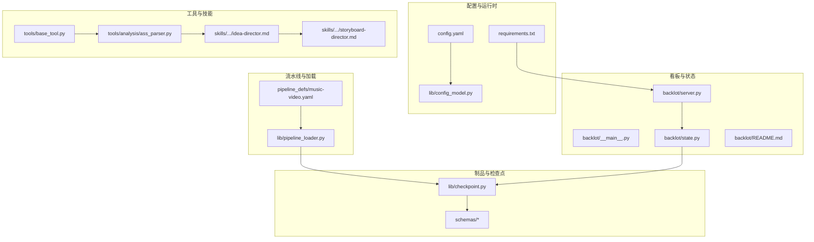
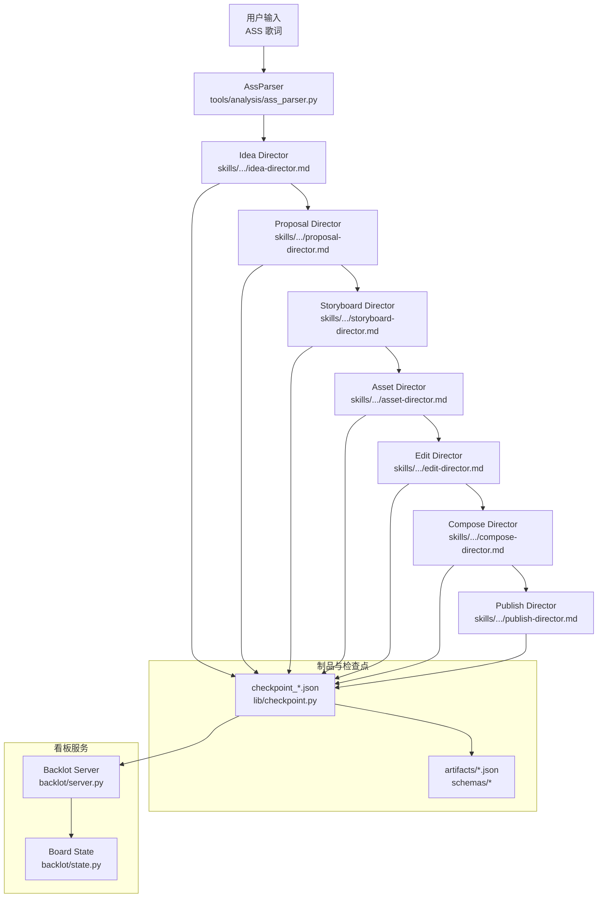
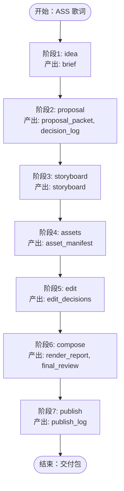
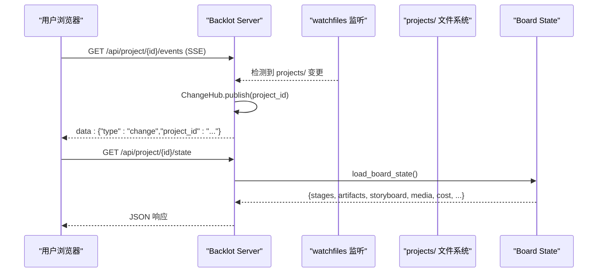
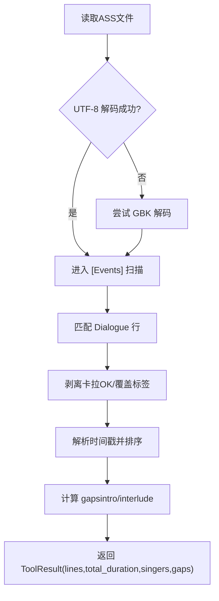
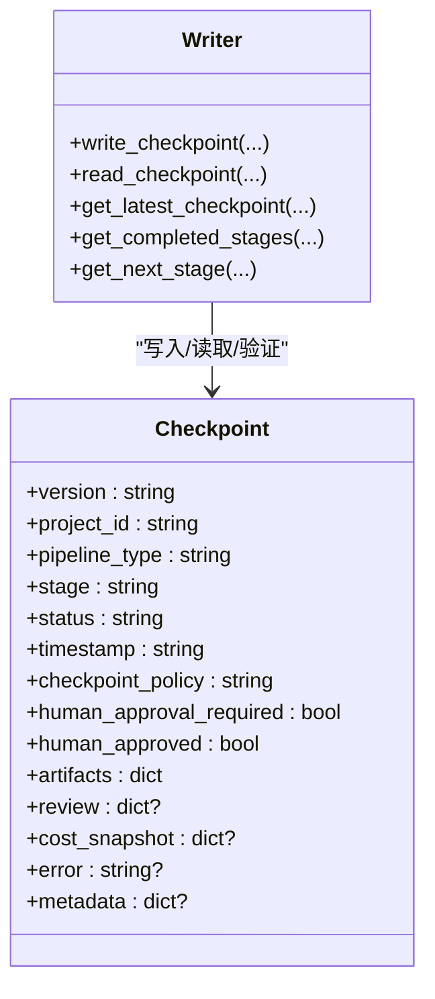
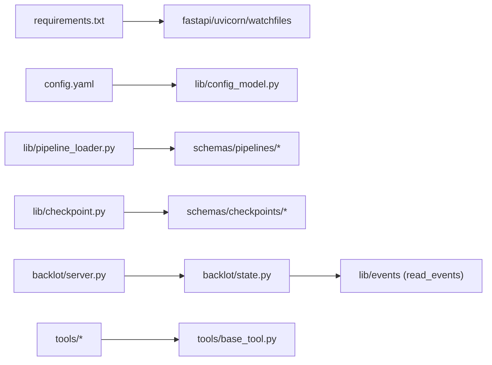

# 项目概览

<cite>
**本文引用的文件**   
- [config.yaml](file://config.yaml)
- [requirements.txt](file://requirements.txt)
- [backlot/README.md](file://backlot/README.md)
- [pipeline_defs/music-video.yaml](file://pipeline_defs/music-video.yaml)
- [backlot/__main__.py](file://backlot/__main__.py)
- [backlot/server.py](file://backlot/server.py)
- [tools/analysis/ass_parser.py](file://tools/analysis/ass_parser.py)
- [lib/pipeline_loader.py](file://lib/pipeline_loader.py)
- [lib/config_model.py](file://lib/config_model.py)
- [skills/pipelines/music-video/idea-director.md](file://skills/pipelines/music-video/idea-director.md)
- [skills/pipelines/music-video/storyboard-director.md](file://skills/pipelines/music-video/storyboard-director.md)
- [tools/base_tool.py](file://tools/base_tool.py)
- [lib/checkpoint.py](file://lib/checkpoint.py)
- [backlot/state.py](file://backlot/state.py)
</cite>

## 目录
1. [简介](#简介)
2. [项目结构](#项目结构)
3. [核心组件](#核心组件)
4. [架构总览](#架构总览)
5. [详细组件分析](#详细组件分析)
6. [依赖关系分析](#依赖关系分析)
7. [性能考量](#性能考量)
8. [故障排查指南](#故障排查指南)
9. [结论](#结论)
10. [附录：快速开始](#附录快速开始)

## 简介
OpenMontage-MV 是一个 AI 驱动的音乐视频制作系统。它以 ASS 卡拉OK歌词为输入，通过“七阶段”流水线自动生成完整的音乐视频（或仅输出分镜脚本）。系统包含：
- 实时协作看板（Backlot）：基于文件系统事件与 SSE 的只读可视化面板，展示生产进度、资产生成、决策与成本等。
- 智能分镜生成：遵循 mv-storyboard 技能规范，产出不超过 23 个镜头、每个镜头时长为整数且 4-15 秒的分镜。
- 资产自动管理：按分镜生成素材并维护清单，支持角色一致性、动作强度约束与进度刷新。
- 合成与发布：使用 ffmpeg 驱动的音视频拼接、字幕烧录与质量校验，最终输出成品与元数据。

本概览面向初学者提供概念性理解，同时为有经验的开发者提供代码级结构与关键流程说明。

## 项目结构
仓库采用“能力分层 + 领域模块”的组织方式：
- 配置与运行时：config.yaml、lib/config_model.py、requirements.txt
- 流水线定义与加载：pipeline_defs/*.yaml、lib/pipeline_loader.py
- 工具与技能：tools/*、skills/*、.agents/skills/*
- 看板服务与状态：backlot/*（FastAPI 服务、SSE 事件、watchfiles 监听、UI）
- 制品与检查点：lib/checkpoint.py、schemas/*（JSON Schema 校验）

图表来源
- [config.yaml:1-20](file://config.yaml#L1-L20)
- [requirements.txt:1-12](file://requirements.txt#L1-L12)
- [pipeline_defs/music-video.yaml:1-187](file://pipeline_defs/music-video.yaml#L1-L187)
- [lib/pipeline_loader.py:1-241](file://lib/pipeline_loader.py#L1-L241)
- [tools/base_tool.py:1-481](file://tools/base_tool.py#L1-L481)
- [tools/analysis/ass_parser.py:1-244](file://tools/analysis/ass_parser.py#L1-L244)
- [skills/pipelines/music-video/idea-director.md:1-81](file://skills/pipelines/music-video/idea-director.md#L1-L81)
- [skills/pipelines/music-video/storyboard-director.md:1-93](file://skills/pipelines/music-video/storyboard-director.md#L1-L93)
- [backlot/__main__.py:1-145](file://backlot/__main__.py#L1-L145)
- [backlot/server.py:1-504](file://backlot/server.py#L1-L504)
- [backlot/state.py:1-714](file://backlot/state.py#L1-L714)
- [lib/checkpoint.py:1-537](file://lib/checkpoint.py#L1-L537)

章节来源
- [config.yaml:1-20](file://config.yaml#L1-L20)
- [requirements.txt:1-12](file://requirements.txt#L1-L12)
- [backlot/README.md:1-43](file://backlot/README.md#L1-L43)

## 核心组件
- 配置模型（Config Model）
  - 统一加载 config.yaml，合并环境变量，提供类型化访问（检查点策略、输出参数、路径映射）。
  - 关键类：OpenMontageConfig、CheckpointConfig、OutputConfig、PathsConfig。
- 流水线加载器（Pipeline Loader）
  - 读取 pipeline_defs/*.yaml，校验 schema，缓存结果；提供阶段顺序、所需工具、人类审批默认值等查询接口。
- 工具基类（BaseTool）
  - 所有工具的抽象基类，统一描述能力、资源需求、执行模式、成本估算、幂等键、事件注入等。
- 检查点系统（Checkpoint）
  - 写入/读取阶段检查点，强制人类审批门控，归档历史版本，合并决策日志，保证可恢复性与审计。
- 看板服务（Backlot Server）
  - FastAPI 应用，提供项目列表、状态 API、SSE 事件流、媒体与缩略图服务、Studio 聊天工作区。
  - watchfiles 监听 projects/ 变更，广播到订阅者，浏览器拉取最新状态。
- 状态推导（Board State）
  - 将项目目录转换为渲染态：阶段轨道、制品、分镜卡片、媒体发现、成本与活动检测、卡顿判定。
- ASS 解析器（AssParser）
  - 确定性解析 ASS 歌词，提取对话行、时间戳、歌手角色、间隔段，供 Agent 进行三段信号段落分析。

章节来源
- [lib/config_model.py:1-70](file://lib/config_model.py#L1-L70)
- [lib/pipeline_loader.py:1-241](file://lib/pipeline_loader.py#L1-L241)
- [tools/base_tool.py:1-481](file://tools/base_tool.py#L1-L481)
- [lib/checkpoint.py:1-537](file://lib/checkpoint.py#L1-L537)
- [backlot/server.py:1-504](file://backlot/server.py#L1-L504)
- [backlot/state.py:1-714](file://backlot/state.py#L1-L714)
- [tools/analysis/ass_parser.py:1-244](file://tools/analysis/ass_parser.py#L1-L244)

## 架构总览
OpenMontage-MV 的整体架构由“配置层 → 流水线层 → 工具/技能层 → 制品/检查点层 → 看板服务层”构成。ASS 歌词经 AssParser 解析后进入 idea/proposal/storyboard 等阶段，逐步产出 brief、proposal_packet、storyboard、asset_manifest、edit_decisions、render_report、final_review、publish_log 等制品，并由 Backlot 实时呈现。

图表来源
- [tools/analysis/ass_parser.py:1-244](file://tools/analysis/ass_parser.py#L1-L244)
- [skills/pipelines/music-video/idea-director.md:1-81](file://skills/pipelines/music-video/idea-director.md#L1-L81)
- [skills/pipelines/music-video/storyboard-director.md:1-93](file://skills/pipelines/music-video/storyboard-director.md#L1-L93)
- [lib/checkpoint.py:1-537](file://lib/checkpoint.py#L1-L537)
- [backlot/server.py:1-504](file://backlot/server.py#L1-L504)
- [backlot/state.py:1-714](file://backlot/state.py#L1-L714)

## 详细组件分析

### 流水线与阶段（music-video）
- 阶段序列与产物
  - idea → brief
  - proposal → proposal_packet, decision_log
  - storyboard → storyboard（≤23 镜头，每镜头 4-15s，连续时间轴）
  - assets → asset_manifest（关联 clip 文件、角色一致性、动作强度约束）
  - edit → edit_decisions（对齐歌词时间线、确认字幕计划）
  - compose → render_report, final_review（ffmpeg 拼接、音频混合、ASS 烧录）
  - publish → publish_log（交付包完整性校验）
- 人类审批门控
  - 由 manifest 中 human_approval_default 决定；写 checkpoint 时强制校验，避免跳过门控。
- 成功标准与审查焦点
  - 各阶段 success_criteria 与 review_focus 明确验收要点，确保产物符合 schema 与业务规则。

图表来源
- [pipeline_defs/music-video.yaml:1-187](file://pipeline_defs/music-video.yaml#L1-L187)
- [lib/checkpoint.py:1-537](file://lib/checkpoint.py#L1-L537)

章节来源
- [pipeline_defs/music-video.yaml:1-187](file://pipeline_defs/music-video.yaml#L1-L187)
- [lib/checkpoint.py:1-537](file://lib/checkpoint.py#L1-L537)

### 实时协作看板（Backlot）
- 启动与 CLI
  - python -m backlot open/serve/studio，自动拉起后端服务并在浏览器打开对应页面。
- 事件驱动
  - watchfiles 监听 projects/ 目录变化，ChangeHub 广播至 SSE 订阅者；浏览器按需拉取状态。
- 主要 API
  - /api/projects、/api/project/{id}/state、/api/project/{id}/events、/api/library/events
  - /media/{project_id}/{path}、/thumb/{project_id}/{path}
  - Studio 聊天会话：/api/chat/sessions、/api/chat/{session_id}/message、/api/chat/{session_id}/events
- 状态推导
  - load_board_state 聚合 checkpoints、history、artifacts、events、media，计算 stage rail、storyboard 卡片、成本与卡顿标记。

图表来源
- [backlot/__main__.py:1-145](file://backlot/__main__.py#L1-L145)
- [backlot/server.py:1-504](file://backlot/server.py#L1-L504)
- [backlot/state.py:1-714](file://backlot/state.py#L1-L714)

章节来源
- [backlot/README.md:1-43](file://backlot/README.md#L1-L43)
- [backlot/__main__.py:1-145](file://backlot/__main__.py#L1-L145)
- [backlot/server.py:1-504](file://backlot/server.py#L1-L504)
- [backlot/state.py:1-714](file://backlot/state.py#L1-L714)

### ASS 歌词解析器（AssParser）
- 功能要点
  - UTF-8→GBK 回退、[Events] Dialogue 正则提取、卡拉 OK 标签与覆盖标签剥离、Style→歌手角色映射、H:MM:SS.cs→秒转换。
  - 输出 lines（start/end/singer/text/raw）、total_duration、singers、gaps（intro/interlude），供 Agent 进行三段信号段落分析。
- 确定性与健壮性
  - 确定性实现，错误不中断整体流程；空行/非法时间戳被忽略。

图表来源
- [tools/analysis/ass_parser.py:1-244](file://tools/analysis/ass_parser.py#L1-L244)

章节来源
- [tools/analysis/ass_parser.py:1-244](file://tools/analysis/ass_parser.py#L1-L244)

### 检查点与门控（Checkpoint）
- 写入与验证
  - write_checkpoint 校验 stage/status/artifacts，强制人类审批门控，归档历史版本，原子替换当前文件。
  - 合并 decision_log，并在相关制品中写入引用。
- 读取与恢复
  - read_checkpoint/get_latest_checkpoint/get_completed_stages/get_next_stage 用于恢复与推进流水线。

图表来源
- [lib/checkpoint.py:1-537](file://lib/checkpoint.py#L1-L537)

章节来源
- [lib/checkpoint.py:1-537](file://lib/checkpoint.py#L1-L537)

### 工具基类与事件注入（BaseTool）
- 统一契约
  - name/version/tier/capabilities/resource_profile/retry_policy/idempotency_key 等元信息。
  - execute() 被装饰器自动注入 Backlot 事件（start/finish/error），写入 events.jsonl，驱动看板活动指示。
- 子进程与错误处理
  - run_command 封装 subprocess，跨平台兼容，异常携带 stderr/stdout 详情。

章节来源
- [tools/base_tool.py:1-481](file://tools/base_tool.py#L1-L481)

### 配置模型（Config Model）
- 字段与默认值
  - checkpoint.policy/storage_dir、output.*（格式/编码/分辨率/FPS/CRF）、paths.*（pipeline_dir/library_dir/styles_dir/skills_dir/output_dir）。
- 加载与路径解析
  - OpenMontageConfig.load(config_path) 从 YAML 加载并类型校验；resolve_path(key, project_root) 解析相对路径。

章节来源
- [lib/config_model.py:1-70](file://lib/config_model.py#L1-L70)
- [config.yaml:1-20](file://config.yaml#L1-L20)

## 依赖关系分析
- 运行时依赖
  - pyyaml、pydantic、jsonschema、python-dotenv、requests
  - fastapi、uvicorn、watchfiles（Backlot 服务）
- 组件耦合
  - Backlot Server 依赖 state 推导与 events 读取；state 依赖 checkpoints、artifacts、media 扫描。
  - Pipeline Loader 依赖 schemas 校验；Checkpoint 依赖 schemas 与 pipeline loader 获取阶段顺序。
  - Tools（如 AssParser）继承 BaseTool，受事件注入影响。

图表来源
- [requirements.txt:1-12](file://requirements.txt#L1-L12)
- [lib/pipeline_loader.py:1-241](file://lib/pipeline_loader.py#L1-L241)
- [lib/checkpoint.py:1-537](file://lib/checkpoint.py#L1-L537)
- [backlot/server.py:1-504](file://backlot/server.py#L1-L504)
- [backlot/state.py:1-714](file://backlot/state.py#L1-L714)
- [tools/base_tool.py:1-481](file://tools/base_tool.py#L1-L481)

章节来源
- [requirements.txt:1-12](file://requirements.txt#L1-L12)
- [lib/pipeline_loader.py:1-241](file://lib/pipeline_loader.py#L1-L241)
- [lib/checkpoint.py:1-537](file://lib/checkpoint.py#L1-L537)
- [backlot/server.py:1-504](file://backlot/server.py#L1-L504)
- [backlot/state.py:1-714](file://backlot/state.py#L1-L714)
- [tools/base_tool.py:1-481](file://tools/base_tool.py#L1-L481)

## 性能考量
- 看板事件与缩略图
  - watchfiles 批量变更去抖，ChangeHub 队列限流；缩略图缓存于 .backlot/thumbs，并发写入使用临时文件名避免竞态。
- 流水线与制品
  - Pipeline Loader 使用 lru_cache 缓存 manifest 与 schema；Checkpoint 写入先写临时文件再原子替换，避免损坏。
- 媒体扫描
  - Board State 对 media 扫描限制深度与排除目录，减少噪声；poster 选择优先图像，其次快照，最后最新渲染帧。

[本节为通用指导，无需特定文件来源]

## 故障排查指南
- Backlot 无法启动或服务无响应
  - 检查端口占用与环境变量 BACKLOT_PORT/BACKLOT_HOST；查看 .studio/server.log 日志轮转记录。
- 看板无更新
  - 确认 projects/ 目录存在且未被忽略；watchfiles 不可用时看板仍可手动刷新。
- 检查点门控失败
  - 若 stage 需要人类审批，必须写入 status=awaiting_human，待批准后以 human_approved=True 再次写入 completed。
- ASS 解析失败
  - 确认编码正确（UTF-8/GBK），[Events] 中存在有效 Dialogue 行；时间戳格式需为 H:MM:SS.cs。
- 媒体缩略图缺失
  - 视频需 ffmpeg 可用；图片需 PIL 可用；非图像/视频类型不会生成缩略图。

章节来源
- [backlot/__main__.py:1-145](file://backlot/__main__.py#L1-L145)
- [backlot/server.py:1-504](file://backlot/server.py#L1-L504)
- [lib/checkpoint.py:1-537](file://lib/checkpoint.py#L1-L537)
- [tools/analysis/ass_parser.py:1-244](file://tools/analysis/ass_parser.py#L1-L244)

## 结论
OpenMontage-MV 通过“配置驱动 + 流水线编排 + 工具/技能扩展 + 检查点治理 + 看板可视化”的体系，实现了从 ASS 歌词到完整音乐视频的自动化生产。其设计强调确定性、可审计与可恢复，并通过 Backlot 提供实时协作体验。对于初学者，建议从快速开始入手，逐步理解各阶段职责；对于开发者，可基于 BaseTool 与 pipeline manifest 扩展能力，结合 schemas 保障契约一致性。

[本节为总结性内容，无需特定文件来源]

## 附录：快速开始
- 安装依赖
  - 参考 requirements.txt 安装 Python 依赖（fastapi、uvicorn、watchfiles 等）。
- 初始化项目
  - 使用 Backlot CLI：python -m backlot open <project-id> 或 serve --port 4750。
- 运行演示
  - 使用模拟运行脚本（如有）与 open 命令查看看板效果。
- 运行流水线
  - 准备 ASS 歌词文件，确保 ass_parser 可用；按 music-video 流水线阶段依次推进，观察 checkpoint 与 artifacts 生成。
- 预览与导出
  - 在 Backlot 中查看 storyboard 与媒体；compose 阶段完成后下载成品与元数据。

章节来源
- [backlot/README.md:1-43](file://backlot/README.md#L1-L43)
- [backlot/__main__.py:1-145](file://backlot/__main__.py#L1-L145)
- [requirements.txt:1-12](file://requirements.txt#L1-L12)